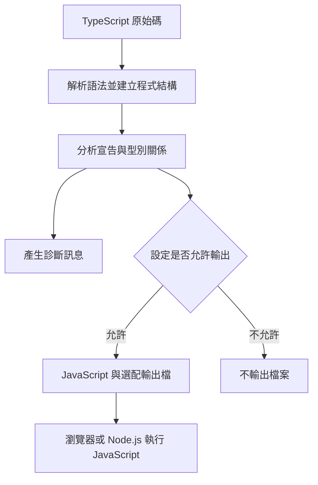

## 編譯器

TypeScript 可以在執行程式之前檢查型別，也可以將 TypeScript 原始碼轉換成 JavaScript。理解這兩個工作，才能分清楚「編譯通過」和「程式執行正確」的差別。

> 本篇於 2026-10-11 依官方文件補充原本的編譯器章節。指令示範使用專案安裝的 `typescript` 套件與 `tsc`，不是此部落格本身的建置指令。

### TypeScript 編譯器做什麼？

常見工具 `tsc` 主要負責：

- 解析原始碼，確認語法結構。
- 依型別註記、推導及函式宣告等資訊進行靜態檢查。
- 依設定輸出 JavaScript，也可輸出 declaration files 或 source maps。

TypeScript 的目標是為 JavaScript 提供靜態型別檢查；一般 `tsc` 工作流程產生的是 JavaScript，而不是 CPU 機器碼。JavaScript 最後仍由瀏覽器或 Node.js 等執行環境處理。見 [TypeScript Handbook](https://www.typescriptlang.org/docs/handbook/intro.html)。

### 編譯流程的概念圖



這是理解用途的簡化流程，不是編譯器內部每個階段的精確執行順序。診斷與輸出也不是只能二選一：有型別錯誤時，預設仍可能輸出 JavaScript。

### 型別通常會從 JavaScript 輸出中移除

原始 TypeScript：

```typescript
function greet(name: string): string {
  return `Hello, ${name}`;
}

console.log(greet('Kiwi'));
```

對應的 JavaScript 可以是：

```javascript
function greet(name) {
  return `Hello, ${name}`;
}

console.log(greet('Kiwi'));
```

`name: string` 和回傳型別不會成為執行時檢查。`interface`、一般型別別名也不會建立執行時物件；但不能說「所有 TypeScript 語法都只是移除」，例如 enum 等語法可能產生 JavaScript。實際輸出還取決於編譯設定。型別移除與輸出示例見 [The Basics](https://www.typescriptlang.org/docs/handbook/2/basic-types.html)。

### 靜態檢查不等於驗證外部資料

```typescript
interface User {
  name: string;
}

const data = JSON.parse('{"name":123}') as User;
// 型別斷言不會把 123 變成字串，也不會驗證 JSON。
console.log(data.name);
```

`as User` 是告訴型別系統如何看待資料，沒有增加執行時驗證。API、檔案或使用者輸入等外部資料，仍需檢查其實際內容。

另外，`any` 會放寬型別檢查，因此即使編譯成功，也可能在執行時發生錯誤。這是靜態型別工具的邊界，不是編譯器能保證所有業務邏輯正確。見 [The Basics](https://www.typescriptlang.org/docs/handbook/2/basic-types.html)。

## 安裝與基本操作

以下指令適用於要使用 TypeScript 的專案：

```bash
npm install --save-dev typescript
npx tsc --version
npx tsc --init
npx tsc -p tsconfig.json
```

`--init` 建立設定檔；`-p` 指定使用哪個專案設定。若專案已有 TypeScript 設定，應沿用或調整既有檔案。

也可以針對單一檔案：

```bash
npx tsc hello.ts
```

但**在指令列明確指定輸入檔案時，tsconfig.json 不會按一般專案模式讀取**。若要使用專案設定，通常採 `npx tsc` 或 `npx tsc -p ...`。見 [tsconfig.json 文件](https://www.typescriptlang.org/docs/handbook/tsconfig-json.html)。

## tsconfig.json：檢查與輸出的設定

下面是偏向「由其他工具負責輸出 JavaScript，tsc 只檢查型別」的示意設定：

```json
{
  "compilerOptions": {
    "target": "ES2022",
    "module": "ESNext",
    "moduleResolution": "bundler",
    "strict": true,
    "noEmit": true
  },
  "include": ["src/**/*.ts"]
}
```

這個範例不是所有 Node.js、Angular 或前端專案都適用的通用設定。Module 選項要配合實際執行環境與建置工具。

| 選項 | 用途 |
| --- | --- |
| `target` | 決定 JavaScript 語法輸出的目標版本 |
| `module` | 決定模組輸出的處理方式 |
| `moduleResolution` | 決定如何解析 import 的模組位置 |
| `strict` | 啟用一組較嚴格的型別檢查 |
| `noEmit` | 不輸出編譯產物 |
| `noEmitOnError` | 發現編譯錯誤時不輸出產物 |
| `outDir` | 設定輸出目錄，須允許 emit 才有作用 |
| `declaration` | 輸出 `.d.ts` 型別宣告檔 |
| `sourceMap` | 輸出對應原始碼位置的資訊，協助除錯 |

專案範圍與設定角色見 [tsconfig 文件](https://www.typescriptlang.org/docs/handbook/tsconfig-json.html)。

### noEmit 和 noEmitOnError 的差別

```bash
npx tsc --noEmit
```

這個指令讓 tsc 檢查程式，但不產生輸出檔。若需要輸出，卻不希望有錯誤時仍產生 JavaScript，則使用 `noEmitOnError: true`。

`noEmitOnError` 預設是 false，因此「有錯誤訊息」不代表「完全沒有輸出」。見 [noEmitOnError 官方說明](https://www.typescriptlang.org/tsconfig/noEmitOnError.html)。

## 編譯器和其他工具的差別

| 工具角色 | 常見工作 |
| --- | --- |
| Type checker | 檢查型別關係與診斷錯誤 |
| Transpiler | 轉換語法、移除型別註記 |
| Bundler | 整合模組與資產，安排最終部署檔案 |
| Runtime | 執行 JavaScript |

工具可能同時負責多個角色。`tsc` 可以檢查與輸出，但一般不等於完整網站的打包器；其他工具能轉換 TypeScript，也不代表一定完成 TypeScript 的完整型別檢查。

因此，專案可能分開執行型別檢查與打包。這是依職責整理的理解方式，具體流程仍應以專案的 build 設定為準。

## 常見誤解

- **編譯成功就不會出錯？** 型別檢查無法保證網路、外部資料或業務邏輯永遠正確。
- **設定 target 就能使用所有新 API？** 語法轉換不代表自動替執行環境加入缺少的 API。
- **型別斷言會轉換資料？** `as` 不負責執行時轉型或驗證。
- **有錯誤就不會產生 JS？** 要看 noEmit／noEmitOnError 等設定。
- **把 TS 轉成 JS 就完成型別檢查？** 轉換語法與檢查型別可以是不同工作。

理解 TypeScript 編譯器時，我會先分清楚三件事：原始碼是否通過靜態檢查、工具是否輸出 JavaScript，以及輸出的程式在哪個環境執行。這樣比較容易判斷問題屬於型別、建置設定，還是執行時行為。
