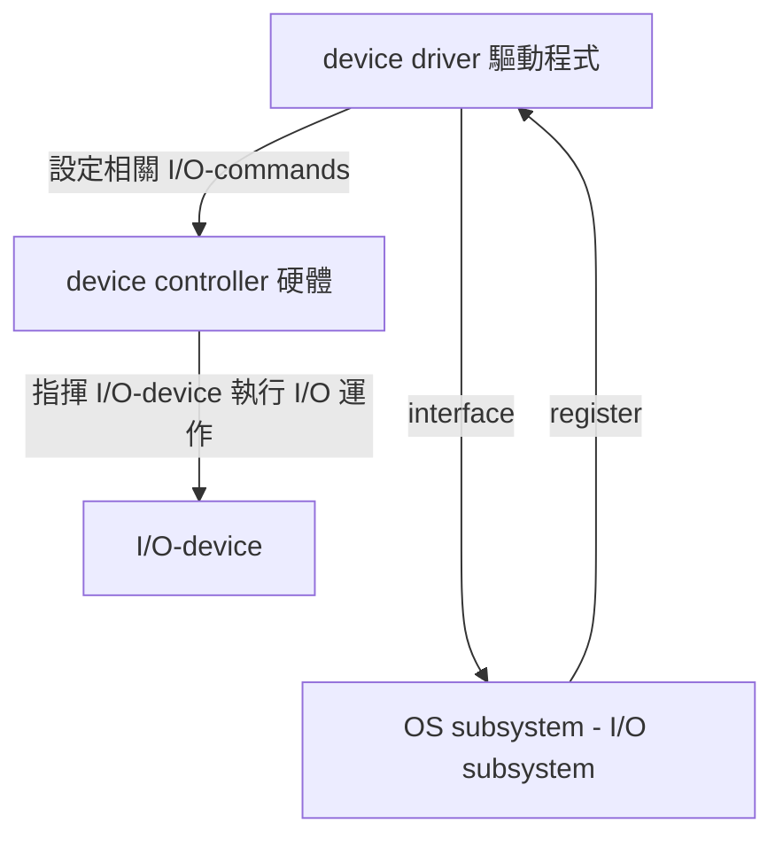
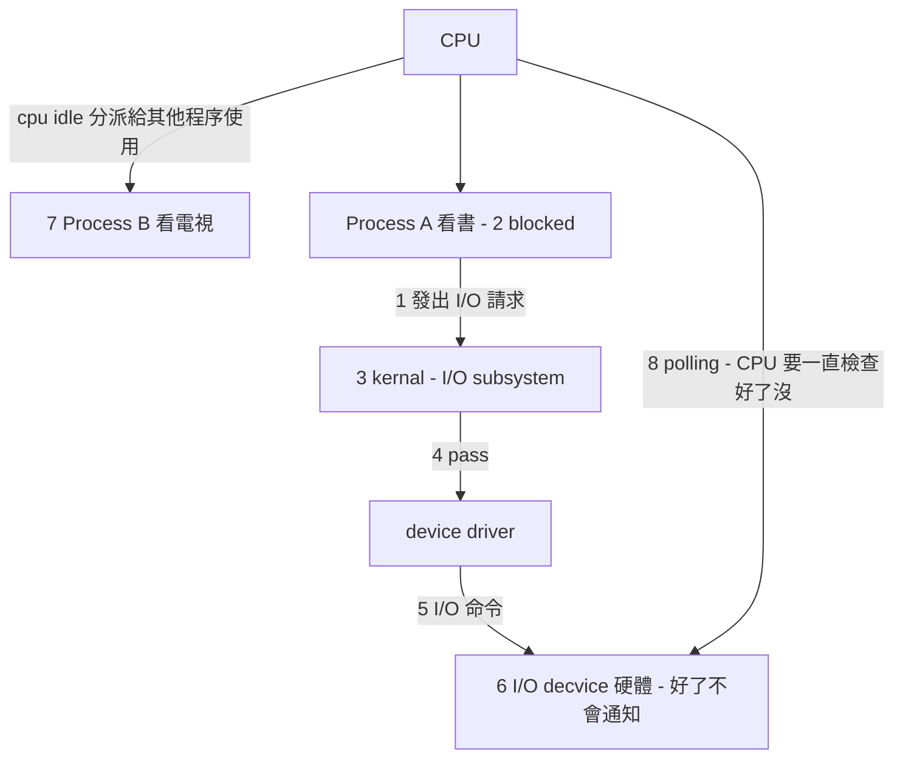
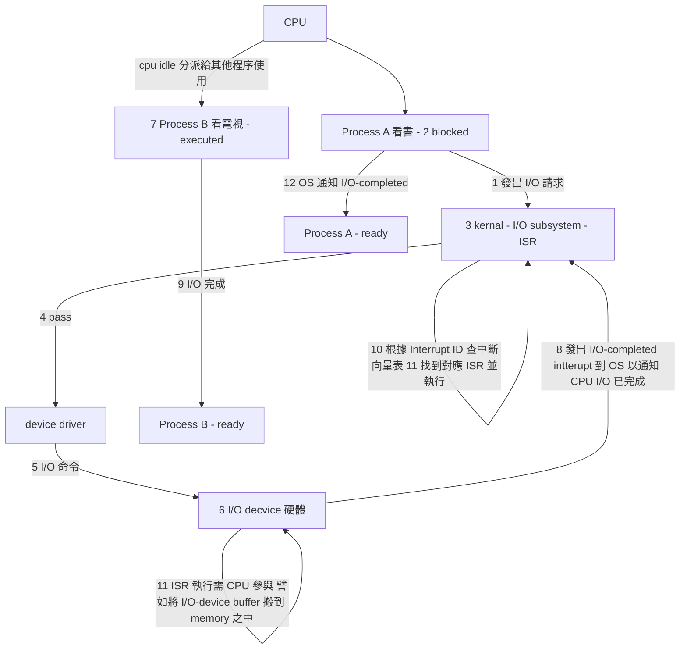
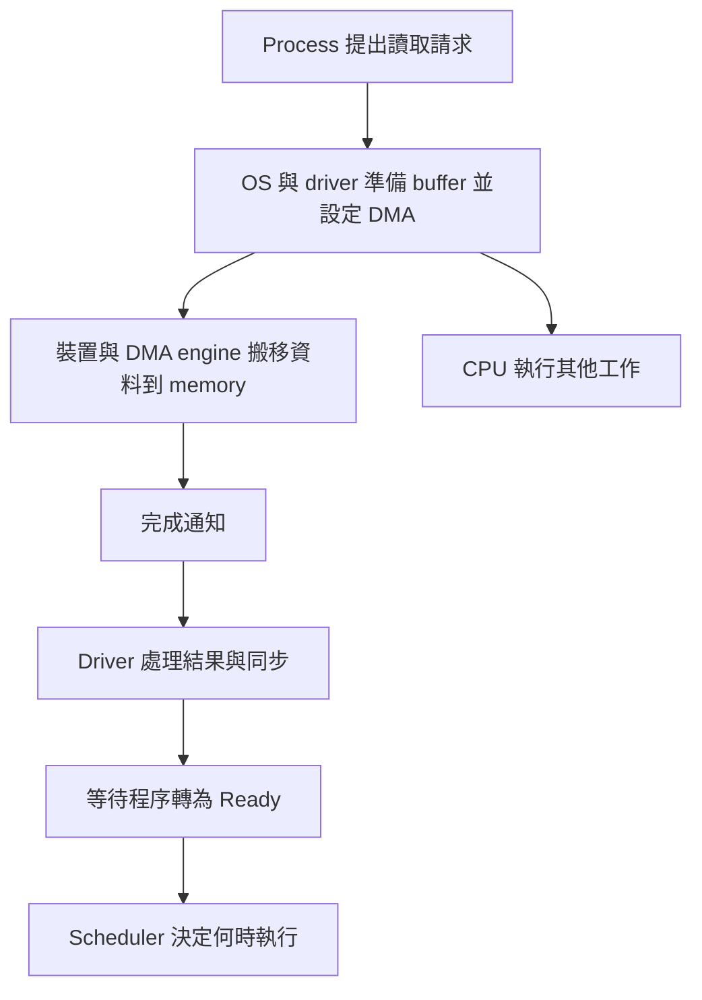
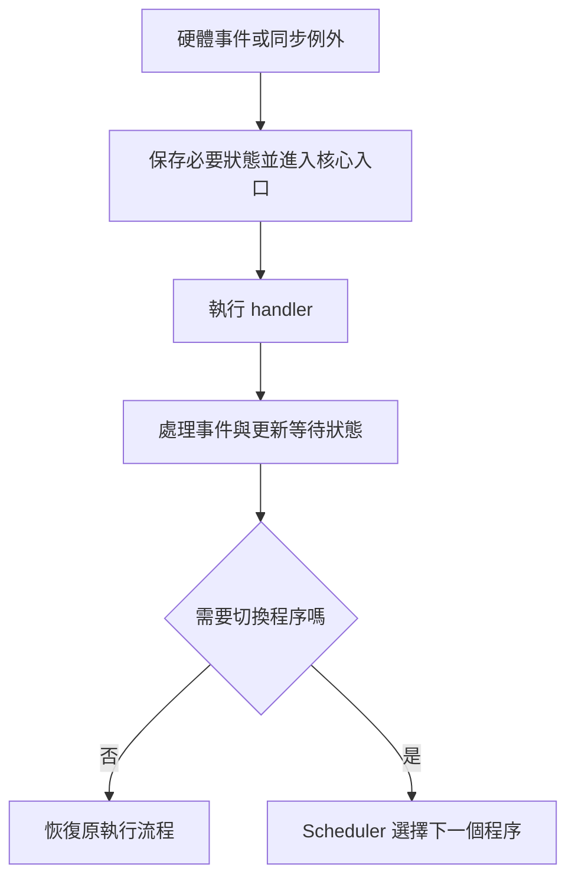
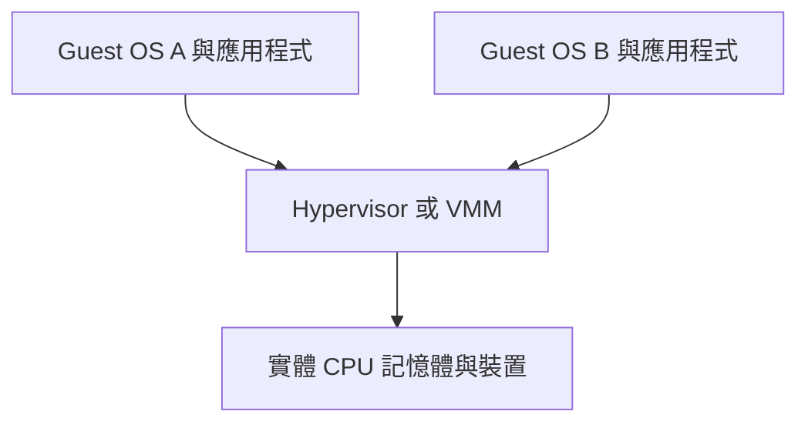

> 本文原始內容是觀看大碩資工研究所作業系統課程時的重點筆記。2026-10-11 依公開教材補充未完成章節並校正部分觀念；補充內容不代表課程逐字稿，考試名詞仍應對照授課講義。

### 原始 I/O 筆記的觀念校正

- **Polling 是查詢狀態的方式；programmed I/O（PIO）描述 CPU 參與資料搬移。** 兩者常一起出現，但不是完全同義；interrupt 與 DMA 也可以搭配。
- Blocking I/O 會讓請求程序等待，但 CPU 是否空轉，取決於誰在 polling、有沒有其他可執行程序，以及系統設計。不能把「CPU 忙等」和「CPU 同時執行其他程序」視為同一段操作。
- **Interrupt 不一定造成 process context switch。** CPU 可以處理 ISR 後返回原程序；是否改跑別的程序由排程與搶占條件決定。
- I/O 完成使等待程序由 **Blocked → Ready**；不保證立即 **Ready → Running**。
- 原流程圖的 kernel／device 拼字與箭頭是課堂速記。後文新增圖表採較明確的資料流，區分裝置搬移、ISR 和程序排程。

以上校正依 [OSTEP：I/O Devices](https://pages.cs.wisc.edu/~remzi/OSTEP/file-devices.pdf) 的控制協定與中斷模型整理。

## IO 運作方式: Interrupt 介紹、HW Resource protection

### I/O 運作方式

#### polling I/O (programmed I/O)
  
Def: 又叫 Busy waiting I/O 或 programmed I/O

步驟如下:

1. 執行中的 Process，發出 I/O request 給 OS 希望 OS 提供某種 I/O 服務，eg Disk read a file。
2. OS 收到請求後(可能)會先暫停(block)該 process 即此 process 會放 CPU 至於 waiting queue 等待 I/O completed。
3. OS (or Kernel) 中的 I/O-subsystem 會處理此請求。eg 也會檢查 Disk cache 是否有命中，若有剛從 Disk cache 取出 file 資料 不用 read I/O。
4. I/O-subsystem 會 pass 此請求給 device driver(驅動程式)。
   driver -( request I/O subsystem )-> OS
5. device driver 會依此請求設定相關 I/O commands 到 device controller(硬體)。
6. device controller  會指揮 I/O-device 執行 I/O 運作
7. 此時 CPU 可能 idle，OS 可能會將 CPU 分派給其他 process 使用。
   [怎麼知道設備到底完成了沒有?]
8. CPU 會不斷地去 polling I/O-device controller 上之相關 registers 值，確定 I/O 運作完成與否或有無 error。
 
缺點: 本希望 CPU 專心 process，但 CPU 並未將全 time 用於此 process exec 上而是耗費大量時間去 polling IO-device controllers。
所以 CPU utilization 不高，且 process throughput 偏低。





#### Interrupted I/O

8. 當 I/O 運作完成，I/O-device controller 會發出一個 "I/O-completed" interrupt 通知 CPU(OS)
9. OS 收到中斷通知後(可能)會先暫停目前執行中的 process(eg. PB execution -> ready state)
10. OS 會依 Interrupt ID(No) 查詢 Interrupt vector(表) 找出中斷對應的服務處理程式(ISR: interrupt service routine) 之位址。
11. Jump to ISR 位址，ISR 執行(eg. 將 File Data 從 Controller 之 buffer registers 搬到 memory 中)
12. ISR 完成，控制權交回 kernel I/O-subsystem 通知 process 其 I/O completed 以及告知結果。
13. OS 恢復中斷之前 process 的執行(eg Process B exec) 或交由 cpu schedule 決定下一執行之 process。




優點: 

CPU 無需花費時間用於 polling I/O device controller，而是可以全心用於 Process 之 execution 上。所以 CPU utilization 較高， throughput 相對地較高故 improve the system performance。

缺點: 

* Interrupt 之處理仍需耗費 cpu time (eg 查表.執行 ISR 保存中斷前 process 之 state etc)
* 中斷過於頻繁會增加 overhead；快速裝置或高負載時可搭配 polling、批次處理等方式。

#### DMA：Direct Memory Access

DMA 讓裝置或 DMA engine 在裝置與主記憶體間搬移資料，不必由 CPU 逐筆執行 load／store。CPU 仍負責設定傳輸條件、配置 buffer、處理完成或錯誤。

典型讀取流程：

1. OS／driver 準備可供 DMA 使用的 buffer，建立適當 mapping。
2. 設定裝置可使用的 DMA address、長度、方向或 descriptor。
3. 啟動傳輸，CPU 可以執行其他工作。
4. 裝置搬移資料，完成後通常以 interrupt 通知，也可透過 polling 確認。
5. Driver 處理完成、必要的同步與資源回收，再使等待程序可繼續。



DMA address 不一定等於 CPU 使用的虛擬位址或實體位址；平台可能透過 IOMMU 做轉譯。Cache coherence、mapping 與同步須依平台及 DMA API 處理，不能假設所有硬體都自動一致。參考 [Linux DMA mapping 指南](https://docs.kernel.org/core-api/dma-api-howto.html)。

##### Machine instruction cycle：CPU 與 DMA 的記憶體競爭

原課堂筆記用五階段模型觀察 CPU 哪些階段可能使用 memory／bus：

| 階段 | 名稱 | 工作 | 是否可能存取記憶體 |
| --- | --- | --- | --- |
| IF | Instruction Fetch | 抓取指令，放入 IR（Instruction Register，指令暫存器） | 需要取得指令；是否使用主記憶體匯流排取決於 cache 是否命中 |
| ID／DE | Instruction Decode | 解碼指令、讀取所需暫存器，產生控制訊號 | 典型五階段模型主要使用暫存器，不必存取主記憶體 |
| EX／EXE | Execute | ALU 運算、位址計算或分支判斷 | 典型模型通常不存取主記憶體 |
| MEM | Memory Access | load／store 的資料讀取或寫入 | 視指令而定；算術指令可能不需要 |
| WB | Write Back | 將結果寫回暫存器 | 典型五階段模型寫回 register，不是寫回主記憶體 |

```text
抓指令       解碼          執行          記憶體存取       暫存器寫回
  IF    →    ID／DE   →    EX／EXE   →      MEM      →      WB
```

**五階段是方便理解的簡化模型，不代表所有 CPU 都採相同流水線。** 原速記將 WB 記成可能使用 memory；若採典型五階段模型，store 的記憶體寫入在 MEM，WB 則是暫存器寫回，兩者要分清楚。

在傳統共享 bus 模型中，DMA 與 CPU 同時需要主記憶體或匯流排時，必須透過仲裁決定使用權。CPU 的 IF 或 MEM 若真的要走共享匯流排，就可能等待；若 cache 命中，則不一定產生相同的衝突。

原課堂筆記提到：衝突時常優先讓 DMA 傳輸，以免裝置等待過久。這可以作為特定仲裁策略的例子，但**不是所有系統的固定規則**；實際優先權還會考慮裝置時限、公平性與平台設計，不能只由「DMA 使用頻率較低」推導平均等待時間一定較短。

這段保留原本從 instruction cycle 觀察 DMA 競爭的學習脈絡；DMA 的平台差異與同步要求可對照前述 Linux DMA 文件。

##### DMA 的傳輸方式

| 方式 | 基本概念 | 取捨 |
| --- | --- | --- |
| Burst／block transfer | 取得匯流排後連續搬移一批資料 | 傳輸效率高，但可能讓 CPU 等待較久 |
| Cycle stealing | 穿插取得匯流排週期搬移資料 | CPU 記憶體存取可能延遲 |
| Transparent DMA | 利用 CPU 未使用匯流排的時段 | 干擾較少，傳輸時機受限 |

這是傳統共享 bus 模型的分類；現代互連與仲裁設計可能不同。DMA 不代表「完全不使用 CPU」，也不能斷言 DMA 永遠具有最高優先權。

##### 三種 I/O 機制比較

| 面向 | Polling | Interrupt-driven | DMA |
| --- | --- | --- | --- |
| 核心問題 | 如何知道狀態／完成？ | 如何通知 CPU？ | 誰搬移資料？ |
| 主要成本 | 狀態查詢與忙等 | 中斷進入與 handler | 設定、同步及記憶體頻寬競爭 |
| 常見搭配 | PIO 或 DMA | PIO 或 DMA | Interrupt 或 polling |

所以它們不是三個完全互斥的選項。這張表是依上述職責整理的複習比較。

### Interrupt 介紹與處理

#### 種類：非同步中斷與同步例外

| 類型 | 來源 | 例子 |
| --- | --- | --- |
| Hardware interrupt | 與目前指令非同步的外部事件 | I/O 完成、timer |
| Exception | 執行指令時發生的同步事件 | page fault、非法指令、除以零 |
| System call entry | 程序主動要求核心服務 | read／write 等服務的入口指令 |

教材有時把 trap 泛指軟體中斷或例外；在特定 CPU 架構中，fault、trap、abort 有更精確的分類。System call 可以使用專用指令，不一定是同一種「軟體中斷」指令。

Maskable interrupt 通常可透過控制設定暫時遮蔽；NMI 不受一般中斷遮蔽機制控制。這些分類與同步／非同步是不同面向。研究所答題時應先說明採用哪一套分類。

#### Interrupt 的處理步驟

1. CPU 在架構允許的時機接受中斷或例外。
2. 硬體保存返回所需狀態，轉到適當權限與入口；實際保存哪些暫存器依架構不同。
3. 透過 vector／入口機制找到 handler，軟體再保存需要使用的狀態。
4. Handler 辨識來源、處理或確認事件；較長工作可能延後執行。
5. 若 I/O 完成，更新等待者狀態。核心可依條件評估排程。
6. 恢復執行狀態，返回原流程或切換到其他程序。



**Mode switch** 是權限模式改變；**context switch** 是切換執行程序或執行緒。進入核心不一定換程序。相關機制參考 [OSTEP：Limited Direct Execution](https://pages.cs.wisc.edu/~remzi/OSTEP/cpu-mechanisms.pdf)。

### HW Resource Protection

硬體資源保護的目標，是避免使用者程式任意控制裝置、存取他人記憶體，或長期霸占 CPU。OS 制定規則，硬體在執行期間協助強制檢查。

#### 基礎：Dual-mode operation

- **User mode**：執行一般應用程式，不能任意使用特權操作。
- **Kernel mode**：執行核心服務，可進行受保護操作。
- System call、interrupt 或 exception 可以透過受控入口進入核心；返回使用者程式則恢復使用者權限。
- Mode bit 是教材簡化模型；實際硬體可能有多個 privilege levels。

##### Privileged instructions

例如設定記憶體保護、調整 timer 或控制部分中斷狀態，通常屬於受限制操作。使用者程式不能自行切成 kernel mode，也不能任意指定核心服務入口。

CPU 進入核心後，OS 仍需檢查 system call 參數、權限及記憶體範圍；擁有 kernel mode 不代表每個要求都應被允許。基本概念見 [UIC：OS Introduction](https://www.cs.uic.edu/~jbell/CourseNotes/OperatingSystems/1_Introduction.html)。

#### I/O protection

一般使用者程式透過 system call 取得裝置服務，由 OS 檢查檔案／裝置權限，再由 driver 操作 controller。

Port-mapped I/O 可以限制 I/O 指令權限；memory-mapped I/O 則限制裝置暫存器所在位址的 mapping。DMA 也要限制可存取的記憶體，否則裝置可能越界修改資料。

受控的裝置直通或 userspace driver 是特殊設計，不能簡化成「任何應用都能直接控制硬體」。參考 [UIC：I/O Systems](https://www.cs.uic.edu/~jbell/CourseNotes/OperatingSystems/13_IOSystems.html) 與 [Linux DMA 指南](https://docs.kernel.org/core-api/dma-api-howto.html)。

#### Memory protection

傳統 contiguous allocation 模型可用 base／limit registers。若邏輯位址 `x` 合法：

```text
0 ≤ x < limit
physical address = base + x
```

例如 `base = 10000`、`limit = 2000`，合法邏輯位址為 0～1999，對應實體位址 10000～11999。設定保護暫存器是核心的責任，檢查由硬體執行。

現代系統常以 paging、MMU 和頁面權限限制讀取／寫入／執行與 user／supervisor 存取。Page fault 不一定是程式錯誤：合法頁面尚未載入，也可能由 OS 處理後繼續執行。地址轉譯機制見 [OSTEP：Address Translation](https://pages.cs.wisc.edu/~remzi/OSTEP/vm-mechanism.pdf)。

#### CPU protection

Timer 讓 OS 在程序不主動交還控制權時，仍能重新取得 CPU。OS 設定 timer；到期後的 interrupt 進入核心，核心再決定是否搶占。

設定 timer 屬受保護操作，否則程式可以把期限設得極長。**Timer interrupt 不保證每次都 context switch**，但它提供排程決策的機會。參考 [OSTEP：Limited Direct Execution](https://pages.cs.wisc.edu/~remzi/OSTEP/cpu-mechanisms.pdf)。

## OS 架構：核心服務如何組織？

| 架構 | 概念 | 常見取捨 |
| --- | --- | --- |
| Monolithic kernel | 多數核心服務在 kernel space 協作 | 呼叫直接，但故障影響範圍可能較大 |
| Layered approach | 分層提供服務，上層使用下層介面 | 結構清楚，但分層邊界與呼叫成本需設計 |
| Microkernel | 核心保留較小的基本機制，部分服務在 user space | 隔離較好，但 IPC 與跨邊界工作有成本 |
| Modular kernel | 核心透過模組擴充功能 | 彈性高；核心模組仍可能影響整個系統 |
| Hybrid | 結合不同架構設計 | 不能只用一個分類推斷所有細節 |

Linux 常被描述為支援模組的 monolithic kernel；「有模組」不等於 microkernel。架構比較應看服務所在位置、互動方式與故障邊界，而非只看核心檔案大小。

System call 是使用者程式進入核心的受控介面；函式庫 API 不一定一對一對應 system call，例如一次函式呼叫可能先使用使用者空間 buffer。

此節依 [UIC：OS Structures](https://www.cs.uic.edu/~jbell/CourseNotes/OperatingSystems/2_Structures.html) 整理。

## VM：Virtual Machine 與 Virtual Memory

### 先分清楚 VM 的兩種意思

| 名稱 | 虛擬化的對象 | 目的 |
| --- | --- | --- |
| Virtual Memory | 程序的位址空間 | 隔離與管理記憶體 |
| Virtual Machine | 一套執行環境或硬體平台 | 執行 guest OS／程式並隔離環境 |

本節主要指 **Virtual Machine**；記憶體章節說的 VM 通常是 Virtual Memory。

### Hypervisor／VMM

Hypervisor（Virtual Machine Monitor）管理 guest 的虛擬 CPU、記憶體與裝置。Guest OS 看到虛擬硬體，底層實際資源仍由 hypervisor 與平台協調。



| 類型 | 典型層次 |
| --- | --- |
| Type 1／bare-metal | Hardware → Hypervisor → Guest OS |
| Type 2／hosted | Hardware → Host OS → Hypervisor → Guest OS |

實際產品可能結合 host kernel 或管理分割區，不宜只用是否看到桌面判斷類型。基本分類見 [IBM：Hypervisors](https://www.ibm.com/think/topics/hypervisors)。

### Guest kernel 不等於控制真實主機

Guest 可以認為自己執行在 kernel mode，但它對實體機的控制仍受虛擬化機制限制。硬體輔助虛擬化提供額外執行模式與受控退出機制，讓 hypervisor 處理必要操作。

Guest 的虛擬記憶體與 hypervisor 的記憶體管理也不是同一層。例如硬體可協助 guest physical address 到 host physical address 的第二階段轉譯。這是地址轉譯層次的補充，不表示每次存取都必須由軟體模擬。

### VM、容器、模擬器的差別

| 機制 | 主要特色 |
| --- | --- |
| 系統 VM | 可執行各自的 guest OS kernel |
| 容器 | 一般共享所在系統的 kernel，以隔離機制分開程序與資源 |
| Emulator | 模擬目標硬體／指令集，可用於不同架構 |

容器可能部署在 VM 內，因此不是非此即彼。VM 適合隔離多套 OS、測試與環境整合，但仍有資源、I/O 和管理成本；隔離也不是絕對保證。VM 的角色見 [IBM Hypervisor 說明](https://www.ibm.com/think/topics/hypervisors)。

## 考前自我檢查

1. Polling、interrupt、DMA 各自回答什麼問題？哪些可以同時使用？
2. I/O 完成後，程序為什麼通常先進 Ready 而非直接 Running？
3. Mode switch 和 context switch 為何不同？
4. DMA 哪些階段仍需要 CPU？DMA address 與 CPU address 是否相同？
5. OS 如何透過 I/O、memory、timer 保護資源？
6. Monolithic、microkernel 與 modular 的差異在哪裡？
7. Guest kernel mode 是否代表可以任意修改 host memory？
8. Virtual Memory 與 Virtual Machine 的 VM 為什麼不能混用？

這些問題用來檢查概念是否能連起來；不是對出題範圍的預測。
