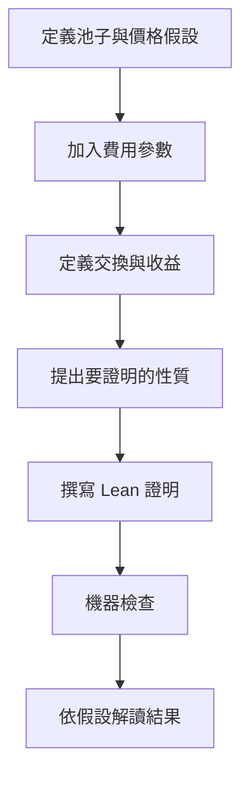

雖然檔名是「期末心得報告說明」，實際內容是一份閱讀心得，主題是 **Lean 4 在 AMM 經濟模型驗證中的應用**。

這篇整理以提供的兩頁報告為主，並查核引用論文與開源專案。核心問題是：把手續費加入交換模型後，原本看似理所當然的經濟性質，還成立嗎？

## 先把名詞分清楚

| 名詞 | 解釋 |
| --- | --- |
| DeFi | Decentralized Finance，以鏈上協議提供金融服務的技術與應用 |
| AMM | Automated Market Maker，自動化做市商，依演算法提供資產交換 |
| Liquidity pool | 流動性池，交換所使用的代幣儲備 |
| LP | Liquidity Provider，提供流動性的參與者 |
| Arbitrage | 套利，利用不同市場的價格差進行交易 |
| Price oracle | 價格預言機，為模型或協議提供外部價格資訊 |
| Formal verification | 形式化驗證，以明確定義及證明檢查指定性質 |
| Lean 4 | 可撰寫程式與機器檢查證明的工具 |

可以把池子想成裝有兩種代幣的容器。交易者放入一種、取出另一種；交換量由規則決定。這只是理解比喻，實際協議還有資產轉移、權限與交易執行等機制。

## 常數乘積與手續費

以兩種資產的儲備 r0、r1 為例，無手續費的理想模型常以儲備乘積描述交換關係。加入手續費後，令輸入量為 x，保留比例為 φ：

```text
0 < φ ≤ 1
有效輸入 = φ × x
輸出量 y = (φ × x × r1) / (r0 + φ × x)
```

注意：原報告的 `SX` 是交換率函數，不是總輸出量；要取得 y，還需要乘上 x。

- φ＝1：模型中沒有交易手續費。
- φ＜1：有效參與定價的輸入小於完整投入量。
- 模型裡完整 x 進入儲備，但以 φx 計算交換，因此費用留在池子中。

例如 r0＝100、r1＝100、x＝10，無費用時 y 約為 9.09。若只作教學例子設定 φ＝0.99，y 約為 9.01；相同投入量的輸出較少。

這是抽象實數模型的說明，不是某個真實協議費率或整數取整實作的保證。

## 論文主要在證明什麼？

引用研究是 Dessalvi、Bartoletti 與 Lluch-Lafuente 的 *A Formal Approach to AMM Fee Mechanisms with Lean 4*。

論文將費用參數加入 AMM 模型，檢查輸出有界性、單調性及可加性等性質；也推導含費用套利問題的閉式解，並以 Lean 4 機器檢查證明。見 [原論文](https://arxiv.org/abs/2602.00101)。

報告整理出三個值得注意的結果：

### 儲備乘積會增加

在有手續費且符合模型的正交換條件下，更新後的儲備乘積高於交換前。這反映費用留在池子的效果，但不表示 LP 在所有市場情況下都一定獲利。

LP 的整體報酬仍可能受資產價格、持有基準、費用收入等因素影響，不能把乘積增加直接當成投資收益保證。

### 拆單與一次交換不一定等價

原報告指出，加入手續費後，可加性需要重新描述。在論文所分析的交換設定與條件下，一次大額交換比拆成多次小額交換具有較高收益。

這不能擴張成所有路由、所有交易所或所有交易策略都應一次下單；實際市場可能有不同池子、價格變動、交易成本和成交規則。

### 價格均衡點與最大收益點可能不同

原報告用收益曲線說明：在該模型的有費用例子中，使池內價格回到外部價格的交換量，不等於收益最大化的交換量。

我把它理解為：**「價格看起來回到平衡」和「這筆交易的目標函數達到最大」是不同問題。** 圖上的位置關係只能依該模型與例子解讀，不能當成任何市場的通用下單規則。

## 這裡的實驗，並非速度競賽

這份報告不是比較 TPS 或網路延遲。收益曲線用來理解數學行為，定理證明則檢查模型中的性質是否在假設下成立。



因此，比起「跑了幾組資料」，更重要的是定理說了什麼、需要哪些條件，以及模型刻意省略了哪些事。

## Lean 4 和一般測試有什麼不同？

| 方法 | 主要用途 | 邊界 |
| --- | --- | --- |
| 單元測試 | 檢查選定輸入的預期結果 | 未測情況可能仍有問題 |
| 性質測試 | 對許多生成案例檢查性質 | 不一定涵蓋所有可能情況 |
| 形式化證明 | 在定義與假設下證明定理 | 保證取決於規格、假設及可信任工具鏈 |

形式化驗證不能簡化為「整個真實系統 100% 安全」。模型證明成立，還需要確認實際合約與模型相符；整數運算、取整、外部呼叫和部署環境也可能有自己的問題。

報告提到正實數子型別不具一般 ring 所需的完整結構，會增加代數自動化的使用難度。我的理解是，數學上寫得很短的推導，翻成工具能檢查的證明，仍需要處理型別、條件與轉換細節。

## 開源專案與 sorry

報告提供的 [lean4-amm](https://github.com/dpusceddu/lean4-amm) 是理解 AMM 形式化的入口。可以先讀定義，再追蹤定理與證明，而非一開始就只看最複雜的套利公式。

文件也介紹 Lake 建置工具與 VS Code 的 Lean 擴充套件。這篇沒有在本機建置該專案，也沒有逐個定理查核完整證明狀態。

其中 `sorry` 的名字很有記憶點，但要認清用途：它可以暫時留下未完成的證明，**不代表該命題已被完整證明**。整理成果時，要清楚區分探索中的占位符和已完成的驗證。

## 數學模型之外，還有鏈上現實

原報告提出的反思包括交易排序、Mempool、MEV、Gas 與三明治攻擊。這些是把模型結果放進真實環境時，需要另外處理的面向。

| 名詞 | 簡要理解 |
| --- | --- |
| Mempool | 尚待納入區塊的交易集合；可見性依系統不同 |
| MEV | 藉交易排序、納入或排除等方式取得的價值 |
| Gas | 鏈上執行所需資源的計量與相關費用 |
| 三明治攻擊 | 以目標交易前後的交易布局利用價格變化的一類行為 |

此外，模型的外部價格假設、實際費率與儲備條件都需要查核。報告開頭提到 Uniswap v2／v3，但本篇的簡化兩資產公式不能直接當成完整 v3 集中流動性模型。

這些補充不是否定形式化方法，而是提醒自己：被證明的部分很有價值，同時也要看清楚它沒有涵蓋的部分。

## 我的整理心得

這份閱讀把程式、數學與經濟行為放在同一個問題裡。最有啟發性的地方，是一個看似小小的手續費參數，竟然會改變拆單與套利的推論。

對我而言，學習重點不是記住一個最大收益公式，而是練習問清楚：我們證明的是什麼？它依賴哪些假設？真實系統是否滿足這些假設？

如果繼續閱讀，我會從交換公式、狀態更新與單調性開始，再看收益最大化。先把一個小定理的定義和證明讀懂，比直接把「有形式化驗證」當作安全標章更有幫助。

## 整理依據

本文依使用者提供的《114-2 點對點與區塊鏈系統期末心得報告說明.pdf》整理，並查核引用論文與開源專案頁面。文章日期是整理日期，不代表原報告的繳交日期。
