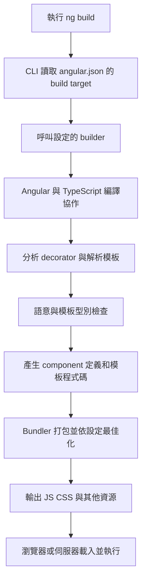
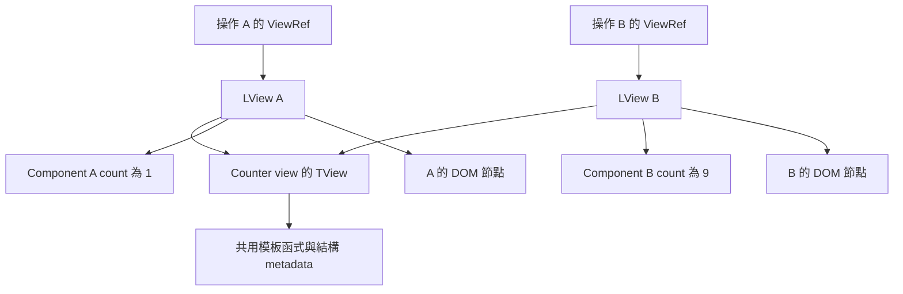
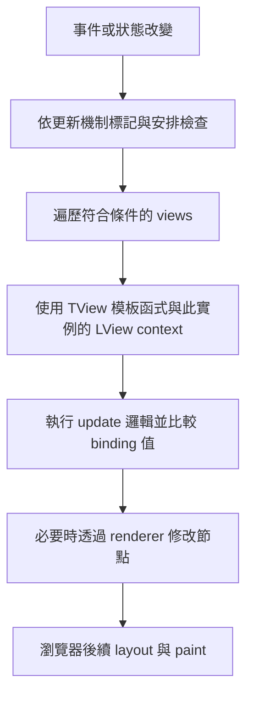

## 前言

平常寫 Angular，大多是在 component 裡寫資料，再到 template 裡綁定。但這些 HTML 和 TypeScript，最後是怎麼變成畫面的？

這篇想從編譯器的角度來看 Angular。先借用 Lex／Yacc 的概念，看看 CLI 到 runtime 中間做了什麼，再介紹常在原始碼裡看到的 `ViewRef`、`LView` 和 `TView`。

接下來，在看 Angular 的流程之前，先來一些編譯器的先備知識。

> 注意: 文件與原始碼於 2026-10-13 查核。內部結構參考 Angular repository 的 `main`，不是固定版本的 ABI。下面的內部指令是教學示意，實際欄位與編譯輸出可能隨版本改變。

## 1. 用 Lex／Yacc 建立編譯器概念

Lex 用來產生詞法分析器，Yacc 用來產生語法分析器。這兩個工具可以一起使用，各自處理不同的工作:

- Lex: 把字元切成 token，像是識別字、數字和運算子。
- Yacc: 依文法整理 token 的結構，搭配 semantic actions，例如建立 AST。

例如 `price + tax * 2`：

```text
字元：price + tax * 2
token：Identifier(price), +, Identifier(tax), *, Number(2)
AST：Add(Read(price), Multiply(Read(tax), Number(2)))
```

上面可以看到，切出 `+` 和 `*` 還不夠，還要知道乘法先算。這就是語法分析要處理的部分。

AST (Abstract Syntax Tree，抽象語法樹) 把這個結構留下來，不需要保留每個空白和括號。至於 `price` 指的是誰、型別能不能相加，就要再往後做語意與型別檢查。

以下把這些工作和 Angular 對照看看:

| 傳統編譯概念 | Angular 中可對照的責任 |
| --- | --- |
| Lexer／scanner | HTML 與模板表達式的 token 化 |
| Parser | 建立 HTML、Angular template 與 expression AST |
| 語意分析 | 比對 directives、bindings、作用域與可用符號 |
| 型別檢查 | 檢查模板讀取的屬性、input 等型別 |
| 中介表示與轉換 | 將模板操作整理成可產生程式碼的結構 |
| Code generation | 產生 component definition 與模板執行指令 |
| Runtime | 執行指令、保存 view 狀態並更新畫面 |

這是概念對照，不表示 Angular 使用 Lex／Yacc 產生 parser。Angular 有自己以 TypeScript 撰寫的 lexer 與 parser；表達式 parser 中的 `parseAdditive()`、`parseMultiplicative()` 等方法呈現遞迴下降的結構，和典型 Yacc 的 LR 系列分析方式不同。參考 [Angular expression lexer](https://github.com/angular/angular/blob/main/packages/compiler/src/expression_parser/lexer.ts)、[expression parser](https://github.com/angular/angular/blob/main/packages/compiler/src/expression_parser/parser.ts)。Lex 類工具的 scanner 職責也可對照 [Flex 官方介紹](https://westes.github.io/flex/manual/Introduction.html)。

## 2. Angular 同時處理幾種語言

先看一個平常會寫的 component:

```typescript
import { Component } from '@angular/core';

@Component({
  selector: 'app-counter',
  standalone: true,
  template: `
    <button (click)="count = count + 1">增加</button>
    <p>{{ count }}</p>
  `,
})
export class CounterComponent {
  count = 0;
}
```

看起來只是 class 加上一段 HTML，實際上這邊同時有三層:

1. TypeScript class 與 decorator：由 TypeScript 與 Angular compiler 協作分析。
2. HTML／Angular template：元素、綁定、插值、控制流程與 directives。
3. 模板表達式：如 `count`；事件中的 `count = count + 1` 又有 action 的語法規則。

Angular expression 不是任意 JavaScript，也不是直接把字串丟給 `eval()`。編譯器必須先理解模板結構，才知道表達式在讀 component context、區域變數，還是 pipe。HTML parser 與 expression parser 是不同責任，不能把整份模板只看成一條算術文法。

## 3. 從 Angular CLI 到建置產物



上圖可以看到，按下 `ng build` 之後，不是 CLI 自己把所有事情做完。它會依設定呼叫 builder，再由不同工具處理各自的工作:

- CLI／builder: 把建置流程串起來。
- Angular compiler: 分析 component 和 template 的 Angular 語意。
- TypeScript: 處理 TypeScript 分析與型別。
- Bundler: 整理模組相依關係、打包輸出。

目前新應用的預設 application builder 使用 esbuild；既有專案也可能使用其他 builder。請以 `angular.json` 的實際設定為準，不能只看到 `ng build` 就斷定是哪個 bundler。以上流程為責任示意，實作上各階段可能交錯並增量執行。參考 [CLI build 指南](https://angular.dev/tools/cli/build)。

### AOT 與 JIT 改變的是 Angular 編譯發生的時機

| 模式 | Angular 編譯時機 | Runtime 主要接到什麼 |
| --- | --- | --- |
| AOT | 建置時 | 已產生的 component 定義與模板程式碼 |
| JIT | 執行期間 | runtime compiler 依 metadata／模板產生可執行定義 |

AOT 不代表沒有 Angular runtime；它是把 Angular 編譯工作提前完成。瀏覽器仍需執行 JavaScript、建立 view、處理事件與更新 DOM。AOT 也不等於預先產生所有 HTML；SSR／prerender 是另一層工作。

Angular 的 JIT 編譯和瀏覽器 JavaScript 引擎的 JIT 是不同層次。即使使用 Angular AOT，JavaScript 引擎仍可以對執行的 JS 進行自己的最佳化。參考 [AOT compilation](https://angular.dev/tools/cli/aot-compiler)。

### 模板型別檢查不是 runtime 才做

例如不小心把模板寫成 `{{ counnt }}`，Angular 可以在建置時就告訴你 component 沒有這個屬性，不用等到開頁面才發現。

這邊 Angular 會把模板要檢查的內容，轉成 TypeScript 能理解的型別檢查程式碼。這份程式碼是拿來找錯誤的，不是拿來畫畫面的。

模板型別檢查的嚴格程度受 `strictTemplates` 等設定影響，見 [Template type checking](https://angular.dev/tools/cli/template-typecheck)。能通過型別檢查也不代表 API 回傳資料在執行時一定符合宣告型別。

### Library 的 partial compilation 與 linker

Angular library 可發布 partial compilation 產物，再由使用它的應用在建置時透過 linker 完成轉換。這和 browser runtime 再解析模板字串的 JIT 不同。相關責任見 [Angular Package Format](https://angular.dev/tools/libraries/angular-package-format)。

## 4. 模板如何變成可執行指令？

先用更簡單的模板：

```html
<p>{{ count }}</p>
```

概念上的 Ivy 模板函式可以寫成：

```typescript
// 偽碼：內部指令的教學示意，不是供應用直接使用的 API
function Counter_Template(rf, ctx) {
  if (rf & 1) { // Create
    elementStart(0, 'p');
    text(1);
    elementEnd();
  }
  if (rf & 2) { // Update
    advanceToTextNode(1);
    textInterpolate(ctx.count);
  }
}
```

`rf` 表示此次執行的 render flags；create 路徑負責節點與建立時工作，update 路徑重新計算綁定並反映差異。首次渲染包含建立與更新工作，但不要推論所有版本都用一次函式呼叫同時執行兩個分支。

`ctx` 是此次 view 的 context。對 component view，通常是 component 實例；對 embedded view，則可能是含 `$implicit` 等欄位的資料物件。

`0`、`1` 是編譯器分配的邏輯索引，用於指令定位；不是直接假設 `LView[0]` 就是 `<p>`。LView 有內部 header 與區段配置，runtime 會做相應換算。

真實輸出可能使用 `ɵɵelementStart`、`ɵɵtext`、`ɵɵtextInterpolate` 等指令，也可能經轉換與最佳化而呈現不同形式。概念與輸出生成可參考 [view compiler](https://github.com/angular/angular/blob/main/packages/compiler/src/render3/view/compiler.ts) 與 [template compilation](https://github.com/angular/angular/blob/main/packages/compiler/src/render3/view/template.ts)。

## 5. 三個 view 名詞的分工

| 名稱 | 性質 | 保存或提供什麼 |
| --- | --- | --- |
| `TView` | 內部、每種 view 結構可共用的資訊 | 模板函式、節點 metadata、索引布局、hooks 等 |
| `LView` | 內部、每個活著的 view 實例的狀態 | context、實際節點參考、綁定值、flags 與關聯 |
| `ViewRef` | 公開 view 控制介面及對應 runtime 包裝 | 偵測變更、銷毀、生命週期與 attachment 操作 |

這邊先抓住三個重點:

- **TView: 大家共用的結構資訊。**
- **LView: 這一份 view 自己的資料與狀態。**
- **ViewRef: 讓程式操作這份 view 的入口。**

可以想成同一個函式被呼叫多次，程式碼一樣，但每次的資料不同。不過這只是類比，LView 不等於 JavaScript call stack frame，TView 也不是 compiler 的 AST。

## 6. TView：共享結構，但在 runtime 建立

這邊有個容易搞混的地方: 看到 TView 存的是「靜態資訊」，可能會以為它在編譯時就做好了。

實際上，**編譯器先產生模板函式與定義，runtime 再建立 TView。** 有些共用資訊，還會在第一次建立 view 時補上。所以這裡的「靜態」是拿來和各個實例的狀態比較，不是說它完全不會變。

TView 可包含模板函式與 TNode 等 metadata。TNode 描述節點結構與相關資訊，不是某個實例的真實 DOM node。多個相同結構的 view 可以共享這些描述，不必每份都重建。

`firstCreatePass` 等狀態用於管理首次建立時的共享資訊蒐集。首次 view 的建立工作完成後，後續實例便能利用既有結構。內部介面見 [TView／LView 定義](https://github.com/angular/angular/blob/main/packages/core/src/render3/interfaces/view.ts)。

### blueprint：建立新 LView 的初始布局

TView 裡還有一份 `blueprint`，可以想成建立 LView 用的初始樣板。

Runtime 先複製這份陣列布局，再填入這次的 context、renderer 等資料，就不用每次從零準備相同的布局了。

不是複製另一個使用者的 component 或 DOM，也不是深層複製一整棵 view tree。`getOrCreateComponentTView()` 與 `createLView()` 可在 [view construction 原始碼](https://github.com/angular/angular/blob/main/packages/core/src/render3/view/construction.ts) 找到。

## 7. LView：同一模板，各自的狀態

假設畫面上放了兩個 Counter，A 的 count 是 1，B 的 count 是 9。

兩個 Counter 的模板結構一樣，所以可以共用 TView。但數字和畫面節點是各自的，這些就放在各自的 LView 裡。如下圖:



LView 以陣列為核心，透過已知位置保存 runtime 資料。概念布局如下，不代表真實 index 或完整欄位：

```text
LView A
├─ header：TView 參考、context、flags、父子關聯、renderer 等
├─ 節點／宣告區：此實例的節點、directive 等資料
├─ 綁定區：上次計算的值，供下一次更新比較
└─ 額外區：runtime 需要的其他資料
```

模板指令利用布局定位所需狀態，更新時可比較舊綁定值，避免沒有差異也重寫 DOM。不要手動讀寫固定 array index；這些是內部細節。綁定比較可參考 [bindings 原始碼](https://github.com/angular/angular/blob/main/packages/core/src/render3/bindings.ts)。

### 一個 component 不等於整個過程只有一個 LView

Component template 有自己的 view；建立 host、動態 component 或 embedded view 時，還會涉及其他 view／container 關係。因此不要把 `ComponentRef.hostView`、component template 的 view 與任意注入位置的 `ChangeDetectorRef` 一律畫成同一物件。

例如 `@if` 的不同分支，以及 `@for` 的重複區塊，可能對應不同 embedded template。相同重複模板的多筆活躍項目可共享一個 TView，各自有 LView；不同分支則有各自結構。View tree 與 DOM tree 也不是一比一。

## 8. ViewRef：公開操作入口，內部委派至 LView

公開 `ViewRef` 是抽象的 view 介面，繼承 `ChangeDetectorRef`，增加 `destroy()`、`destroyed`、`onDestroy()` 等能力。`EmbeddedViewRef<C>` 再提供 embedded view 的 context 與 rootNodes。

Ivy 的具體 ViewRef 實作持有 `_lView`，方法會委派到 view runtime。這不表示每個 LView 都必定先建立且只對應一個永久 ViewRef wrapper；應用透過公開 API 取得需要的控制入口即可。參考 [ViewRef API](https://angular.dev/api/core/ViewRef) 與 [runtime ViewRef 實作](https://github.com/angular/angular/blob/main/packages/core/src/render3/view_ref.ts)。

| 操作 | 意義 |
| --- | --- |
| `markForCheck()` | 標記需要檢查，交由更新流程處理，不是當場同步渲染 |
| `detectChanges()` | 對該 view 與相關子 view 執行局部變更偵測 |
| `detach()` | 從一般變更偵測樹中停用檢查，不是移除 DOM |
| `reattach()` | 恢復一般變更偵測 attachment |
| `destroy()` | 銷毀 view 並執行相應清理 |

`ViewRef.detach()` 與 `ViewContainerRef.detach(index)` 是不同操作：前者影響變更偵測，後者將 view 從 container 移出而不銷毀。名稱相同，控制的關係不同。契約見 [ChangeDetectorRef](https://angular.dev/api/core/ChangeDetectorRef) 與 [ViewContainerRef](https://angular.dev/api/core/ViewContainerRef)。

### 用公開 API 觀察 embedded view

```typescript
import {
  Component, EmbeddedViewRef,
  TemplateRef, ViewChild, ViewContainerRef,
} from '@angular/core';

interface RowContext {
  $implicit: string;
}

@Component({
  selector: 'app-view-demo',
  standalone: true,
  template: `
    <ng-template #row let-label><p>{{ label }}</p></ng-template>
    <ng-container #outlet />
    <button [disabled]="created" (click)="createRows()">建立 A 與 B</button>
    <button (click)="rename()">修改 A</button>
  `,
})
export class ViewDemoComponent {
  @ViewChild('row', { static: true }) row!: TemplateRef<RowContext>;
  @ViewChild('outlet', { read: ViewContainerRef, static: true })
  outlet!: ViewContainerRef;

  private viewA?: EmbeddedViewRef<RowContext>;
  created = false;

  createRows(): void {
    if (this.created) return;
    this.created = true;
    this.viewA = this.outlet.createEmbeddedView(this.row, { $implicit: 'A' });
    const viewB = this.outlet.createEmbeddedView(this.row, { $implicit: 'B' });
    this.viewA.detectChanges();
    viewB.detectChanges();
  }

  rename(): void {
    if (!this.viewA) return;
    this.viewA.context.$implicit = 'A 已修改';
    this.viewA.detectChanges();
  }
}
```

按下「建立 A 與 B」，就會用同一份 `TemplateRef` 建立兩份 embedded view。接著按「修改 A」，只會改 A 的文字，B 不會跟著變。

這就是**結構共用、狀態各自保存**。平常操作時，用公開 API 就可以了，不需要自己去改 `_lView` 或 TView。

## 9. Runtime 更新與瀏覽器繪製是不同階段



安排檢查、判斷哪些 view 要更新，以及真的執行模板，是不同責任。OnPush、Signals 與 zoneless 會影響觸發與遍歷條件，但不是把 LView／TView 的角色交換。`detectChanges()` 可以直接啟動局部檢查，不必走完整的排程入口。

刷新流程包含模板、hooks、queries 與子 view 等工作，不只是執行插值函式。內部細節可閱讀 [change detection 原始碼](https://github.com/angular/angular/blob/main/packages/core/src/render3/instructions/change_detection.ts)。更新機制背景另見 [Angular 變更偵測演變](./angular-change-detection-history.html)。

## 10. 把整條流程放回同一張圖

| 階段 | 輸入 | 輸出／持有資料 | 是否是 DOM |
| --- | --- | --- | --- |
| 詞法／語法分析 | 模板字串 | Tokens、AST | 否 |
| 語意／型別檢查 | AST、component 與 directive 資訊 | 診斷與供生成使用的資訊 | 否 |
| 程式碼生成與打包 | 分析結果 | JS 模板函式與 component 定義 | 否 |
| Runtime 建立共享結構 | 定義、模板與首次建立過程 | TView、TNode 等 metadata | 否 |
| Runtime 建立每份 view | 共享結構與此次 context | LView、節點與實例狀態 | LView 持有節點參考，本身不是 DOM |
| 公開 API 操作 | ViewRef 等控制入口 | 標記、檢查、銷毀等動作 | ViewRef 不是 DOM |
| Renderer／瀏覽器 | 更新結果 | 實際節點、排版與繪製 | 是實際畫面層 |

如果想回頭看原始碼，可以沿著表格的順序找: 先看 template 怎麼被解析，再看怎麼產生指令，最後追 runtime 怎麼建立與更新 view。

寫應用時，通常用 `ViewRef`、`ChangeDetectorRef`、`TemplateRef` 和 `ViewContainerRef` 就足夠了。知道 LView／TView 的分工，主要是讓我們讀內部實作時比較不會迷路。😆
