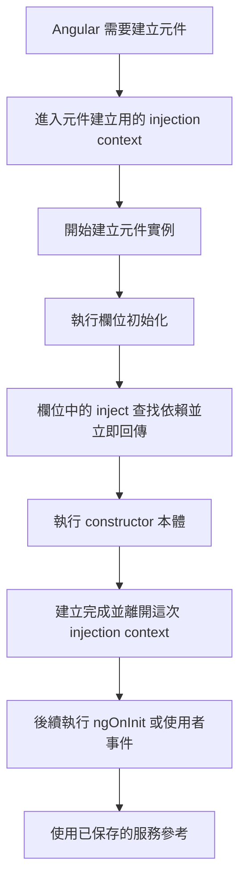
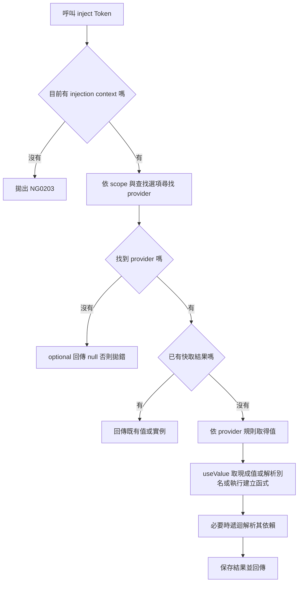
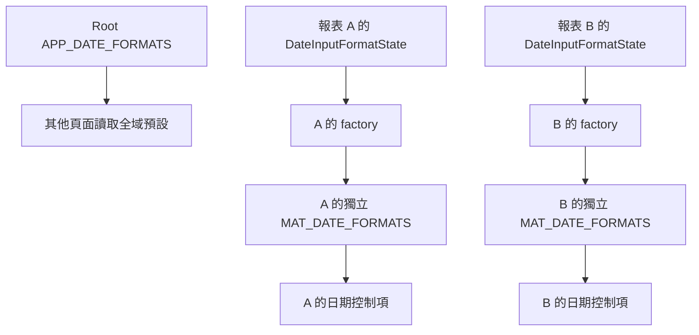

## 前言

寫自訂表單元件時，常會看到一段 `NG_VALUE_ACCESSOR` 的 providers。照著貼通常能跑，但裡面的 `useExisting`、`multi` 到底在幹嘛？

日期格式也是一樣，改了 `MAT_DATE_FORMATS`，有時只想改這頁，結果其他頁也跟著變了。

這篇先介紹 provider、token 和 inject，再用這兩個常見例子看看設定怎麼運作。遇到問題時，可以先想三件事: **用哪個 token 找？怎麼取得值？在哪個 scope 提供？**

> 注意: 本篇以 standalone Angular 寫法為主，文件於 2026-10-13 查核。

## 1. Provider、token 與 injector

先認識三個名詞:

- Provider: 告訴 Angular 怎麼取得這個依賴。
- Token: 拿依賴時用的識別，可以是 class，也可以是 `InjectionToken`。
- Injector: 依照 token 找 provider，再把值提供給使用者。

TypeScript interface 在執行時就不存在了，所以不能直接拿它當 DI token。以下用 API URL 當例子:


```typescript
import { InjectionToken, inject, Injectable } from '@angular/core';

export const API_BASE_URL = new InjectionToken<string>('API_BASE_URL');

@Injectable({ providedIn: 'root' })
export class DeviceApi {
  readonly baseUrl = inject(API_BASE_URL);
}

// 放在 app.config.ts 的 providers
// { provide: API_BASE_URL, useValue: '/api' }
```

`InjectionToken` 的描述字串用於除錯，真正識別依據是物件本身。兩次 `new InjectionToken('API_BASE_URL')` 會產生不同 token，應共用匯出的同一個常數。參考 [Angular provider 指南](https://angular.dev/guide/di/defining-dependency-providers)。

## 2. inject()：從目前的注入脈絡取得依賴

前面有了 provider，接下來就要把依賴拿出來使用。這時可以用 `inject()`:

**Providers 負責提供，inject 負責取得。** 拿到哪一份則要看所在 scope，如果有局部 provider，不一定會拿到 root 的實例。

```typescript
import { Component, inject } from '@angular/core';
import { DeviceApi, API_BASE_URL } from './device-api';

@Component({
  selector: 'app-device-page',
  standalone: true,
  template: `<p>API：{{ baseUrl }}</p>`,
})
export class DevicePageComponent {
  private readonly api = inject(DeviceApi); // 推導為 DeviceApi
  readonly baseUrl = inject(API_BASE_URL); // 推導為 string
}
```

這裡假設前節的 class 與 token 匯出於 `device-api.ts`，且應用已提供 `API_BASE_URL`。`inject()` 不會替缺少的 token 自動註冊 provider；無法解析依賴時仍會拋錯。

### 與 constructor 注入的比較

如果習慣以前的 constructor 注入，可以和下面的 inject 寫法對照看看。兩者使用相同的 DI scope 規則:

```typescript
// 寫法 A：欄位初始化時取得依賴
private readonly api = inject(DeviceApi);
readonly baseUrl = inject(API_BASE_URL);

// 寫法 B：constructor 參數注入，需從 @angular/core 匯入 Inject
constructor(
  private readonly api: DeviceApi,
  @Inject(API_BASE_URL) readonly baseUrl: string,
) {}
```

Class token 可以直接用 constructor 參數型別指定；`InjectionToken` 則透過 `@Inject(TOKEN)` 指定。`inject(TOKEN)` 可直接由 token 推導回傳型別，也能用在有注入脈絡的函式中。以上是替代寫法，不應在同一 class 重複貼上。參考 [inject API](https://angular.dev/api/core/inject)。

### Injection context：不是任何位置都能呼叫

Injection context 可以先理解成「這段程式現在知道要去哪個 injector 拿依賴」。Angular 在建立 class 的欄位和 constructor、執行 factory，或呼叫 functional route guard 等入口時，會提供這個脈絡。

所以 `inject()` 不是在元件裡隨便哪一行都能寫，還要看當下有沒有 context。

### 「同步執行」到底是什麼時候？

這裡的「同步」指的是目前這段函式呼叫尚未返回，程式沿著同一條呼叫鏈立即執行。**Angular 在特定入口提供 injection context；只有同步執行，並不保證有這個 context。** 例如 `ngOnInit()` 通常也是同步呼叫，但不是可直接使用 `inject()` 的入口。

以建立一般、沒有繼承關係的元件為例，順序可以這樣看。這是概念流程，省略框架內部細節：



例如 `private readonly api = inject(DeviceApi)`，是在**每次建立該元件實例時**執行一次欄位初始化，不是每次畫面更新都重新注入。若 Angular 首次需要建立 `DeviceApi`，建立服務時也會提供相應的注入脈絡，讓服務的欄位與 constructor 能取得自己的依賴。

Context 也可以出現在稍後執行的 factory、functional guard 或 `runInInjectionContext()` 中，因此不是「只有應用啟動時才能 inject」。關鍵是呼叫當下是否有 context。依據見 [Angular injection context](https://angular.dev/guide/di/dependency-injection-context)。

```typescript
// 在合法的 injection context 中同步呼叫 helper：可以
function getDeviceApi() {
  return inject(DeviceApi);
}

// 元件欄位初始化
private readonly api = getDeviceApi();

// 即使排程發生在 constructor 中，callback 也不會繼承 context
setTimeout(() => {
  // inject(DeviceApi); // 沒有另外建立 context 時會出現 NG0203
}, 0);
```

以上是函式與元件內片段的對照。同步 helper 可以沿用呼叫者的 context；延後的 callback、Promise continuation 與 `await` 後的程式，不能沿用原本那次 context。需要依賴時，通常先注入並保存參考，再於後續非同步工作中使用。

### inject 越多，速度就越慢嗎？

多呼叫一次 inject，確實多一次查找。不過這邊要分開看: **查找服務，不等於重新建立服務。**

同一 provider 已經有結果時，通常直接拿快取就好。比較花時間的可能是第一次建立時，constructor／factory 做了很多事，又接著建立一串其他依賴。

以下是普通 token、預設查找且沒有循環依賴時的概念流程。詳細查找規則仍會受 `self`、`skipSelf` 等選項影響：



快取與實例共享的概念可對照 [Angular injector 階層指南](https://angular.dev/guide/di/hierarchical-dependency-injection)。`useValue` 的值本來就已準備好；圖中的建立步驟主要適用於尚未解析的 class、factory 或別名。

```typescript
// 假設 DeviceApi 由同一個普通 provider 解析
private readonly a = inject(DeviceApi);
private readonly b = inject(DeviceApi);
// a === b：通常是同一個實例，不是建立兩次 DeviceApi
```

實際評估效能時，可以分開看：

| 情況 | 主要增加的工作 |
| --- | --- |
| 再注入已建立的同一服務 | 查找並取得既有參考 |
| 第一次注入服務 | 查找、建立服務、解析它的依賴 |
| 同時注入多個尚未建立的服務 | 各自建立及其依賴的成本 |
| 大量元件各自提供同一服務 | 每個局部 scope 都可能建立一份 |
| constructor／factory 做大量同步計算 | 建立期間的計算會延後呼叫者繼續執行 |

一般元件注入幾個服務，不用先擔心會不會太慢。真的遇到卡頓，再用工具看看時間花在哪裡，特別是 constructor／factory 有沒有做大量同步計算。

同一個元件要用服務很多次，先存成欄位，後面用這個欄位就好。

`inject(HttpClient)` 本身不會發送 HTTP 請求，也不會等候網路完成。若服務建立時自行啟動非同步工作，那是服務實作的行為；`inject()` 仍是同步取得依賴，不會自動等待該工作完成。改成 constructor 注入也不會消除依賴解析與建立成本。

### 常見錯誤：在 hook 中才 inject

一般生命週期 hook、點擊事件、`setTimeout` 或 Observable 訂閱 callback，不能假設仍有這個脈絡。即使函式寫在元件內也一樣：

```typescript
// 錯誤示例：一般 ngOnInit 呼叫時沒有 injection context
ngOnInit(): void {
  const api = inject(DeviceApi); // NG0203
}

// 正確方式：先在欄位初始化取得，再於一般方法使用
private readonly api = inject(DeviceApi);

ngOnInit(): void {
  console.log(this.api.baseUrl);
}
```

這兩段是錯誤與修正的對照。直接 `new DevicePageComponent()` 也不會因為 class 有 `@Component` 就自動建立注入脈絡。詳細限制見 [Injection context 指南](https://angular.dev/guide/di/dependency-injection-context)。

### 在 useFactory 中使用 inject()

前面的工廠也可以在執行時直接取得依賴，省略 `deps`：

```typescript
// providers 中的片段；API_OPTIONS 為應用自行定義的 token
{
  provide: API_OPTIONS,
  useFactory: () => ({
    baseUrl: inject(API_BASE_URL),
    timeoutMs: 5000,
  }),
}
```

`inject()` 必須寫在工廠函式內。若寫成 `useValue: inject(API_BASE_URL)`，就會在設定物件求值時執行，普通的頂層 `app.config.ts` 沒有 injection context。

### runInInjectionContext：明確指定 injector

已有 injector 時，可以用 `runInInjectionContext()` 在同步 callback 中呼叫 `inject()`：

```typescript
import {
  EnvironmentInjector, Injectable, inject, runInInjectionContext,
} from '@angular/core';
import { DeviceApi } from './device-api';

@Injectable({ providedIn: 'root' })
export class DeviceTask {
  private readonly injector = inject(EnvironmentInjector);

  async execute(): Promise<string> {
    const api = runInInjectionContext(this.injector, () => inject(DeviceApi));
    await Promise.resolve();
    return api.baseUrl; // await 後使用先前取得的依賴
  }
}
```

這是示範明確建立脈絡；若只是固定依賴，直接在欄位 `inject(DeviceApi)` 更簡單。`runInInjectionContext()` 不會建立新的 provider scope，查找由傳入的 injector 決定，而且脈絡不會延續到 `await` 之後。需要的依賴應在同步階段先取得，見 [runInInjectionContext API](https://angular.dev/api/core/runInInjectionContext)。

`optional`、`self`、`skipSelf`、`host` 等查找選項整理於 [service scope 筆記](./angular-service-scope-code-reuse.html)。使用 `optional: true` 時，找不到依賴會回傳 `null`，回傳型別也包含 `null`，使用前要處理這個分支。

## 3. 四種常見 provider 寫法

| 寫法 | 如何取得值 | 適合用途 |
| --- | --- | --- |
| `useClass` | 由 injector 建立指定 class 的實例 | 替換服務實作 |
| `useValue` | 使用提供的值或物件參考 | 常數、設定、測試假資料 |
| `useFactory` | 呼叫工廠函式取得值 | 依其他依賴計算設定 |
| `useExisting` | 指向同一 injector 查找範圍內的既有 token | 同一物件的別名 |

```typescript
// 以下為 provider 設定片段；各 class／token 由應用程式定義。
providers: [
  Logger, // 等同 { provide: Logger, useClass: Logger }
  { provide: StorageService, useClass: BrowserStorageService },
  { provide: API_BASE_URL, useValue: '/api' },
  {
    provide: API_OPTIONS,
    useFactory: (baseUrl: string) => ({ baseUrl, timeoutMs: 5000 }),
    deps: [API_BASE_URL],
  },
  { provide: AUDIT_LOGGER, useExisting: Logger },
]
```

這裡 `AUDIT_LOGGER` 與 `Logger` 取得相同實例。若改成 `useClass: Logger`，則是另外一份建立規則，可能得到不同實例。`useFactory` 一般在首次解析時執行，結果由該 injector 快取，不是每次 `inject()` 都重新計算。

四種設定的正式定義見 [Angular dependency providers](https://angular.dev/guide/di/defining-dependency-providers)。下面分別用具體的取值結果解釋 `useValue`、`useFactory` 與 `multi`。

### useValue：提供現成的值，物件會共享參考

假設我們把一份設定物件交給 Angular：

```typescript
import { InjectionToken, Injector } from '@angular/core';

interface ApiConfig {
  timeoutMs: number;
}

const API_CONFIG = new InjectionToken<ApiConfig>('API_CONFIG');
const config: ApiConfig = { timeoutMs: 5000 };

const injector = Injector.create({
  providers: [{ provide: API_CONFIG, useValue: config }],
});

const a = injector.get(API_CONFIG);
const b = injector.get(API_CONFIG);

console.log(a === b);      // true
console.log(a === config); // true：沒有複製物件

a.timeoutMs = 1000;
console.log(b.timeoutMs);      // 1000
console.log(config.timeoutMs); // 1000
```

上面可以看到，`a === b` 是 true，連 `config` 也指向同一個物件。

所以改 `a.timeoutMs`，再從 b 讀取也會看到新值。不是 Angular 幫忙同步了兩個物件，而是它們本來就拿著**同一份物件**。

> 小補充: const 限制的是變數不能重新賦值，不是物件裡的屬性不能修改。

但「改屬性」與「讓變數指向另一個物件」不同：

```typescript
let local = injector.get(API_CONFIG);
local = { timeoutMs: 9000 }; // local 改指向新物件

console.log(local.timeoutMs);                   // 9000
console.log(injector.get(API_CONFIG).timeoutMs); // 1000：原物件沒變
```

這也適用於註冊時的來源變數：provider 保存的是當時傳入的值，不會持續追蹤來源變數後續的重新賦值。若 `useValue` 提供的是字串或數字，也不能把它當成能透過參考修改的物件。

若希望每個使用者有自己的設定，可以自行複製，例如 `{ ...config }`；但展開運算只做淺層複製，巢狀物件仍可能共享。若希望禁止修改，可考慮 `Object.freeze()`，但它也只凍結第一層。TypeScript 的 `readonly` 則是編譯期限制，不是執行時凍結。

此外，修改普通物件不等於發出 Signal 或 Observable 通知；其他程式再次讀取會得到新值，但畫面是否立即更新還取決於其更新機制。

### useFactory：需要時呼叫函式，把回傳值當成依賴

UseValue 是值已經準備好了，直接交出去。UseFactory 則是先交出製作方法，等需要時才呼叫函式。

Factory 就是這個建立值的函式，不一定要 new 一個 class，回傳設定物件、字串或函式也都可以。接下來用執行次數看看它什麼時候被呼叫:


```typescript
import { InjectionToken, Injector } from '@angular/core';

const BASE_URL = new InjectionToken<string>('BASE_URL');
const OPTIONS = new InjectionToken<{
  statusUrl: string;
  timeoutMs: number;
}>('OPTIONS');

let factoryCalls = 0;

function createOptions(baseUrl: string) {
  factoryCalls += 1;
  return { statusUrl: `${baseUrl}/status`, timeoutMs: 5000 };
}

const injector = Injector.create({
  providers: [
    { provide: BASE_URL, useValue: '/api' },
    {
      provide: OPTIONS,
      useFactory: createOptions, // 傳函式本身，沒有寫 createOptions()
      deps: [BASE_URL],
    },
  ],
});

console.log(factoryCalls); // 0：此例尚未要求 OPTIONS
const a = injector.get(OPTIONS);
console.log(a);            // { statusUrl: '/api/status', timeoutMs: 5000 }
console.log(factoryCalls); // 1

const b = injector.get(OPTIONS);
console.log(a === b);      // true：同一份快取結果
console.log(factoryCalls); // 1：沒有再執行一次 factory
```

第一次要求 `OPTIONS` 時，Angular 做三件事：

1. 依 `deps: [BASE_URL]` 查出 `BASE_URL` 的值，也就是 `'/api'`。
2. 將它當作參數呼叫 `createOptions('/api')`。
3. 把函式回傳的物件保存起來，作為此 provider 的結果。

所以 `deps` 是「函式需要哪些依賴」，不是額外要註冊哪些服務。若有多個 token，就依陣列順序傳入各個參數。前面 `useFactory: () => ({ baseUrl: inject(API_BASE_URL), ... })` 的寫法，是在 factory 內自己注入依賴，因此可以省略 `deps`。

這個例子的回傳物件也會共享參考；**useFactory 不代表每個使用者都得到新物件**。若把 factory 分別註冊在兩個元件的 injector，各自解析時才會各自執行並快取。只在 root 註冊一次，子元件繼承的仍是同一份結果。

Factory 也不是會隨依賴變動自動重算的 `computed()`。適合用來依設定選擇實作、組合 API 選項；若需要持續更新，應讓它提供包含 Signal／Observable 的服務或物件。

### multi: true 是收集多筆 provider

Providers 本來就是一個陣列，所以第一次看 multi 可能會想: 已經有很多項了，為什麼還要多寫這個？

這邊的 multi 指的是**同一個 token 可以收到多筆值**。沒有 multi 時，後面的設定覆蓋前面的；加上 multi，才會把各筆結果收成陣列。下面直接比較:

### 沒有 multi：同一 token 後面的值覆蓋前面的值

```typescript
import { InjectionToken, Injector } from '@angular/core';

const LABEL = new InjectionToken<string>('LABEL');
const injector = Injector.create({
  providers: [
    { provide: LABEL, useValue: '第一個' },
    { provide: LABEL, useValue: '第二個' },
  ],
});

console.log(injector.get(LABEL)); // '第二個'
```

這個 token 表示「取得一個 label」，同一 injector 中後面的設定成為最後採用的規則。

### 加上 multi：每筆貢獻一個值，結果是陣列

```typescript
import { InjectionToken, Injector } from '@angular/core';

const LABELS = new InjectionToken<readonly string[]>('LABELS');
const injector = Injector.create({
  providers: [
    { provide: LABELS, useValue: '第一個', multi: true },
    { provide: LABELS, useValue: '第二個', multi: true },
  ],
});

console.log(injector.get(LABELS)); // ['第一個', '第二個']
```

每筆 `useValue` 在這裡是一個字串，Angular 將兩筆結果收集成陣列，因此 token 型別寫成 `readonly string[]`。即使只註冊一筆，取得的仍是 `['第一個']`，不是 `'第一個'`。

不要為了 multi 把每筆值先包成陣列；若每筆提供的是陣列，結果會是陣列的陣列，Angular 不會自動攤平。也不要在同一 injector 混用同一 token 的 multi 與非 multi 設定。

| 註冊方式 | 此例取得的結果 |
| --- | --- |
| 同 token 兩筆普通 provider | `'第二個'` |
| 同 token 兩筆 multi provider | `['第一個', '第二個']` |
| 不同 token 各註冊一筆 | 各自取值，彼此沒有收集關係 |

### 收集之後，誰決定如何使用？

Multi 只負責組合結果。例如自訂 token 收集數個檢查函式，使用者可以逐一呼叫；若完全沒有呼叫，就不會自動進行檢查。每筆也可以使用 `useClass`、`useExisting` 或 `useFactory`，收集的是各筆規則解析後的值。

Multi 不代表跨整棵 injector 樹合併，也不代表框架會執行每一筆；消費端決定如何使用陣列。`NG_VALUE_ACCESSOR` 就是「取得候選項，再選出一個」的例子。

以後面的開關元件為例，`useExisting: ToggleComponent` 貢獻的是元件實例，所以 Forms 取得的是 accessor 候選陣列，不是單獨的元件。Forms 接著選出一個 accessor 來讀寫控制項；`multi: true` 不表示所有 accessor 都會一起接收值。

作用域也要分開看：若父層提供 `['A', 'B']`，子層又針對同 token 註冊 multi 值 `'C'`，一般從子層解析會得到子層的 `['C']`，不是自動得到 `['A', 'B', 'C']`。需要合併父子結果時，必須明確設計合併方式。

## 4. NG_VALUE_ACCESSOR：把自訂元件接上 Angular Forms

原生 input 已經有內建的 value accessor。不過自己做一個開關或評分器時，Forms 不知道要怎麼讀寫這個元件，就需要我們幫它接起來。

這邊有兩個名詞:

- `ControlValueAccessor`: 定義和 Forms 溝通的方法。
- `NG_VALUE_ACCESSOR`: 把這個 accessor 提供給 Forms 的 DI token。

只寫 `implements ControlValueAccessor` 還不夠，providers 也要註冊，Forms 才找得到它。官網: [NG_VALUE_ACCESSOR API](https://angular.dev/api/forms/NG_VALUE_ACCESSOR)。

### 完整範例：可用 formControl 綁定的開關

```typescript
import { Component, forwardRef, signal } from '@angular/core';
import { ControlValueAccessor, NG_VALUE_ACCESSOR } from '@angular/forms';

@Component({
  selector: 'app-toggle',
  standalone: true,
  template: `
    <button type="button" role="switch"
      [attr.aria-checked]="value()"
      [disabled]="disabled()"
      (click)="toggle()"
      (blur)="markTouched()">
      {{ value() ? '開啟' : '關閉' }}
    </button>
  `,
  providers: [{
    provide: NG_VALUE_ACCESSOR,
    useExisting: forwardRef(() => ToggleComponent),
    multi: true,
  }],
})
export class ToggleComponent implements ControlValueAccessor {
  readonly value = signal(false);
  readonly disabled = signal(false);

  private onChange: (value: boolean) => void = () => {};
  private onTouched: () => void = () => {};

  writeValue(value: boolean | null): void {
    this.value.set(value === true);
  }

  registerOnChange(fn: (value: boolean) => void): void {
    this.onChange = fn;
  }

  registerOnTouched(fn: () => void): void {
    this.onTouched = fn;
  }

  setDisabledState(disabled: boolean): void {
    this.disabled.set(disabled);
  }

  toggle(): void {
    if (this.disabled()) return;
    const next = !this.value();
    this.value.set(next);
    this.onChange(next);
  }

  markTouched(): void {
    this.onTouched();
  }
}
```

父元件使用方式：

```typescript
import { Component } from '@angular/core';
import { FormControl, ReactiveFormsModule } from '@angular/forms';
import { ToggleComponent } from './toggle.component';

@Component({
  selector: 'app-settings',
  standalone: true,
  imports: [ReactiveFormsModule, ToggleComponent],
  template: `<app-toggle [formControl]="enabled" />`,
})
export class SettingsComponent {
  readonly enabled = new FormControl(false, { nonNullable: true });
}
```

| 方法 | 資料方向／用途 |
| --- | --- |
| `writeValue` | Forms → UI，例如 setValue、reset |
| `registerOnChange` | 保存 UI → Forms 的通知函式 |
| `registerOnTouched` | 保存 touched 通知函式，本例在 blur 呼叫 |
| `setDisabledState` | 把表單停用狀態反映到 UI |

`writeValue()` 不應呼叫 `onChange()`，否則程式寫入也可能被回報成使用者輸入。`registerOnChange()` 是保存 callback，真正互動時才呼叫。方法契約見 [ControlValueAccessor API](https://angular.dev/api/forms/ControlValueAccessor)。

### 為什麼是 useExisting、forwardRef、multi？

- `useExisting`：把畫面上的 `ToggleComponent` 實例當作 accessor。`useClass` 會另建物件，可能與 UI 狀態分離。
- `forwardRef`：延後取得 class 參考，避免 decorator 設定求值時 class 尚未完成初始化；它不是延後建立服務的通用開關。
- `multi: true`：Forms 預期 token 的結果為 accessor 陣列，再依內建／自訂規則選出適用者。同一控制項存在多個自訂 accessor 可能報錯。

這個 provider 應放在自訂控制項元件或指令上。Forms 指令會在同一元素以 `self` 方式取得 accessor；搬到 `app.config.ts` 不會讓所有控制項自動使用它。可參考 [FormControlDirective 原始碼](https://github.com/angular/angular/blob/main/packages/forms/src/directives/reactive_directives/form_control_directive.ts) 與 [accessor 選擇邏輯](https://github.com/angular/angular/blob/main/packages/forms/src/directives/shared.ts)。本節討論的是 Reactive／Template-driven Forms 的 CVA 整合。

## 5. MAT_DATE_FORMATS：設定格式，DateAdapter 負責處理

接下來看另一個常見例子: Material 的日期格式。先把下面三個依賴分開看:

| Token | 職責 |
| --- | --- |
| `DateAdapter` | 解析、格式化、日期運算與日期型別 |
| `MAT_DATE_FORMATS` | 輸入解析與畫面顯示的格式設定 |
| `MAT_DATE_LOCALE` | adapter 使用的 locale |

格式必須與 adapter 相容。Moment 的 `YYYY/MM/DD` 不能直接套到 Native adapter；Native adapter 的顯示格式使用 `Intl.DateTimeFormat` 選項，且不能靠指定 parse 字串提供任意嚴格解析。

下面用 Moment adapter 示範明確的輸入格式。需安裝與 Angular Material 版本相容的 `@angular/material-moment-adapter` 及 `moment`；這是既有 Moment 專案的示例，其他專案也可以使用 date-fns、Luxon 或自訂 adapter。

```typescript
// date-formats.ts
import { MatDateFormats } from '@angular/material/core';

export const APP_DATE_FORMATS: MatDateFormats = {
  parse: { dateInput: 'YYYY/MM/DD' },
  display: {
    dateInput: 'YYYY/MM/DD',
    monthYearLabel: 'YYYY MMM',
    dateA11yLabel: 'LL',
    monthYearA11yLabel: 'YYYY MMMM',
  },
};
```

```typescript
// app.config.ts
import { ApplicationConfig } from '@angular/core';
import { MAT_DATE_LOCALE } from '@angular/material/core';
import { provideMomentDateAdapter } from '@angular/material-moment-adapter';
import 'moment/locale/zh-tw';
import { APP_DATE_FORMATS } from './date-formats';

export const appConfig: ApplicationConfig = {
  providers: [
    { provide: MAT_DATE_LOCALE, useValue: 'zh-tw' },
    provideMomentDateAdapter(APP_DATE_FORMATS, { strict: true }),
  ],
};
```

Helper 會註冊 adapter 與格式。也能在相同 scope 額外寫 `{ provide: MAT_DATE_FORMATS, useValue: APP_DATE_FORMATS }`，但注意先後順序，後面的 helper 可能把前面的格式覆蓋掉。直接傳入 helper 通常較清楚。

Moment adapter 對應的表單值是 `Moment | null`，不是格式化字串；顯示格式也不等於後端傳輸格式。日期解析、各 adapter 與設定方式見 [Material datepicker 官方指南](https://github.com/angular/components/blob/main/src/material/datepicker/datepicker.md)。

### 直接改 inject 取得的 display.dateInput，為什麼會污染全域？

假設前面的 app config 在 root 提供 `APP_DATE_FORMATS`，報表元件沒有覆蓋這個 token，卻這樣做：

```typescript
// 元件內的示意片段
private readonly formats = inject<MatDateFormats>(MAT_DATE_FORMATS);

constructor() {
  this.formats.display.dateInput = 'YYYY-MM-DD';
}
```

型別正確名稱是 `MatDateFormats`，token 是 `MAT_DATE_FORMATS`。`inject(MAT_DATE_FORMATS)` 本來就能推導型別，泛型不會改變查找範圍，也不會複製物件。

這個元件沒有局部 provider，所以拿到的是 root 的格式物件。這時改 `display.dateInput`，其他使用同一份物件的 datepicker 再讀取時，也會看到新的格式。

原本只想改報表頁，結果改到大家共用的預設了。這就是這邊說的「污染全域」。😅

```text
報表頁的 formats ─┐
其他頁的 formats ─┼─→ 同一份 root APP_DATE_FORMATS
日期輸入的格式  ─┘       display.dateInput 被報表頁改掉
```

**Inject 本身只是取得依賴，修改共享物件才造成影響。** 如果注入的是局部 provider 的物件，影響範圍就限於共用該物件的使用者。也不要把「屬性已修改」理解成所有已顯示的日期立即刷新；這種修改沒有自動發出格式變更通知。

Material 日期輸入會讀取注入格式中的 `display.dateInput` 來格式化日期，詳見 [datepicker input 原始碼](https://github.com/angular/components/blob/main/src/material/datepicker/datepicker-input-base.ts)。物件共享與影響範圍則依前面的 useValue 及 DI scope 規則判斷。

### 改用局部 DateInputFormatState + useFactory

如果希望每個報表元件有自己的格式，可以把 state 和格式 factory 一起放到元件 providers。

下面的 `DateInputFormatState` 是自己寫的 service，Material 沒有內建這個 class:

下面延續 Moment adapter，使用 `'YYYY-MM-DD'`；假設 root 已提供相容的 adapter。

```typescript
// date-input-format-state.ts
import { Injectable } from '@angular/core';
import { MatDateFormats } from '@angular/material/core';
import { APP_DATE_FORMATS } from './date-formats';

@Injectable() // 刻意由元件提供，不在 root 自動註冊
export class DateInputFormatState {
  readonly dateInput = 'YYYY-MM-DD';
}

export function createDateFormats(state: DateInputFormatState): MatDateFormats {
  return {
    ...APP_DATE_FORMATS,
    parse: {
      ...APP_DATE_FORMATS.parse,
      dateInput: state.dateInput,
    },
    display: {
      ...APP_DATE_FORMATS.display,
      dateInput: state.dateInput,
    },
  };
}
```

```typescript
// report-filter.component.ts
import { Component, inject } from '@angular/core';
import { MAT_DATE_FORMATS } from '@angular/material/core';
import { MatDatepickerModule } from '@angular/material/datepicker';
import { MatFormFieldModule } from '@angular/material/form-field';
import { MatInputModule } from '@angular/material/input';
import { DateInputFormatState, createDateFormats } from './date-input-format-state';

@Component({
  selector: 'app-report-filter',
  standalone: true,
  imports: [MatDatepickerModule, MatFormFieldModule, MatInputModule],
  providers: [
    DateInputFormatState,
    {
      provide: MAT_DATE_FORMATS,
      useFactory: createDateFormats,
      deps: [DateInputFormatState],
    },
  ],
  template: `
    <mat-form-field>
      <mat-label>報表日期</mat-label>
      <input matInput [matDatepicker]="picker">
      <mat-datepicker-toggle matSuffix [for]="picker" />
      <mat-datepicker #picker />
    </mat-form-field>
  `,
})
export class ReportFilterComponent {
  readonly formatState = inject(DateInputFormatState);
}
```

這個設定分成三步理解：

1. `DateInputFormatState`：每個報表元件的 injector 都可以建立自己的狀態實例。
2. `deps: [DateInputFormatState]`：Angular 執行 factory 時，先解析該局部狀態，作為參數傳入。
3. `useFactory: createDateFormats`：回傳新的格式物件，提供給此元件範圍內的日期控制項。

真正避免污染的是**局部註冊，加上建立獨立物件**。Factory 不能回傳修改後的原始 `APP_DATE_FORMATS`；只寫 `{ ...APP_DATE_FORMATS }` 也不夠，因為 `display` 與 `parse` 仍共用原物件。此例連這兩層都建立新物件，且使用的格式值都是字串；若格式內還有可變的巢狀物件或陣列，需再處理那些參考。



若這個頁面連 locale 或 adapter 都要獨立，也需要局部提供它們。若在同一個 providers 使用 adapter helper，應先放 helper，再放這份 `MAT_DATE_FORMATS` factory，避免 helper 覆蓋格式。僅覆蓋局部 locale，不會重新建立已有的 root adapter。

### 什麼時候 inject，什麼時候寫 provider？

看到這邊，可能會想以後是不是都要改寫 provider，不要用 inject？

其實這兩個會一起用。**Provider 決定怎麼提供，inject 負責拿出來。** 上面的元件還是用 inject 取得 state，Material 也會取得我們提供的格式。

可以依下面的用途來選:

| 需求 | 做法 | 判斷原因 |
| --- | --- | --- |
| 讀取目前有效的日期格式 | `inject(MAT_DATE_FORMATS)`，不修改 | 使用既有依賴即可 |
| 全站都使用同一個預設 | 在 app config 提供格式 | 本來就要全域共享 |
| 某頁固定使用不同格式 | 在元件／路由提供局部格式 | 覆蓋該 scope 的預設 |
| 局部格式需依其他設定產生 | 局部 useFactory + deps | 由設定建立此 scope 的值 |
| 每個元件狀態要獨立 | 同時局部提供 state 與 factory | 避免依賴仍解析到 root 共享狀態 |

若格式固定且沒有 state 需求，不必特意建立 `DateInputFormatState`；局部提供一份格式即可。但 `useValue` 若指向檔案頂層的同一個常數，兩個元件仍可能共享該物件。需要可變且每個元件獨立的設定時，用 factory 每次為各個局部 injector 建立新物件更清楚。

如果不確定，可以回頭找這個 token 的 providers，看看註冊在哪裡、拿到的物件跟誰共用。

接著想一下這次要改全站、整個功能區，還是單一控制項。Scope 要依這個需求決定，不是看 inject 有沒有寫泛型。

### 官網有寫這個問題嗎？

官方文件分別說明 [provider 的 useValue／useFactory](https://angular.dev/guide/di/defining-dependency-providers)、[局部 injector 與覆蓋規則](https://angular.dev/guide/di/hierarchical-dependency-injection)，以及 [Material 日期格式設定](https://github.com/angular/components/blob/main/src/material/datepicker/datepicker.md)。這些章節不是一份完整的「修改 display.dateInput 會污染全域」案例教學。

上述污染判斷，是把官方的共享與 scope 規則、JavaScript 物件參考行為，以及 Material 讀取格式的實作合在一起推導；不是官方規定「一定要用 DateInputFormatState」。這個自訂 service + factory 是在需要局部獨立設定時可採用的設計。

### 這個 factory 不會自動支援動態切換

> 注意: 上例是在建立時決定格式，不是完整的動態切換範例。

這邊把 `dateInput` 設成 readonly。Factory 第一次讀取之後就會保存結果，即使把 state 改成可變欄位，後面修改也不會自動更新已產生的格式；換成 Signal 也不會讓 factory 自動重跑。

若要在畫面上動態切換格式，還需要設計局部格式物件的更新與輸入顯示刷新，或重新建立相關日期控制項。不能把這份初始設定範例當成完整的動態格式切換 API；也不應呼叫 Material 私有方法來強迫刷新。

## 6. 全域與 scope：延伸閱讀

Service 註冊位置、root／route／component 的共享範圍與覆蓋規則，已拆成 [Angular service 的註冊與 scope：全域共享、局部狀態與程式碼共用](./angular-service-scope-code-reuse.html)。新篇也比較 service、純函式、extends、共用元件與指令，說明如何消除重複程式碼並選擇狀態範圍。

## 7. 常用 providers 與建議位置

| Token／helper | 用途 | 常見註冊位置 |
| --- | --- | --- |
| `provideHttpClient()` | 設定 HttpClient | 應用層 |
| `provideRouter(routes)` | 設定 Router | 應用層 |
| `provideAppInitializer()` | 啟動前載入必要設定 | 應用層 |
| `LOCALE_ID` | Angular pipe 等的預設 locale | 應用層或刻意限定的 scope |
| `NG_VALUE_ACCESSOR` | 自訂控制項與 Forms 的橋接 | 控制項元件／指令 |
| `NG_VALIDATORS`、`NG_ASYNC_VALIDATORS` | Forms 同步／非同步驗證擴充，使用 multi | 驗證指令／控制項 |
| `DateAdapter`、`MAT_DATE_FORMATS`、`MAT_DATE_LOCALE` | 日期實作、格式、locale | 應用預設或日期功能 scope |
| `MAT_DIALOG_DEFAULT_OPTIONS` | Dialog 的預設選項 | 應用層或可見的功能 scope |
| 自訂 `InjectionToken` | API URL、功能設定、替換實作 | 按需要共享的範圍 |

`LOCALE_ID` 不會自動載入所有 locale data；使用 Angular 格式化 pipe 時仍需確認相應資料已註冊。Material 日期 locale 也應配合 adapter 的 locale 資料設定。

### HttpClient 與 interceptor

```typescript
import { ApplicationConfig } from '@angular/core';
import { HttpInterceptorFn, provideHttpClient, withInterceptors }
  from '@angular/common/http';

const apiHeader: HttpInterceptorFn = (req, next) =>
  next(req.clone({ setHeaders: { 'X-Client': 'field-notes' } }));

export const appConfig: ApplicationConfig = {
  providers: [provideHttpClient(withInterceptors([apiHeader]))],
};
```

新程式可採用 functional interceptors；既有 class interceptor 使用 `HTTP_INTERCEPTORS`、`multi: true` 時，要搭配 `withInterceptorsFromDi()` 才會納入該 HttpClient 的設定。參考 [interceptors 指南](https://angular.dev/guide/http/interceptors)。

在子 environment 再次呼叫 `provideHttpClient()` 會有自己的設定，不能假設自動繼承父層 interceptor chain。需要把請求接回父層時，可用 `withRequestsMadeViaParent()`；前提是父層已提供 HttpClient。參考 [HttpClient 設定指南](https://angular.dev/guide/http/setup)。

### 啟動初始化

```typescript
// ApplicationConfig.providers 中的片段
provideAppInitializer(() => inject(AppConfigService).load())
```

`load()` 若回傳 Promise，Angular 會等待完成；若回傳 Observable，會等待 complete，因此不要回傳永不結束的串流。既有 `APP_INITIALIZER` 自 Angular v19 起已 deprecated，新程式使用 [provideAppInitializer](https://angular.dev/api/core/provideAppInitializer)。

## 8. 選擇 scope 與排查問題

前面的範例看完後，實際遇到問題可以先查 providers 的位置。全站預設、整個功能區、單一元件，各自需要的共享範圍不同。

以下整理幾個常見問題，方便回頭查:

| 現象 | 優先檢查 |
| --- | --- |
| No provider／NullInjectorError | 是否註冊、token 是否為同一物件、所在 injector 能否看見 |
| NG0203：inject 必須在 injection context 中使用 | 是否在 hook、事件或 await 後才呼叫；改在初始化時取得依賴 |
| 自訂控制項沒有 value accessor | 是否在同一元素註冊 NG_VALUE_ACCESSOR、使用 multi 與 useExisting |
| 同一服務狀態不同步 | component／route 是否重複提供 root service |
| 日期格式沒有改變 | adapter 是否支援格式、helper 是否覆蓋設定、內層是否另有 provider |
| 局部 locale 沒有效果 | adapter 是否已在父層建立，需要局部 adapter 嗎 |
| 局部設定沒有影響 service | service 是否由 root 建立並已解析其依賴 |
| 全站日期一起改變 | 是否修改共享 adapter，例如在 root adapter 呼叫 setLocale |

Dialog、overlay 等動態內容還要確認建立時傳入的 injector／`ViewContainerRef`。DOM 畫在哪裡不等於 DI scope 在哪裡；若需要功能區設定，應明確讓動態內容使用該功能區的注入脈絡。相關選項見 [MatDialogConfig API](https://material.angular.dev/components/dialog/api)。
