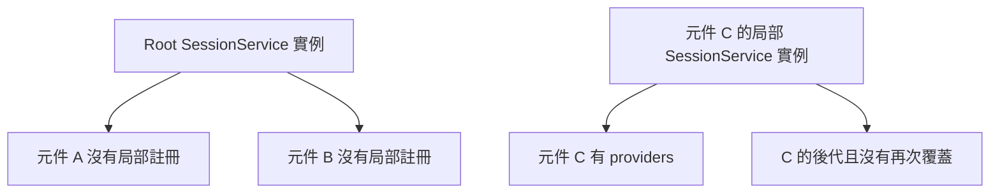

## 前言

兩個元件都寫了差不多的程式碼，通常會想把它抽成 service。不過抽出來之後，兩個元件就會共用同一份資料嗎？

這邊要先分開兩件事: **共用程式碼**，和**共享狀態**。

程式碼可以寫在同一個 service class 裡，但實際上拿到幾個物件，要看 service 註冊在哪裡。`extends` 也能共用實作，不過各個子類別物件仍有自己的欄位。

接下來先用 service 說明 scope，再看看有重複程式碼時，除了 service 還有哪些做法。

> 注意: 本篇以 standalone Angular 為例，文件於 2026-10-13 查核。Provider 與 inject 的先備知識，可以先看 [Angular providers 筆記](./angular-providers-value-accessor-date-formats.html)。

## 1. 全域與 scope：註冊位置決定共享範圍

先認識兩個名詞: `EnvironmentInjector` 和 `ElementInjector`。Standalone 應用主要透過這兩條階層查找依賴。

一般會先從所在元素往祖先元素找，找不到再往對應的 environment 階層找。**先找到哪個可用的 provider，就用那一份。** 詳細規則可參考 [Hierarchical injectors](https://angular.dev/guide/di/hierarchical-dependency-injection)。

以下整理常見的註冊位置:

| 註冊位置 | 範圍與典型用途 |
| --- | --- |
| `providedIn: 'root'` | 應用 root 中共享的服務，可配合 tree shaking |
| `ApplicationConfig.providers` | 應用層的設定、框架功能與預設實作 |
| `Route.providers` | 該路由及其子路由的 environment scope |
| `Component.providers` | 每個元件實例自己的 element scope，供自己及可見的後代使用 |
| `Component.viewProviders` | 元件及其 view；投影內容不能直接取得這些註冊 |

Root 共享只限該應用的 injector，不是整個瀏覽器或所有 SSR 請求共用的永久 singleton。NgModule 專案還有 ModuleInjector：eager module 的 providers 通常合併至應用層，lazy module 可有自己的子 injector。

### 元件 provider 會建立局部服務

```typescript
import { Component, Injectable, inject, signal } from '@angular/core';

@Injectable({ providedIn: 'root' })
export class DraftStore {
  readonly text = signal('');
}

@Component({
  selector: 'app-editor',
  standalone: true,
  providers: [DraftStore],
  template: `<p>{{ store.text() }}</p>`,
})
export class EditorComponent {
  readonly store = inject(DraftStore);
}
```

上面特別在元件寫了 `providers: [DraftStore]`。如果畫面放兩個 `app-editor`，就會有兩份 DraftStore，草稿互不影響；各自可見的子元件則可以取得自己編輯器的那一份。

即使 service 原本有 `providedIn: 'root'`，這邊仍會優先使用局部註冊。拿來存草稿很方便，但如果拿來存登入狀態，就要小心不小心變成兩份資料了。

### 路由 scope 適合整個功能區

```typescript
import { Routes } from '@angular/router';
import { DraftStore } from './draft.store';

export const routes: Routes = [{
  path: 'editor',
  providers: [DraftStore],
  loadComponent: () => import('./editor-page.component')
    .then(m => m.EditorPageComponent),
}];
```

若頁面再次寫 `providers: [DraftStore]`，就會遮蔽路由的實例。Route scope 的建立與重用也不能直接等同「每次進頁面都重建」；需要每次建立元件就重置的狀態，宜使用元件 scope 或明確 reset。Route providers 的契約見 [Route API](https://angular.dev/api/router/Route)。

### Root service 不會因呼叫者在子 scope 就改用子設定

這邊有個容易踩到的地方。假設 `DeviceApi` 是 root service，裡面會注入 `API_BASE_URL`。

你在報表元件提供另一個 URL，再注入 `DeviceApi`，會拿到新的 URL 嗎？這個 root service 還是從建立它的 root injector 取得設定，所以不會因為使用它的元件改了設定，就跟著換 URL。

若報表需要另一個 API endpoint，應在局部同時提供 `DeviceApi` 與 `API_BASE_URL`，或讓方法明確接受 endpoint。Material 的 root `DateAdapter` 也不會自動採用局部 locale，原因相同。

### 調整查找方式

| 注入選項 | 意義 |
| --- | --- |
| `inject(Token, { self: true })` | 只查目前 injector |
| `inject(Token, { skipSelf: true })` | 跳過目前 injector，從父層開始 |
| `inject(Token, { optional: true })` | 找不到時回傳 null |
| `inject(Token, { host: true })` | 在元素階層限制查找到 host 邊界 |

這些選項改變查找，不會移動 provider。`providers` 與 `viewProviders` 的差異在 `ng-content` 投影時尤其重要；不能只依畫面 DOM 巢狀關係推論依賴可見性。

## 2. 以 service 註冊決定誰共享狀態

假設兩個頁面都要顯示目前登入者，可以提供一份 root service：

```typescript
// session.service.ts
import { Injectable, signal } from '@angular/core';

@Injectable({ providedIn: 'root' })
export class SessionService {
  private readonly userState = signal<string | null>(null);
  readonly user = this.userState.asReadonly();

  signIn(name: string): void {
    this.userState.set(name);
  }

  signOut(): void {
    this.userState.set(null);
  }
}
```

接下來，各元件用 `readonly session = inject(SessionService)` 取得服務。

只要都找到 root 的 provider，就會拿到同一個物件。A 呼叫 `signIn('Kiwi')`，B 讀取 `session.user()` 也會得到 `'Kiwi'`。這邊 DI 負責讓大家取得同一份實例，Signal 則負責狀態通知。

若 B 額外寫 `providers: [SessionService]`，就會取得另一個實例，其初始 user 仍是 `null`。共享的是同一份 class 程式碼，但不是同一份狀態。



圖中的箭頭表示取得哪個實例，不是 DOM 或完整 injector 樹。Root 與局部實例不會自動同步。

若服務只應局部使用，可寫 `@Injectable()` 而不指定 `providedIn`，再由元件或路由明確提供。只有 decorator 而沒有可見的 provider，`inject()` 仍無法取得它。

也可以在 `ApplicationConfig.providers` 註冊服務，或透過 `{ provide: SessionService, useClass: DemoSessionService }` 替換應用層實作。通常 class 已有 `providedIn: 'root'` 就不必為了使用它再註冊一次。

## 3. 重複程式碼：先分清楚重複的是什麼

看到兩個頁面寫了一樣的東西，先別急著全部塞進 service。可以先看重複的是哪一種內容:

- 只是計算或資料轉換？
- 需要呼叫 API，或保存大家共用的狀態？
- 還是連模板和 DOM 行為都一樣？

以下列出幾種常見做法:

| 共用方式 | 適合的重複內容 | 狀態／實例關係 |
| --- | --- | --- |
| 純函式 | 格式化、計算、資料轉換 | 通常無內部狀態，輸入決定輸出 |
| Service 組合 | API、業務規則、跨元件狀態 | 由註冊 scope 決定共享實例 |
| 一般 class 組合 | 可重用演算法、每個使用者自己的物件 | 用 new 建立，各有實例 |
| `extends` | 子類別共同的實作與固定流程 | 子類別物件各有自己的欄位 |
| 共用 Component | 重複 UI 區塊 | 每個元件實例各有狀態，透過 inputs／outputs 互動 |
| Directive／hostDirectives | 重複的元素行為 | 行為附加至各個 host 元素 |
| Pipe | 模板中的資料轉換 | 適合純轉換，不宜拿來管理共享業務狀態 |

這些做法可以一起用。例如把商品卡片抽成 component，裡面注入 service，而 service 再呼叫共用函式。不需要整個專案只選一種方式。

### 純函式：單純計算不必經過 DI

```typescript
// price.ts
export function calculateTotal(price: number, quantity: number): number {
  return price * quantity;
}

// 各頁面 import 後呼叫
// calculateTotal(100, 3) === 300
```

若只是同一個計算式，函式容易單獨驗證，也不需要註冊 provider。呼叫共用函式不代表兩個頁面共享任何可變狀態。

### Service：共用 API 存取，頁面組合需要的能力

```typescript
// product-api.service.ts
import { Injectable, inject } from '@angular/core';
import { HttpClient } from '@angular/common/http';

export interface Product {
  id: string;
  name: string;
}

@Injectable({ providedIn: 'root' })
export class ProductApi {
  private readonly http = inject(HttpClient);

  getProduct(id: string) {
    return this.http.get<Product>(`/api/products/${encodeURIComponent(id)}`);
  }
}
```

先在應用層提供 `provideHttpClient()`，商品頁和訂單頁就能注入 `ProductApi`，呼叫 `getProduct(id)`。

這樣 URL 和請求邏輯只要維護一份。這種做法稱為組合 (composition): 頁面使用 API 服務，不需要繼承 API 服務。

此服務沒有保存商品資料；共享服務實例不代表 HTTP 結果會自動快取。各自訂閱 HttpClient Observable 仍可能各自發出請求，資料快取必須另外設計。

### 一般 class 組合：共用實作，各有自己的狀態

```typescript
class SelectionModel {
  readonly selected = new Set<string>();

  toggle(id: string): void {
    if (this.selected.has(id)) this.selected.delete(id);
    else this.selected.add(id);
  }
}

const productSelection = new SelectionModel();
const orderSelection = new SelectionModel();
productSelection.toggle('p1');
console.log(orderSelection.selected.size); // 0
```

這種小型物件不依賴 Angular，可由各元件各自建立。若希望子元件也取得同一份模型，則可改成局部 service，交給元件 scope 管理。

## 4. extends：共用流程，並不共享父類別實例

若數個頁面都有固定的「開始載入 → 執行工作 → finally 結束載入」流程，可以把流程放在基底 class：

```typescript
import { signal } from '@angular/core';

export abstract class LoadingPage {
  readonly loading = signal(false);

  protected async runLoading<T>(task: () => Promise<T>): Promise<T> {
    this.loading.set(true);
    try {
      return await task();
    } finally {
      this.loading.set(false);
    }
  }
}
```

```typescript
import { Component, inject } from '@angular/core';
import { firstValueFrom } from 'rxjs';
import { LoadingPage } from './loading-page';
import { ProductApi } from './product-api.service';

@Component({
  selector: 'app-product-page',
  standalone: true,
  template: `<button [disabled]="loading()" (click)="reload()">重新載入</button>`,
})
export class ProductPageComponent extends LoadingPage {
  private readonly api = inject(ProductApi);

  async reload(): Promise<void> {
    await this.runLoading(async () => {
      const product = await firstValueFrom(this.api.getProduct('p1'));
      console.log(product);
    });
  }
}
```

其他頁面也能 `extends LoadingPage`，就不用再寫一次 try／finally。

不過這邊共用的是流程，各個頁面還是有自己的 `loading` Signal。A 正在載入，不會讓 B 自動變成 loading。

> 小補充: 這個範例假設同一頁面只有一個載入工作。如果允許多個工作同時執行，就要用計數等方式管理 loading，不能只用一個 boolean。

此基底只提供普通 TypeScript 欄位與方法，因此不需要 Angular decorator。若基底需要 inputs、outputs、host bindings 等 Angular metadata，應以適當的 `@Directive()`／`@Component()` 宣告。

### Angular 繼承要留意的地方

- 基底欄位中的 `inject()` 可在 Angular 建立子類別時使用；constructor 注入若由基底接收，子類別需透過 `super(...)` 傳入。
- 子類別覆寫 `ngOnInit()` 時，不會自動執行父類別同名方法；需要父層行為時，要明確呼叫 `super.ngOnInit()`。
- 不要把 provider scope 寄託在繼承上；應在需要的應用、路由或元件明確註冊。也不要假設所有 decorator 設定都與 inputs 一樣繼承。
- TypeScript class 只能直接繼承一個基底 class。若 API、權限、選取狀態都塞進父類別，子類別容易被迫依賴不需要的功能。

Angular 的 metadata 與依賴繼承規則見 [Inheritance 官方指南](https://angular.dev/guide/components/inheritance)。

若只是希望很多元件都有 loading 能力，也可以抽成局部 `LoadingService`，各頁面在 `providers` 註冊並注入。這樣可以組合多種能力，不占用唯一的基底 class；實例是否共享仍由 scope 決定。

## 5. 共用元件與指令：重複的是畫面或元素行為

若數頁都有相同的商品卡片，抽成 `ProductCardComponent`，以 input 傳商品、output 回報操作，比只抽 service 更能消除模板重複。

若多個按鈕都有相同的 focus、鍵盤或 host 屬性行為，可抽成 directive。下例把固定的 title 行為組合到元件：

```typescript
import { Component, Directive } from '@angular/core';

@Directive({
  standalone: true,
  host: { title: '開啟商品明細' },
})
export class ProductHintDirective {}

@Component({
  selector: 'app-product-link',
  standalone: true,
  hostDirectives: [ProductHintDirective],
  template: `<ng-content />`,
})
export class ProductLinkComponent {}
```

其他元件可以組合相同 directive，不必繼承一個 UI 基底 class。`hostDirectives` 在編譯時決定；若 directive 有 inputs／outputs，需要明確設定是否向外公開。參考 [Directive composition API](https://angular.dev/guide/directives/directive-composition-api)。

## 6. 實際選擇：共用邏輯與狀態範圍分開決定

| 需求 | 建議方式 |
| --- | --- |
| 各頁都要同一個總價公式 | 純函式 |
| 各頁都呼叫商品 API | Service 組合 |
| 全站共享登入狀態 | Root service |
| 同一編輯頁的工具列與預覽共用草稿 | 頁面提供局部 service，子元件注入 |
| 兩個編輯器使用相同草稿邏輯，但內容互不影響 | 每個編輯器各自提供同一個 service class |
| 多個相關頁面有穩定且相同的執行流程 | 可考慮 extends，或組合局部 service |
| 重複卡片模板 | 共用 Component |
| 重複 DOM／host 行為 | Directive 或 hostDirectives |

實際開發時，可以先對照上表，看重複的是邏輯、狀態，還是畫面，再決定放哪裡。

如果遇到「明明用了同一個 service，資料卻不同步」，可以先回頭看 providers，確認是不是建立了不同實例。反過來，如果改 A 的草稿連 B 都變了，就要看看是不是把獨立狀態放到 root 了。😆
