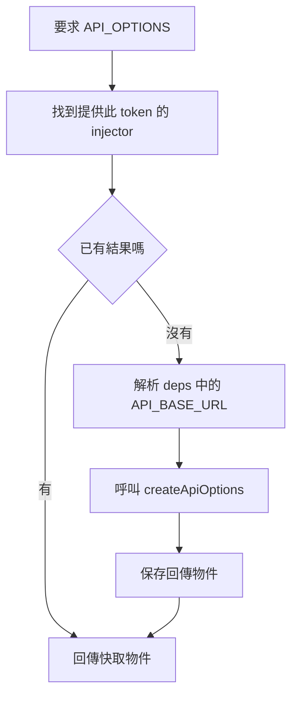
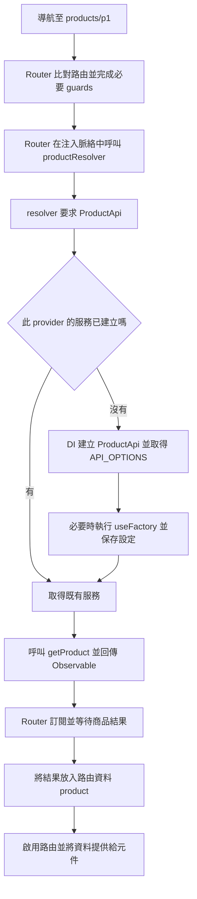

## 前言

看到 `useFactory` 和 resolver，會發現它們好像都是一個函式，裡面都能用 `inject()`，最後又都回傳某個值。那它們到底差在哪裡？

這篇用商品頁的例子，把設定、service 和路由資料串起來看。先認識名詞，再看看兩個函式各自在什麼時候被呼叫。

**Provider 負責告訴 DI 怎麼取得依賴，useFactory 是其中一種做法；resolver 則幫 Router 準備進頁面需要的資料。**

> 注意: 這裡的 resolver 指 Angular Router 的 data resolver，範例使用 standalone 與 `ResolveFn`。文件於 2026-10-13 查核。

先備知識: [providers 與 inject](./angular-providers-value-accessor-date-formats.html)、[service scope](./angular-service-scope-code-reuse.html)。

## 1. 這些詞的關係

| 名稱 | 職責 | 本文例子 |
| --- | --- | --- |
| Token | 識別要取得的依賴 | `API_OPTIONS`、`ProductApi` |
| Provider | 宣告如何取得該依賴 | `{ provide: API_OPTIONS, useFactory: ... }` |
| useFactory | Provider 的一種建立規則 | 計算 API 選項的函式 |
| Injector | 查找 provider、解析依賴並保存結果 | 應用或路由的 injector |
| inject | 在注入脈絡中要求某個 token | `inject(ProductApi)` |
| Service | 封裝 API、業務邏輯或狀態的物件 | `ProductApi.getProduct(id)` |
| Resolver | Router 在啟用路由前執行的資料準備邏輯 | 取得路由 id 對應的商品 |

上表先看用途就好，不用急著背名詞。

這邊容易混淆的是 resolve 這個字: DI 的 dependency resolution 是根據 token 找依賴；Router 的 resolver 則根據路由設定取得資料。雖然都叫「解析」，負責的事情不同。

## 2. useFactory：提供取得依賴的函式

先準備 API 設定和對應的 token:

```typescript
// api-options.ts
import { InjectionToken } from '@angular/core';

export interface ApiOptions {
  baseUrl: string;
  timeoutMs: number;
}

export const API_BASE_URL = new InjectionToken<string>('API_BASE_URL');
export const API_OPTIONS = new InjectionToken<ApiOptions>('API_OPTIONS');

export function createApiOptions(baseUrl: string): ApiOptions {
  return { baseUrl, timeoutMs: 5000 };
}
```

應用層註冊如下，`routes` 會在後面定義：

```typescript
// app.config.ts
import { ApplicationConfig } from '@angular/core';
import { provideHttpClient } from '@angular/common/http';
import { provideRouter, withComponentInputBinding } from '@angular/router';
import { API_BASE_URL, API_OPTIONS, createApiOptions } from './api-options';
import { routes } from './app.routes';

export const appConfig: ApplicationConfig = {
  providers: [
    provideHttpClient(),
    provideRouter(routes, withComponentInputBinding()),
    { provide: API_BASE_URL, useValue: '/api' },
    {
      provide: API_OPTIONS,
      useFactory: createApiOptions,
      deps: [API_BASE_URL],
    },
  ],
};
```

上面這段設定可以這樣讀:

> 有人要 `API_OPTIONS` 時，先幫他取得 `API_BASE_URL`，再丟進 `createApiOptions()`，把做好的物件交給他。

注意這邊寫的是 `createApiOptions`，沒有加 `()`，所以是在交出函式，不是當場執行。

`deps` 就是這個函式要用的依賴清單。Angular 會依陣列順序找出值，再放進函式參數。

同樣的規則也能寫成在工廠內注入：

```typescript
// 替代寫法，需從 @angular/core 匯入 inject
{
  provide: API_OPTIONS,
  useFactory: () => createApiOptions(inject(API_BASE_URL)),
}
```

### 第一次取值與後續取值

第一次有人要這個依賴時，才需要執行 factory。做好之後，injector 會把結果存起來，後面再來拿就用同一份。如下圖:



因此改動依賴，不會讓 factory 自動重算；它也不是每次路由切換就重新執行。若想持續更新設定，要提供可更新的服務或 Signal。若局部重新註冊 factory，才會有局部自己的解析結果。Provider 語法見 [Angular provider 指南](https://angular.dev/guide/di/defining-dependency-providers)。

## 3. Service 使用 factory 提供的設定

```typescript
// product-api.service.ts
import { Injectable, inject } from '@angular/core';
import { HttpClient } from '@angular/common/http';
import { API_OPTIONS } from './api-options';

export interface Product {
  id: string;
  name: string;
}

@Injectable({ providedIn: 'root' })
export class ProductApi {
  private readonly http = inject(HttpClient);
  private readonly options = inject(API_OPTIONS);

  getProduct(id: string) {
    return this.http.get<Product>(
      `${this.options.baseUrl}/products/${encodeURIComponent(id)}`,
      { timeout: this.options.timeoutMs },
    );
  }
}
```

`ProductApi` 第一次建立時，會要求 `API_OPTIONS`，必要時觸發其 factory。建立服務本身沒有發送商品請求；呼叫 `getProduct()` 並訂閱回傳的 Observable，才會執行 HTTP 工作。本例以目前 HttpClient 的 `timeout` 選項限制請求時間，參考 [HTTP requests 指南](https://angular.dev/guide/http/making-requests)。

商品頁、resolver 或其他 service 都可以使用這個 `ProductApi`。

這邊分工很單純: ProductApi 知道**怎麼取得商品**，接下來的 resolver 則決定**這次進頁面要哪一筆商品**。

## 4. Resolver：路由啟用前取得商品

```typescript
// product.resolver.ts
import { inject } from '@angular/core';
import { ResolveFn } from '@angular/router';
import { Product, ProductApi } from './product-api.service';

export const productResolver: ResolveFn<Product> = (route) => {
  const api = inject(ProductApi);
  const id = route.paramMap.get('id');
  if (id === null) throw new Error('商品路由缺少 id');
  return api.getProduct(id);
};
```

Resolver 接收路由 snapshot 與 router state snapshot，本例只使用第一個參數。它可以回傳同步資料、Promise、Observable，或用 `RedirectCommand` 指示轉向；Router 負責處理結果並等待必要資料。契約見 [ResolveFn API](https://angular.dev/api/router/ResolveFn)。

> 注意: 這邊直接 return Observable 就好，不用自己 subscribe。把資料來源交回 Router，它才能處理訂閱、等待和取消導航。

```typescript
// app.routes.ts
import { Routes } from '@angular/router';
import { ProductPageComponent } from './product-page.component';
import { productResolver } from './product.resolver';

export const routes: Routes = [{
  path: 'products/:id',
  component: ProductPageComponent,
  resolve: { product: productResolver },
}];
```

`resolve.product` 的 `product` 是路由資料的 key，不是 DI token。前面的 `withComponentInputBinding()` 會將符合名稱的路由資料傳給元件 input：

```typescript
// product-page.component.ts
import { Component, input } from '@angular/core';
import { Product } from './product-api.service';

@Component({
  selector: 'app-product-page',
  standalone: true,
  template: `<h1>{{ product().name }}</h1>`,
})
export class ProductPageComponent {
  readonly product = input.required<Product>();
}
```

Router resolver 的設定與資料讀取可參考 [data resolvers 指南](https://angular.dev/guide/routing/data-resolvers)。另一種方式是注入 `ActivatedRoute`，透過 `route.data` 觀察資料。若路由可能重用元件，僅在初始化讀一次 `snapshot.data` 不能自動追蹤後續資料變化。

## 5. 串起來：Router 使用 DI 提供的服務

前面的設定看完了，接下來用一張圖看看它們怎麼一起運作。這邊先看成功進入商品頁的流程，省略 lazy loading、重用和錯誤分支:



看上圖可能會以為 factory 一定是在 resolver 裡才執行。其實要看誰先用到這個服務。

如果其他地方早就拿過 ProductApi，設定可能已經做好了；如果第一次使用它的是 resolver，才會在這次取服務的過程中執行 factory。

Resolver 函式是 Router 在合法注入脈絡中呼叫的，因此可以同步 `inject(ProductApi)`。若 resolver 使用 `async`，要在 `await` 前取得依賴，或明確建立新的注入脈絡；非同步回傳型別不表示 context 會跨越 `await`。參考 [injection context](https://angular.dev/guide/di/dependency-injection-context)。

## 6. Provider 與 resolver 差異

| 比較項目 | Provider／useFactory | Router resolver |
| --- | --- | --- |
| 所屬機制 | DI | Router |
| 設定位置 | providers 或 token 的 factory 設定 | Route 的 resolve |
| 誰呼叫 | Injector 解析依賴時 | Router 執行資料解析階段時 |
| 用什麼識別結果 | DI token | 路由資料 key |
| 典型目的 | 提供設定、服務或可重用能力 | 準備此次導航需要的資料 |
| 回傳結果保存在哪 | 負責此 provider 的 injector | 對應路由的 data |
| 是否自動等待 Promise／Observable | 普通 useFactory 不會自動等待或解包 | Router 會處理非同步資料來源 |
| 是否重跑 | 同一 provider 一般使用快取結果 | 依導航情況與 rerun policy 決定 |
| 失敗影響 | 要求依賴的程式無法取得值 | 導航可能失敗、取消或轉向 |

### useFactory 可以 async 嗎？

可以，但這邊要注意: **回傳 Promise，注入拿到的也就是 Promise。**

例如 token 可以是 `InjectionToken<Promise<Config>>`，再由使用者自己 await。回傳 Observable 也一樣，DI 不會幫你 subscribe。

因此把 HTTP 放進普通 factory，並不會讓 Angular 自動「等資料回來再啟動頁面」。若需求是應用啟動前載入必要設定，可使用 [provideAppInitializer](https://angular.dev/api/core/provideAppInitializer)；若需求是路由啟用前取得該頁必要資料，用 resolver 更貼近需求。

### Resolver 每次進頁面都會重跑嗎？

不能一概而論。路由未變但參數或 query 改變時，是否重跑受 `runGuardsAndResolvers` 控制；預設 `paramsChange` 不包含 query parameter 的變更。需要涵蓋 query 的頁面可選 `paramsOrQueryParamsChange`，也能設定 `always` 或自訂判斷。詳見 [RunGuardsAndResolvers API](https://angular.dev/api/router/RunGuardsAndResolvers)。

另外，resolver 不會自動幫商品資料做快取。再次執行時，如果 API 沒有快取，還是會重新請求。想共用資料，就要另外在 service 或資料層設計快取。

## 7. Scope 與錯誤處理要注意什麼？

Resolver 可以取得路由層可見的服務，但頁面元件自己的 `providers` 不是 resolver 的注入來源；不要等頁面建立後才提供 resolver 所需依賴。

若在 route 覆蓋 `API_OPTIONS`，但 resolver 取得的是 root `ProductApi`，該 root service 仍從 root 解析自己的設定。需要功能區獨立設定時，應在同一 route scope 同時提供設定和 `ProductApi`。完整 scope 例子見 [service scope 筆記](./angular-service-scope-code-reuse.html)。

Resolver 很方便，但請求沒回來之前，路由會先等著。

所以這邊適合放「進頁面一定要有」的資料。像很慢的推薦清單，就可以進頁面後再載入，另外顯示 loading。使用者還是有等待，只是等待的位置不同。

Resolver 的請求失敗時，可以在 resolver 內處理，或使用 `withNavigationErrorHandler()` 集中處理。回傳 `RedirectCommand` 是轉向；回傳替代資料是讓頁面用替代值；回傳 `EMPTY` 則沒有資料值，不能把它當成成功取得空物件。Observable resolver 要能及時發出需要的值，否則導航會持續等待。這些行為可參考 [Resolver 錯誤處理](https://angular.dev/guide/routing/data-resolvers)。

## 8. 常見混淆

- `providers: [productResolver]` 不等於註冊路由資料解析。Functional resolver 應放在 `resolve: { product: productResolver }`。
- 舊式 class resolver 本身可以是 DI 提供的服務，但「建立 resolver 物件」與「Router 執行它的 resolve 方法」仍是不同步驟。
- 在 `Route.providers` 註冊 service，只代表該功能區可取得它，不代表 Router 會預先載入資料。
- 不需要因為 resolver 會使用服務，就把普通 factory 寫成路由專用邏輯；當前 route 的參數應由 resolver 的 snapshot 取得。
- Resolver 不會持續訂閱商品更新來當頁面即時資料流；需要刷新或即時資料時，另外設計頁面的資料更新機制。

實際要用哪個，可以回到需求看: 想提供設定或服務，就從 provider 開始；想在進路由前先拿資料，就用 resolver。

前面的商品頁同時用了兩者: factory 準備設定，resolver 使用服務取得商品。不需要二選一，可以一起用。
