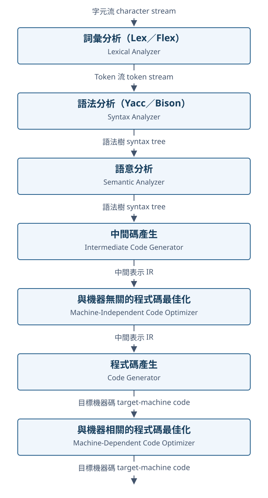

---
title: 淺談編譯器最佳化：一起理解程式為什麼能被改寫
date: "2026-10-14"
description: 從編譯流程與 IR 出發，逐步理解常數折疊、SSA、指標別名、未定義行為與成本模型，再連到 JIT、AI 編譯器與實際效能量測。
tags: [Compiler, C, LLVM, CS]
---

## 前言

寫程式時，我們很容易把原始碼想成電腦即將照做的步驟：寫了一個迴圈，電腦就跑那個迴圈；呼叫一個函式，執行時就真的會跳進那個函式。

但開啟最佳化之後，事情常常和想像不同。函式呼叫可能消失，一萬次迴圈可能只剩下一個 `return`，甚至連我們特地寫下的檢查都可能不見。

這篇根據 Jim Huang（黃敬群）於 2026 年 10 月 2 日的《淺談編譯器最佳化》簡報整理，以學習筆記的方式，帶著大家一步步理解這些變化。程式片段有些沿用簡報，有些為了說明而簡化；它們用來解釋原理，不代表每個編譯器都會產生相同輸出。簡報裡與版本、機器相關的測試數字，也不直接當成普遍結論。

我們先記住兩個問題，後面遇到每一種最佳化，都可以拿出來想一遍：**這樣改寫，還會得到語言規則要求的行為嗎？這樣改寫，在目標機器上值得嗎？**

## 1. 程式進入編譯器之後，會經過什麼？

先看簡報第二頁的流程圖。下面保留原圖的七個階段，將標籤改成中文，方便對照後面的內容。



圖依簡報第 2 頁重繪；原圖出自《Compilers: Principles, Techniques, and Tools》第二版。這是概念流程，實際編譯器可能交錯執行部分階段，也可能使用多層 IR。

假設我們寫下：

```c
int result = a + 3 * 2;
```

詞彙分析先將文字切成 token，例如 `int`、`result`、`=`、`a` 與數字。語法分析再整理它們的結構，知道 `3 * 2` 是乘法，整個結果才和 `a` 相加。語意分析則檢查 `a` 是否宣告、型別是否相容等問題。

### Lex／Yacc 在哪個階段？

如果學過 Lex／Yacc，現在就可以把它們放回流程圖的前兩個階段。它們都是用來**產生分析器的工具**，產生出來的分析器才會在編譯程式時處理原始碼。

| 工具 | 對應階段 | 我們提供什麼 | 產生的分析器做什麼 |
| --- | --- | --- | --- |
| Lex（或 Flex） | 詞彙分析 | 以正規表示式等方式描述 token 的規則與動作 | 將字元流辨識成識別字、數字、關鍵字與運算子等 token |
| Yacc（或 GNU Bison） | 語法分析 | 文法規則、優先順序與需要執行的動作 | 依文法解析 token，檢查語法結構，並執行我們附上的動作 |

例如讀到 `a + 3 * 2`，Lex 產生的 scanner 可以依序回傳：

```text
IDENTIFIER(a), '+', NUMBER(3), '*', NUMBER(2)
```

Yacc 產生的 parser 再依我們寫的文法與優先順序，將這些 token 整理成「先乘法，再加法」的結構。如果我們在文法規則裡加入建立 AST 的動作，就能得到：

```text
Add(Identifier(a), Multiply(Number(3), Number(2)))
```

這裡的 AST 是我們透過動作程式建立的，Yacc 不會只根據文法就自動替我們決定 AST 的設計。在典型的 C 介面中，parser 的入口是 `yyparse()`，它會呼叫 scanner 的 `yylex()` 取得下一個 token，因此圖中的 token 流不一定會先完整存成一份清單。這個分工可參考 [Flex 官方介紹](https://westes.github.io/flex/manual/Introduction.html)與 [Bison 的詞彙分析介面](https://www.gnu.org/s/bison/manual/html_node/Lexical.html)。

那語意分析呢？Yacc 文法裡可以附上 **semantic actions（語意動作）**，用來建立 AST、更新符號表，或呼叫語意檢查與 IR 產生的程式。但「有語意動作」不表示 Yacc 會自動知道變數是否宣告、型別是否相容。這些規則仍要由我們實作，也常在 AST 建立後另做一趟分析。參考 [Bison 的語意動作說明](https://www.gnu.org/software/bison/manual/html_node/Semantic-Actions.html)。

所以，沿著這張圖看，**Lex／Yacc 主要協助建構編譯器前端的詞彙與語法分析部分**；後面的 IR 最佳化、暫存器配置與指令排程，還需要其他分析與轉換。編譯器也可以手寫 lexer／parser，或使用其他產生器，不一定要採用 Lex／Yacc。

接著，編譯器產生中間表示，也就是 IR（Intermediate Representation）。它可能把運算拆成類似這樣的形式：

```text
t1 = 3 * 2
t2 = a + t1
result = t2
```

這時，編譯器已經能用一致的方式分析運算，不必一直處理原始語法的細節。中端負責許多與特定機器無關的分析與改寫，後端再將結果對應到目標架構的指令，處理暫存器配置與指令排程等問題。

因此，能看懂一段程式，只是開始。接下來還要知道它能如何改寫，以及改寫後在真實硬體上會發生什麼。

## 2. 最容易理解的起點：提早算出已知的結果

我們先從一個小例子開始：

```c
int f(int x) {
    int a = 10;
    int b = a + 20;
    return x + b;
}
```

讀到這裡，我們已經知道 `a` 是 10，`b` 是 30。編譯器也可以沿著資料的使用關係，將已知數值帶到後面的運算。

這裡有兩個相關概念：

- **常數傳播（constant propagation）**：知道 `a` 是 10，便把這項資訊傳到使用 `a` 的地方。
- **常數折疊（constant folding）**：將 `10 + 20` 直接算成 30。

最後，函式可以簡化成 `return x + 30;`。這個例子討論的是所有運算都有定義時的行為，例如不發生有號整數溢位。

還有一個容易混淆的地方：看到 IR 裡直接出現常數，不一定代表最佳化器做過常數傳播。簡報第 5 頁特別提醒，前端在產生 IR 時，就可能直接把常值放進運算元。**我們要分清楚「怎麼表示程式」和「後來做了什麼分析」。**

常數的資訊也能影響指令選擇。例如，特定寬度的無號整數除以 3，可以用經過推導的乘法與位移組合完成。這種轉換仍必須保證整數結果正確，不能直接把它理解成隨意乘上一個浮點近似值。有號數、無號數與不同位元寬度，需要分別處理。

## 3. 函式與迴圈：一次改寫，打開下一次機會

再看一個無號整數的例子：

```c
unsigned scale(unsigned x, unsigned k) {
    return k ? x / k : 0;
}

unsigned g(unsigned x) {
    return scale(x, 8);
}
```

只看 `scale()`，編譯器不知道 `k` 是多少，必須處理一般的除法和 `k == 0` 的情況。

但如果將函式本體展開到 `g()`，也就是做 inlining，就能看見 `k` 固定為 8。接著，條件分支可以消失，無號整數除以 8 又可以改成右移 3 位元。

我們可以在這裡停一下：inlining 的收益，除了減少呼叫成本，也包含**讓更多資訊出現在同一個分析範圍裡**。

迴圈也有類似機會：

```c
void fill(unsigned *a, unsigned n, unsigned k) {
    for (unsigned i = 0; i < n; ++i)
        a[i] = i * k;
}
```

假設 `a` 指向足夠大的有效陣列，`i * k` 可以用每輪累加 `k` 的方式表示。對這裡的無號型別，累加與乘法都依相同的模數規則運作。這類將運算換成較適合目標機器形式的轉換，稱為強度折減（strength reduction）。

另一種做法是迴圈展開：一輪處理多筆資料，減少比較與分支的次數，也讓指令排程看見更多獨立運算。不過，展開會增加程式碼大小，是否划算還要交給成本模型判斷。

簡報還展示了更進一步的情況：將等差和、平方和的迴圈轉成封閉公式。這提醒我們，原始碼裡的迴圈不一定會留到最後。但從數學公式走到有限寬度的整數運算，仍要處理輸入範圍、溢位與中間結果，不能直接把任何迴圈換成公式。

## 4. 編譯器靠什麼證明？先認識 CFG 與 SSA

前面一直提到「知道」「推導」「證明」。編譯器究竟把這些資訊放在哪裡？

先認識基本區塊（basic block）。我們可以先把它想成一段從入口開始、依序執行，直到結尾才可能轉移控制的指令。將基本區塊依可能的跳轉關係連起來，就得到控制流程圖 CFG（Control Flow Graph）。

有了 CFG，編譯器便能分析哪些區塊根本無法從入口抵達。移除不可達區塊之後，後續分析也會比較單純。

另一個重要概念是支配關係（dominance）：如果從入口走到區塊 B 的每條路徑，都必須先經過 A，我們就說 A 支配 B。這能協助編譯器判斷某個定義是否一定先發生，也為程式碼移動提供結構上的依據。

接著是 SSA（Static Single Assignment，靜態單一賦值形式）：每個名稱只對應一個定義。看下面的分支：

```c
if (cond)
    x = 10;
else
    x = 20;
return x + 1;
```

用 SSA 的概念表示，可以寫成：

```text
then: x1 = 10
else: x2 = 20
join: x3 = phi(x1, x2)
      return x3 + 1
```

`phi` 會依執行時來自哪個前任區塊，選擇對應的值。它是 IR 裡表達合流的方式，不代表硬體真的有一條 `phi` 指令。

SSA 讓「這個值來自哪裡、被誰使用」變得清楚。配合資料流分析和值域推導，編譯器可以一路縮小結果的可能範圍。

簡報的綜合例子就利用這種連鎖效果：先算出常數 143 與 61226，再知道 `i` 的範圍是 0 到 9999，因此 `i + 143` 介於 143 和 10142。這個範圍內的正整數除以 61226，商一定是 0。後續若沒有其他可觀察效果，相關的累加與迴圈就可能整段消失。

原圖中曾出現 61126 的筆誤，簡報已註明正確值為 `11 × 5566 = 61226`。這裡採用更正後的數字。

## 5. 為什麼有些看似簡單的計算，編譯器卻不搬？

現在看一個很像可以最佳化的例子：

```c
void foo(int *a, int *b, int *y, int z) {
    while (*y < z) {
        int x = *a + *b;
        *y += x;
    }
}
```

我們可能會想：`a` 和 `b` 都沒有改變，為什麼不把 `*a + *b` 提到迴圈外？

先區分兩件事：**指標本身沒變，不表示指向的內容沒變。** 如果 `a`、`b`、`y` 指向同一個物件，更新 `*y` 就會同時改變後面讀到的 `*a` 和 `*b`。這就是指標別名（pointer aliasing）造成的影響。

因此，單靠這個函式的宣告，編譯器不能假設每一輪的加法結果相同。

C 的 `restrict` 能提供額外資訊。例如在合適的使用條件下，將參數宣告為 `int *restrict y`，可以承諾對相關被修改物件的存取遵守 `restrict` 的規則，讓編譯器排除這裡的別名疑慮。這個承諾涉及物件、存取方式與執行範圍，不能簡化成「所有指標位址永遠不同」。呼叫端若違反規則，就可能產生未定義行為。

嚴格別名規則（strict aliasing）則從型別提供資訊。例如在符合 C 規則的程式中，編譯器通常可以排除透過 `float *` 寫入、卻修改了一個以 `int` 存取的物件這種情況。但規則存在字元型別等例外，也不能推成「不同型別一律不重疊」。

回到我們最初的問題：最佳化器有時停下來，是因為目前掌握的資訊不足以證明改寫安全。

## 6. 語言規則，可能和我們腦中的硬體直覺不同

這是簡報裡最值得慢慢讀的部分。

```c
int inc_gt(int x) {
    return x + 1 > x;
}
```

我們若想著二補數硬體，可能會問：`x` 已經是最大值時，加一不是會繞回負數嗎？

但在 C 的一般語意下，有號整數溢位是未定義行為。對於這段運算有定義的輸入，`x + 1 > x` 成立，因此編譯器可以將函式化簡為回傳 1。

改成無號型別，情況就不同。無號運算有模數語意，最大值加一會成為 0，編譯器必須保留這個差異。

同樣的推理也會出現在指標檢查：

```c
int read_value(const int *p) {
    int value = *p;
    if (p == 0)
        return 0;
    return value;
}
```

我們是在取值之後才檢查空指標。對有效的非空指標執行，後面的檢查不會成立；空指標取值則已經進入未定義行為。編譯器因而可能移除檢查。正確的順序應該是先檢查，再使用。

另外，清除密碼的 `memset()` 也可能消失：如果寫入後再也沒有可觀察的讀取，最佳化器可能將它視為無用寫入。安全上希望清除殘留資料，需要使用執行環境所提供、明確保證不省略清除的介面，並理解它對暫存器與其他副本的保證範圍。

並行程式也遵守相同原則：一般共享變數不能取代正確同步，`volatile` 也不能當成執行緒同步工具。編譯器需要從 atomic、鎖與相應的記憶體模型，理解哪些順序必須保留。

到這裡，我們可以更具體地理解「保持行為」：它指的是語言與執行環境要求的可觀察行為。原始碼的長相，以及我們沒有透過適當介面表達的意圖，不一定都在保證範圍內。

## 7. 後端開始面對真實的機器

即使中端已把運算整理得很漂亮，後端還有很多工作。

首先是指令選擇。例如 `a * b + c` 在合適的整數語意與目標架構下，可能對應到乘加指令；乘以 9，則可能用位移加法完成。實際選擇取決於目標支援的指令與成本。

接著是暫存器配置。IR 可以有很多暫存名稱，硬體暫存器卻有限。若兩個值需要同時保留，就不能隨意共用同一個暫存器；放不下的值可能要暫時存回記憶體，也就是 spilling。

這也解釋了為什麼「做更多最佳化」不一定單調變快：迴圈展開雖然減少分支，卻可能同時增加暫存器壓力，最後多出記憶體存取。

指令排程則嘗試在相依限制內調整次序。例如某個載入還沒完成時，可以先安排另一段獨立運算，減少等待。但不能把有相依性的指令任意交換，也必須考慮目標處理器的執行資源。

因此，指令數量少是一項資訊，實際延遲、吞吐量與資料搬移成本仍要一起看。

## 8. 編譯器看得多遠，也影響它能做多少

我們通常把專案拆成很多檔案，方便維護與平行建置。不過，分離編譯也形成資訊邊界：編譯器正在處理一個編譯單元時，可能只看得到外部函式的宣告，看不到函式本體。

LTO（Link Time Optimization，連結時期最佳化）讓編譯工具鏈在連結階段取得更多跨檔案資訊，進一步做 inlining 或刪除無用程式碼。收益取決於專案，代價則可能包括額外的建置時間與記憶體使用量。

標準函式也帶有資訊。知道 `memcpy()` 或 `printf()` 的語意，編譯器就可能換成其他等價指令或呼叫。反方向也成立：清零迴圈可能被辨識成 `memset()`。

這對一般應用程式很方便，但在自行實作 libc 或 bare-metal 環境時，就必須明確告訴工具鏈環境假設。看起來沒有寫函式呼叫的原始碼，最後仍可能產生函式呼叫。

## 9. 合法之後，還要判斷值不值得

假設某個迴圈能安全向量化，也就是用 SIMD 指令同時處理多個元素，編譯器仍可能保留純量版本。原因可能是資料量太少、尾端處理太貴，或需要額外的別名檢查。

資料排列也會改變答案。對採逐列存放的二維陣列，連續存取通常比跨列跳著存取更容易利用 cache。迴圈交換與 tiling，就是在合法的相依條件下，調整資料重用的方式。

浮點運算還多一層限制：有限精度的加法不滿足數學上的結合律，`(a + b) + c` 不一定等於 `a + (b + c)`。因此，將加總拆成平行歸約，可能需要放寬數值語意。

像 `-ffast-math` 這類選項會改變編譯器可採用的假設，連 NaN 與無窮大的處理都可能受到影響。使用它之前，應先確認工作負載允許哪些數值差異。

PGO（Profile-Guided Optimization）則把實際執行資訊帶回編譯過程，協助判斷哪些路徑值得展開、哪些函式應該靠近。不過，profile 必須符合目標：低延遲交易系統可能特別在意很少執行、卻不能慢的路徑，只看平均熱門程度就未必足夠。

最佳化的目標也可以是縮小程式。韌體容量、下載量與指令 cache，都可能讓 `-Os` 或 `-Oz` 成為有意義的選擇。

## 10. JIT 與 Sea of Nodes：換一種方式保存相依性

前面主要沿著 CFG 與 SSA 理解程式。簡報也介紹 Sea of Nodes：以節點表示運算，以邊表達資料、控制與記憶體相依性。

這種表示法能讓部分純運算先保留相依關係，等排程時再決定放在哪裡。例如 `a * b` 不依賴迴圈索引，若其他合法性條件也成立，就可以安排在迴圈之前。

不過，圖的走訪成本、記憶體使用量與除錯難度，同樣影響工程選擇。不同 IR 讓某些分析更自然，也各有代價。

JIT 又能利用執行時期資訊：先以較低成本執行與收集回饋，再對熱點產生較積極的程式碼。若最佳化依賴推測，就要以 guard 檢查假設，並在失敗時保留正確的退路，例如 deoptimization。

以陣列邊界檢查為例，JIT 可以嘗試證明整段迴圈的索引都有效，避免每輪重做檢查。但入口條件、溢位、例外發生的語意，以及退回執行的方式，都必須一起處理。

## 11. 到了 AI 編譯器，同樣的問題變成 tensor

再看一段熟悉的模型運算：

```python
y = relu(x @ w + b)
```

我們看到的是矩陣乘法、加偏置與 ReLU。編譯器還要考慮中間結果放在哪裡、哪些運算可以融合，以及如何切成適合 GPU 執行的 tile。

如果每個步驟都將完整中間 tensor 寫回全域記憶體，再由下一個步驟讀回，就會增加搬移成本。融合可以減少部分中間資料的往返，但也可能增加暫存器需求，或影響原本高效的矩陣乘法實作，仍須量測。

小批次、稠密 LLM 的 decode 常能用這個角度理解：每產生一步結果，都需要讀取大量權重，資料重用卻有限。因此，效能可能受記憶體頻寬限制。Prefill 的工作形態不同，有機會更有效地重用資料，不能把兩者直接混為一談。

量化可以降低權重的儲存與讀取量，但必須搭配合適的 kernel，也要在模型層級驗證準確度。FlashAttention 則進一步提醒我們，演算法設計本身可以改變資料搬移方式；通用最佳化器未必會自動發現這種重構。

從純量到 tensor，問題仍然熟悉：先確認轉換符合要求，再依硬體資源與工作負載判斷是否值得。

簡報最後延伸到量化交易、Arm 與 SSE2NEON。這些案例也讓我們看到，效能來自語言、工具鏈、runtime 與硬體的合作。移植成功只是起點，還要看資料排列、指令對應與實際工作負載。比較效能數字時，也要保留精度、機器與量測方法等條件。

## 12. 下一次遇到效能問題，我們可以怎麼查？

理解原理之後，最實用的一步是讓工具告訴我們發生了什麼。

例如，先用 Clang 的最佳化報告查看向量化與 inlining：

```bash
clang -O2 -Rpass=loop-vectorize -Rpass-missed=loop-vectorize -c example.c
clang -O2 -Rpass=inline -Rpass-missed=inline -c example.c
```

也可以輸出 LLVM IR 與組合語言：

```bash
clang -O2 -S -emit-llvm example.c -o example.ll
clang -O2 -S example.c -o example.s
```

GCC 則能透過最佳化報告與 dump 觀察中間結果：

```bash
gcc -O2 -fopt-info-all -c example.c
gcc -O2 -fdump-tree-all -c example.c
```

這些是觀察入口，實際輸出會隨工具鏈與目標架構改變。測試時還要記錄編譯器版本、選項、輸入資料與量測條件，並先確保程式行為正確。

看見程式變慢，可以先問：編譯器缺少什麼資訊？哪一個相依關係擋住了轉換？我們假設的瓶頸，真的是量測中的瓶頸嗎？

這次讀完簡報，我最想留下的是這種閱讀程式的方式。看到一個運算，除了理解它怎麼寫，也試著追問它依賴什麼、允許如何改寫，以及真正花時間的地方在哪裡。當這些問題逐漸清楚，編譯器輸出的差異就會開始變得可以解釋。

## 資料來源

本文依 Jim Huang（黃敬群），《淺談編譯器最佳化》，2026-10-02 簡報整理。重點對應：第 2 頁的編譯流程、第 5–22 頁的基本轉換與語意陷阱、第 23–55 頁的 CFG／SSA 與 Sea of Nodes、第 56–90 頁的後端與最佳化決策、第 91–100 頁的 AI 編譯器，以及第 101–117 頁的應用案例與結論。

