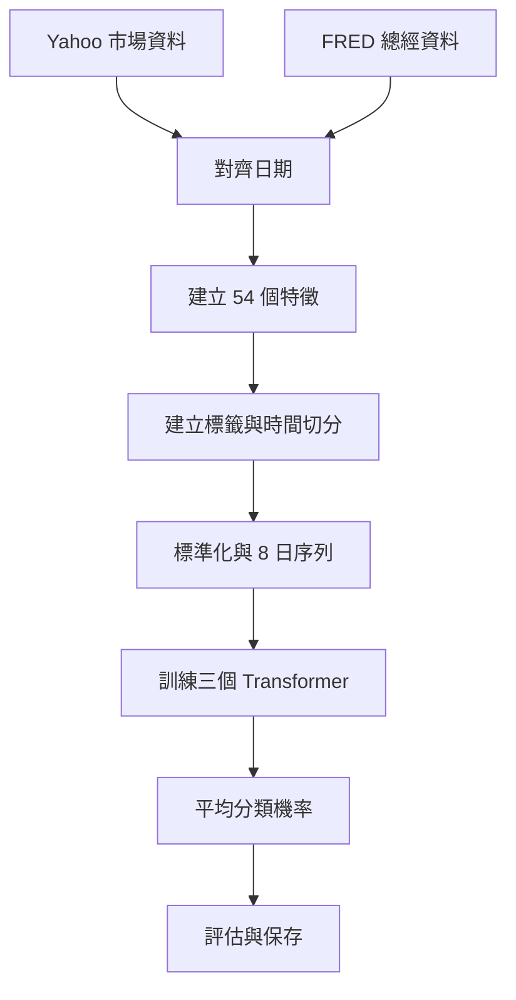

這個專案來自智慧金融與機器學習課程的期末練習。README 記錄了多次模型改版、OLS 相關性分析與 LASSO 特徵篩選的嘗試，最後將重點放在 Transformer。

目前保存的版本以 `daily_transformer_only.py` 為主，搭配資料快取、模型 checkpoints 與三個批次檔，讓完整訓練、更新和預測有各自的入口。本文依 2026-10-13 閱讀的原始碼、README 與輸出 CSV 整理，沒有重新下載資料或執行模型訓練。

## 專案想解決什麼問題？

專案以 `0052.TW` 為目標，使用日頻市場資料與總體經濟資訊，將最近一段時間的特徵輸入 Transformer，再產生分類結果和機率。

不過，「預測方向」必須先說清楚方向的定義。目前程式雖然把輸出命名為 Up／Down，但實際標籤不是單純的「隔日價格比今天高或低」。後面的標籤章節會說明這個重要差異。

## 檔案分工

| 檔案／目錄 | 職責 |
| --- | --- |
| `daily_transformer_only.py` | 資料、特徵、標籤、訓練、評估與預測的主要流程 |
| `cache/` | Yahoo／FRED 資料快取 |
| `daily_transformer_outputs/checkpoints/` | 模型權重、scaler 與 metadata |
| `daily_transformer_predictions.csv` | 保存日期、實際與預測類別等資料 |
| `daily_transformer_misclassified_dates.csv` | 列出分類錯誤的樣本 |
| `train_refresh.bat` | 刷新資料並完整重訓 |
| `update_refresh.bat` | 刷新資料並增量微調 |
| `predict_refresh.bat` | 刷新資料並使用既有模型預測 |

主要流程集中在一支 Python 檔案，閱讀方便；如果繼續擴充，可再拆成資料、特徵、模型及評估模組。

## 資料如何變成模型輸入？



### 市場與總經來源

Yahoo 資料包含 0052、0050、台股與美股指數、台積電 ADR、匯率及其他市場指標。FRED 使用 UMCSENT、PAYEMS、RSAFS，分別提供消費者信心、非農就業與零售相關資訊。

程式為總經資料建立推定發布日，再使用 `merge_asof(..., direction="backward")`，將交易日對應到當時可取得的最近資料。

這是避免直接用觀測月份提前取得資料的設計方向，但發布日規則只是近似。它仍需要查核實際公告時間、修訂值與跨市場收盤時差；僅依日期合併，不能保證完全排除未來資訊。

### 54 個特徵

`FEATURE_COLS` 列出 54 個輸入，可分成：

- 0052 報酬、延遲報酬與移動平均。
- 其他市場與匯率的變化。
- Momentum、RSI、MACD、KD、布林通道等技術指標。
- 波動度、ATR、成交量變化與價差。
- 星期、月份等日曆資訊。

特徵多不代表每一項都有效。下一步可用固定評估方法做消融測試，檢查拿掉某類特徵後的差異，而不是只根據特徵數量判斷模型品質。

## 標籤：目前的 Up／Down 實際表示什麼？

`build_labels()` 使用的 `Close` 是整理後的對數報酬，不是原始收盤價。令它為 r_t，程式設定 k＝1，因此 `mu_k` 是 r_(t+1)，比較量是：

```text
diff = r_t − r_(t+1)
```

再以 20 筆報酬的滾動標準差分成四類。當 `TARGET_MODE = "direction"`，原四類的 0、1 被合併為 Up，2、3 為 Down。

因此目前 Up 的意思更接近 **次日報酬高於當日報酬**，而不是次日報酬大於零。例如今天跌 3%、明天跌 1%，仍可能被歸到 Up。

這不是只有名稱上的細節：它會改變 Accuracy 的意義。如果目標是「下一交易日是否上漲」，應另定義標籤為下一日報酬是否大於零，重新建立資料與訓練，不能直接沿用既有模型的成績。

## Transformer 結構與集成

| 設定 | 目前值 |
| --- | --- |
| 序列長度 | 8 筆日頻特徵 |
| 隱藏維度 | 64 |
| Attention heads | 4 |
| Encoder layers | 1 |
| Feedforward 維度 | 128 |
| Dropout | 0.2 |
| Batch size | 64 |
| 訓練 seeds | 42、7、21 |

模型先將每筆特徵投影到隱藏維度，加入位置編碼，再經 Transformer Encoder。最後使用序列最後一個位置的表示，輸出分類 logits。

三個 seed 各自訓練，推論時平均 softmax 機率，再取最高機率的類別。這是機率集成，不是把模型權重直接平均；輸出機率也不等於已校準的實際事件機率。

## 訓練與更新流程

### 完整重訓

程式以 `shuffle=False` 按時間切分，比例約為 train 65%、validation 15%、test 20%。第一階段只以 train fit scaler，再用 validation 選最佳 epoch。

之後合併 train＋validation，重新 fit scaler，並按各 seed 選出的 epoch 數重訓最終模型，再評估 test。這個結構將模型選擇與最後測試分開，但反覆查看同一份 test 調整設計，仍可能逐漸讓測試集失去獨立性。

### 增量微調

`update` 模式載入 checkpoints 與既有 scaler，使用最近最多 504 筆已標記序列，預設訓練 3 epochs、learning rate 為 1e-5，再保存更新後模型。

504 是序列筆數，不是保證 504 個日曆日。這個模式也不是重新訓練全部歷史資料；更新後的表現需另做樣本外評估。

### 只預測

`predict` 載入已有模型，取得最新 8 筆特徵，輸出平均分類機率。程式將目標描述為「最新資料的下一個交易日」，並未在輸出中計算確切的交易日日期。

## README 的結果如何解讀？

README 保存的一次訓練紀錄如下：

| 指標 | 記錄值 |
| --- | --- |
| Accuracy | 0.7751 |
| Macro F1 | 0.7740 |
| Weighted F1 | 0.7743 |
| MSE | 0.2249 |
| Sharpe | 2.0334 |
| Test 樣本數 | 538 |

這些是專案內的歷史紀錄，不是本文重新驗證的結果，也不能直接理解成「未來真實漲跌預測有 77.51% 正確率」。必須先處理上述標籤定義與以下時間對齊問題。

## 值得優先檢查的時間對齊

`create_sequences()` 對從 i 開始的 8 筆輸入，取 `labels[i + 7]`。但後面的 test 日期、價格與報酬使用 `iloc[TIME_STEPS:]`，也就是從位置 8 開始。

換句話說，第一個輸出對應的標籤在位置 7，結果表中的日期／報酬卻從位置 8 開始，存在一筆偏移。分類 Accuracy 比較的是模型與 loader 的標籤；但 CSV 日期與策略報酬不能因此直接認定對齊正確。

下一步應先明確約定：每個樣本的最後資訊日、預測目標日、可交易時間與報酬區間。再讓序列產生函式同時回傳索引，避免不同步地靠切片推算日期。

此外，現行 Sharpe 以預測訊號乘上對應報酬計算，沒有完整處理交易成本、成交時機與資金曲線。它是簡化指標，不是完成的可執行策略回測。二元類別的 MSE 也不代表價格預測誤差。

## 如何執行這個專案？

批次檔會切到專案目錄，使用 `.venv\Scripts\python.exe`。也可以在環境準備好後執行：

```bash
python daily_transformer_only.py --mode train --refresh-data
python daily_transformer_only.py --mode update --refresh-data
python daily_transformer_only.py --mode predict --refresh-data
```

首次使用需要完整訓練或已有相容 checkpoints；只預測不會自動產生缺少的模型。Python 套件環境與資料服務可用性，也需另行確認。

## 這個專案留下的學習重點

README 記錄從約 55% 到 77% 的改進，但目前目錄沒有保留全部早期模型與相同條件的比較結果，因此這段應當作開發歷程，而非已完成的受控實驗。

這份專案最值得延伸的，是把資料處理、模型訓練和日常操作串起來。下一步，我會優先釐清標籤與日期，再加入 walk-forward 評估、基準模型、資料版本與完整交易假設。

模型架構固然重要，但金融時間序列裡，資料何時可取得、標籤究竟代表什麼，以及結果是否對齊，往往更直接決定我們能不能相信評估數字。

## 整理依據

本文根據專案的 README、`daily_transformer_only.py`、三個刷新批次檔與輸出 CSV 撰寫。未修改原專案，也未重新訓練模型。
