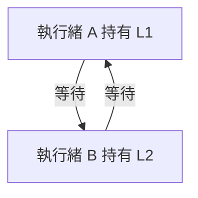

作業系統課程中的 lock，和 C# 的 `lock` 都在處理同一類問題：多個執行單位共用資料時，如何避免互相干擾。但 OS 談的是同步機制與實作策略，C# `lock` 則是語言提供的互斥區塊。

本文從概念連到實際程式，API 資訊於 2026-10-11 查核。

## 為什麼需要 lock？

假設兩個執行緒都執行 `count++`。這個運算包含讀取、計算與寫回，不是整組原子操作：

```text
初始 count = 0
A 讀取 0 → B 讀取 0 → A 寫回 1 → B 寫回 1
最後 count = 1，而不是 2
```

執行順序影響結果，稱為 race condition。存取共享資料並維持一致性的區域稱為 **critical section（臨界區）**。Lock 讓參與同一套同步協定的執行緒，一次只有一個進入受保護區域。

常見評估面向包含互斥是否成立、公平性與效能。Lock 不會自動保證所有等待者都有固定順序或等待上限。參考 [OSTEP：Locks](https://pages.cs.wisc.edu/~remzi/OSTEP/threads-locks.pdf)。

## OS 的鎖：等待時要做什麼？

### Spinlock：持續嘗試取得鎖

Spinlock 取得失敗時，通常反覆檢查或執行原子操作，形成 busy waiting。等待者仍消耗 CPU，但可能省下睡眠與喚醒成本。

它適合持鎖時間非常短、且持有者能繼續執行的情境。若等待很久、持有者被搶占，或只有一個可用 CPU，自旋就可能浪費大量時間。常見實作依靠 test-and-set、compare-and-swap 等原子機制，不能用普通布林變數的讀寫取代。

### Blocking mutex：讓等待者暫停

取得不到 mutex 的執行緒可以被掛起，交由排程器安排其他工作；代價是等待與喚醒的管理成本。實際實作也可能先短暫自旋，再進入阻塞，所以不能只靠名稱推定每一步都進入核心。

Mutex 通常具有持有者概念；釋放規則要依 API 確認。教材模型與等待策略見 [OSTEP：Locks](https://pages.cs.wisc.edu/~remzi/OSTEP/threads-locks.pdf)。

### Semaphore：管理許可數量

Semaphore 用計數控制有多少執行單位能通過；初始許可數為 1 時可用於互斥，為 N 時可限制同時處理的工作數量。

它與 mutex 的 ownership 規則不一定相同，也可以用在訊號通知。不能因兩者都會等待，就把它們視為完全相同的 API。

### 核心情境有額外限制

核心中的中斷、搶占與能否睡眠，會影響可使用的鎖。以 Linux 為例，sleeping locks 不能隨意用於 atomic context；PREEMPT_RT 下部分 spinlock 語意也不同。

因此，研究所常見的「spinlock 忙等、mutex 睡眠」是理解方向，實際規則仍須看平台。詳見 [Linux lock types](https://docs.kernel.org/locking/locktypes.html)。

## C# lock：以共同的鎖建立互斥

```csharp
public sealed class Counter
{
    private readonly object _gate = new();
    private int _count;

    public void Increment()
    {
        lock (_gate)
        {
            _count++;
        }
    }

    public int Read()
    {
        lock (_gate)
        {
            return _count;
        }
    }
}
```

重點是共享 `_count` 的存取都遵守同一個 `_gate`。沒有取得鎖的程式仍然能碰到資料；lock 不會把欄位自動變成不可存取。

`readonly` 防止鎖欄位換成另一個 instance；它不代表 `_count` 唯讀。不同 Counter instance 的 `_gate` 不同，也就不會互相排隊。

C# 的 object lock 以 reference identity 判斷同一把鎖，不是內容相等或變數名稱相同。傳統機制見 [Monitor API](https://learn.microsoft.com/en-us/dotnet/api/system.threading.monitor)。

### 傳統 object lock 對應 Monitor

對一般 reference-type 物件，編譯器使用 `Monitor.Enter`／`Monitor.Exit`，並透過 `try/finally` 確保離開區塊時釋放鎖。

它具有執行緒 ownership 與重入能力：同一執行緒可以再次取得同一把鎖，對應進入次數也要正確釋放。Monitor 還提供 Wait／Pulse 等協調能力；Wait 會暫時釋放鎖，返回前再重新取得。

C# lock 不等於每次都呼叫 OS mutex；底層等待策略依 runtime 與平台實作。API 語意見 [Monitor 文件](https://learn.microsoft.com/en-us/dotnet/api/system.threading.monitor)。

## C# 13／.NET 9：System.Threading.Lock

.NET 9 與 C# 13 起，可使用專用的 Lock 物件：

```csharp
public sealed class ModernCounter
{
    private readonly System.Threading.Lock _gate = new();
    private int _count;

    public int IncrementAndRead()
    {
        lock (_gate)
        {
            return ++_count;
        }
    }
}
```

當編譯器知道 expression 的型別是 `System.Threading.Lock`，會使用 `EnterScope()` 的 scope-based 路徑；若靜態型別是 object，則可能使用 Monitor 路徑。不要將同一個 Lock 轉成 object 後混用兩套機制。

新版也具有執行緒 ownership 與重入能力。這是版本差異，不能再籠統說「所有 C# lock 都編譯成 Monitor」。見 [C# lock 文件](https://learn.microsoft.com/en-us/dotnet/csharp/language-reference/statements/lock) 與 [System.Threading.Lock](https://learn.microsoft.com/en-us/dotnet/api/system.threading.lock)。

## 不要鎖 this、字串或每次建立的新物件

```csharp
// 錯誤示範：不同呼叫取得不同 instance，沒有共同互斥。
lock (new object())
{
    // 修改共享資料
}
```

應使用專用、私有且穩定的鎖物件。`this`、`typeof(...)` 或字串可能被外部程式一起鎖住，使鎖的使用範圍難以掌握。

鎖內工作保持短且有界；不要隨意呼叫外部 callback 或長時間 I/O。寫入時鎖住，也要考慮讀取與整組狀態的保護方式。建議見 [C# lock guidelines](https://learn.microsoft.com/en-us/dotnet/csharp/language-reference/statements/lock)。

## Deadlock：互相等對方的鎖

假設兩條路徑的順序相反：

```text
執行緒 A：先取得 L1，再等待 L2
執行緒 B：先取得 L2，再等待 L1
```



傳統死結四個必要條件是 mutual exclusion、hold and wait、no preemption、circular wait。常用做法是讓所有路徑遵守一致的取鎖順序；也可調整資源取得協定，避免持有一把鎖又無限等待另一把。

重入只解決同一執行緒再次取得同一把可重入鎖，不會解決兩個執行緒互相等待。Timeout 能讓程式有機會退出等待，但仍需設計失敗後的狀態與清理。概念見 [OSTEP：Concurrency Bugs](https://pages.cs.wisc.edu/~remzi/OSTEP/threads-bugs.pdf)。

## lock 裡不能 await：非同步用 SemaphoreSlim

C# 不允許在 lock 區塊內使用 await。鎖的 ownership 屬於執行緒，但 await 後的 continuation 不保證使用同一個執行緒。

需要讓非同步操作排隊時，可以使用 SemaphoreSlim：

```csharp
using System.Threading;
using System.Threading.Tasks;

public sealed class AsyncGate
{
    private readonly SemaphoreSlim _gate = new(1, 1);

    public async Task RunAsync(CancellationToken cancellationToken)
    {
        await _gate.WaitAsync(cancellationToken);
        try
        {
            await Task.Delay(100, cancellationToken); // 示範非同步工作
        }
        finally
        {
            _gate.Release();
        }
    }
}
```

`try` 放在成功取得許可之後，才能避免 WaitAsync 被取消時錯誤 Release。SemaphoreSlim 不要求取得與釋放來自同一執行緒，也不提供 lock 那樣的重入 ownership。

它適合同一程序內的非同步協調；不是跨程序或跨伺服器的鎖。管理者也要在確定沒有工作使用時處理其生命週期。見 [SemaphoreSlim API](https://learn.microsoft.com/en-us/dotnet/api/system.threading.semaphoreslim)。

## 簡單原子操作：Interlocked

若需求只有共享計數器遞增，可以採用：

```csharp
using System.Threading;

private int _count;

public int Increment() => Interlocked.Increment(ref _count);
```

Interlocked 提供單個操作的原子性，但不能直接把多個欄位的商業條件整組變成交易。例如「檢查餘額再扣款」需要維持整體不變量，不能只把最後減法換成原子操作。

`volatile` 也不是一般的 lock 替代品；可見性與排序、單個操作原子性、整段互斥是不同問題。API 定義見 [Interlocked](https://learn.microsoft.com/en-us/dotnet/api/system.threading.interlocked)。

## 同步範圍：同程序、跨程序、跨機器

| 需求 | 可評估工具 |
| --- | --- |
| 同程序內短同步臨界區 | lock／Monitor／System.Threading.Lock |
| 單個原子讀改寫操作 | Interlocked |
| 同程序的非同步互斥或併發數限制 | SemaphoreSlim |
| 同機跨程序同步 | 平台支援的 named Mutex 等 |
| 多台伺服器或多個應用 instance | 資料庫交易、並行控制或適合的分散式協調 |

Named Mutex 可用於跨程序同步，但需確認平台、名稱範圍與權限；它不能讓不同主機自動共用一把鎖。見 [Mutex API](https://learn.microsoft.com/en-us/dotnet/api/system.threading.mutex)。

例如 Web API 部署兩個 instance，即使各自都用 lock，仍只能管住各自程序的記憶體。庫存扣減應由資料庫約束／交易等共同權威處理，而非只靠某台服務的記憶體鎖。這是依同步範圍整理的設計判斷。

## 如何把 OS 概念連到 C#？

OS 的重點是原子操作、等待策略、排程與資源保護；C# 的重點是用正確的共享鎖，把程式的不變量包在臨界區。

選工具前，我會先確認：共享資源在哪裡、哪些存取必須一起保護、是否需要 await，以及所有參與者是否真的共用同一套協定。這些條件比單純在程式外面加上一個 lock 更能決定同步是否正確。
