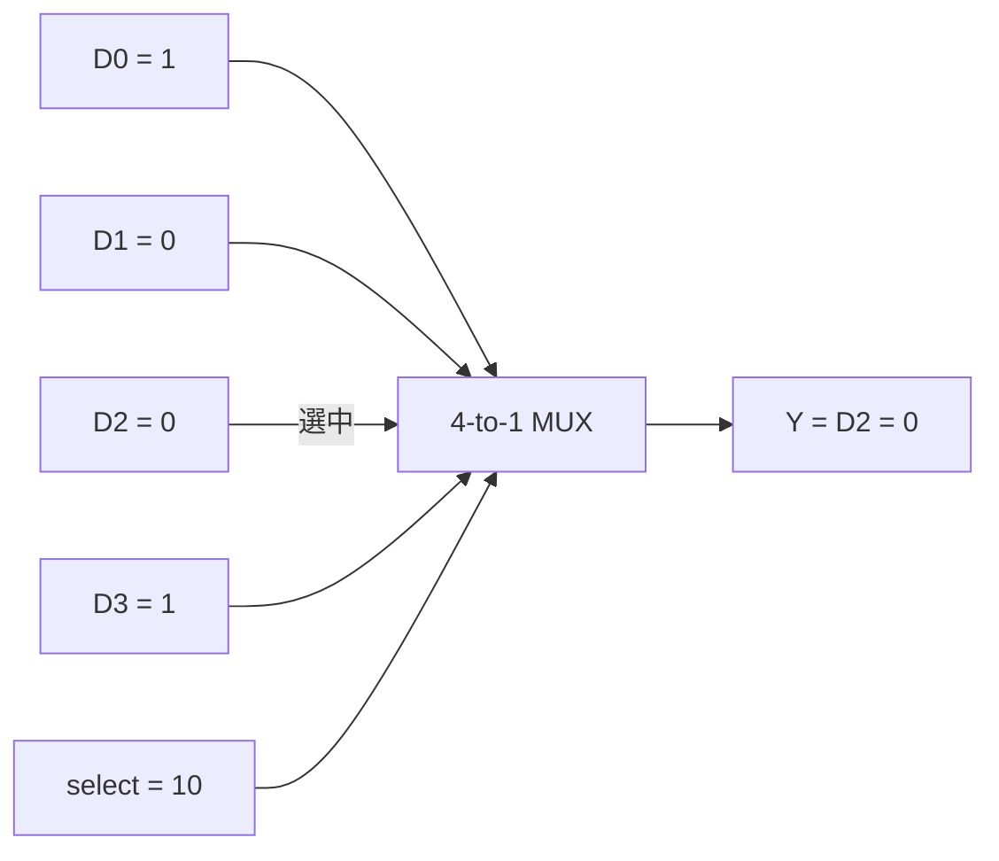
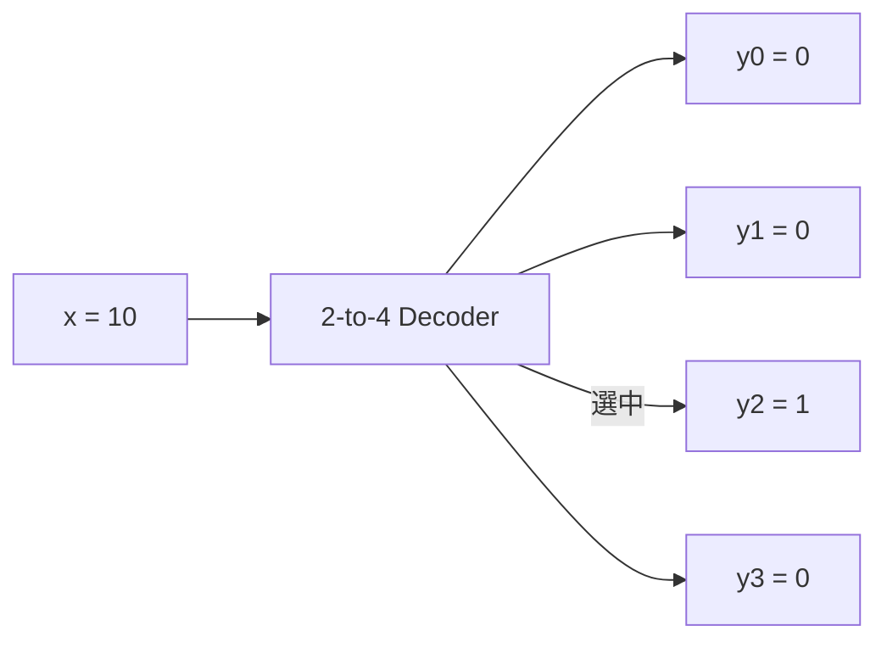
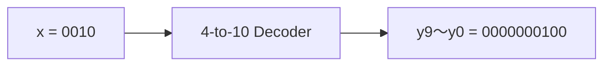
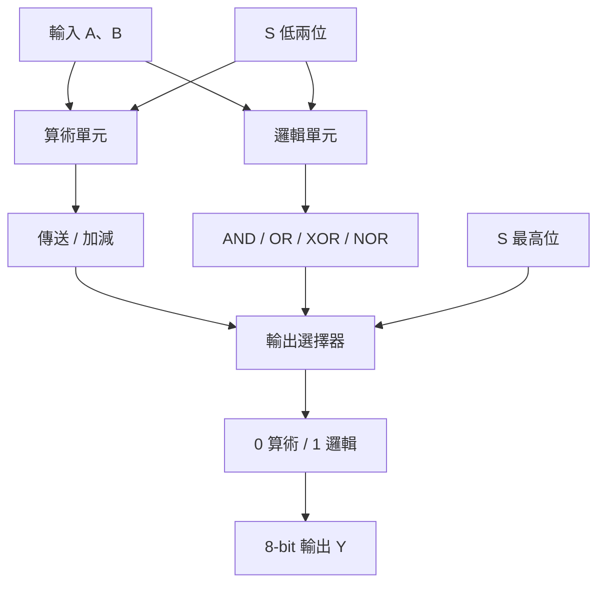
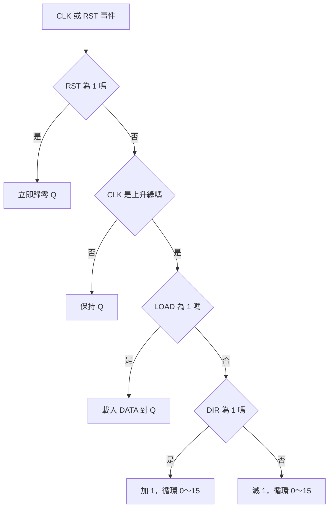
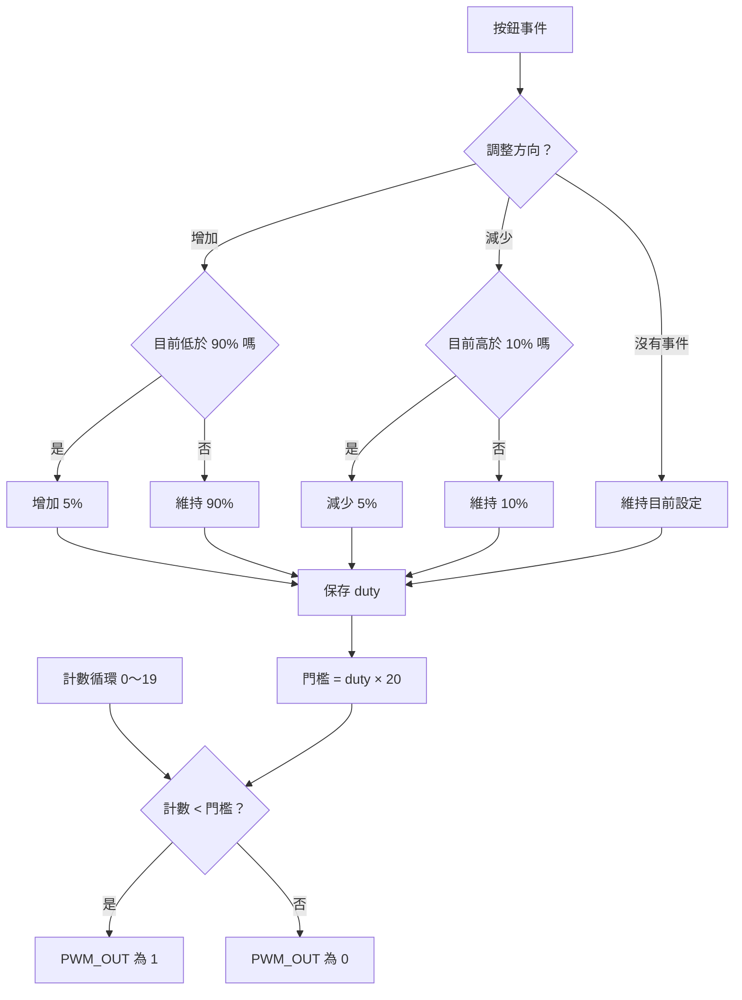
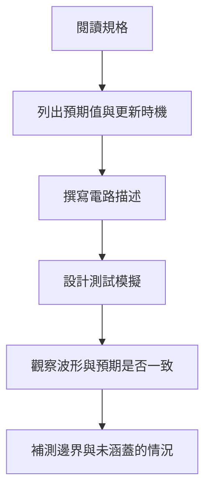
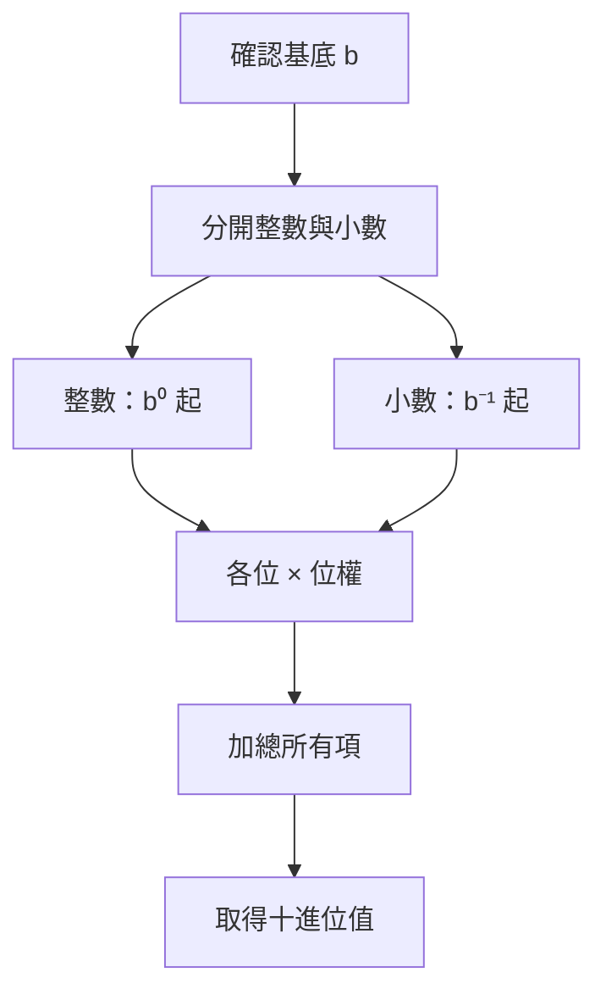
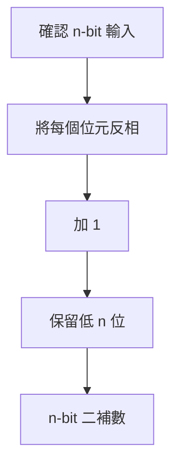

回頭整理這份 VHDL 課程作業，我覺得最值得記下的，是看待程式碼的角度改變了。以前習慣追問程式先做什麼、再做什麼；在硬體描述裡，還得問：這段描述對應什麼電路、哪些訊號同時存在，以及輸出應該在什麼時刻改變。

這篇依據「STEM 與永續發展人才培訓」的作業文件整理。文件包含題目、程式截圖、模擬波形與解析；以下心得以這些練習為基礎，不將模擬結果當作實際上板測試的證明。

### VHDL 的名詞與歷史背景

- **HDL**：Hardware Description Language，描述硬體結構與行為的語言。
- **VHDL**：VHSIC Hardware Description Language；VHSIC 是 Very High Speed Integrated Circuit 的縮寫。
- **Simulation**：模擬描述的行為與訊號變化。
- **Synthesis**：將可合成描述轉換成邏輯電路表示；不是所有模擬語法都能實現為硬體。
- **Testbench**：提供測試刺激並觀察／檢查設計的驗證環境。

VHDL 源自美國國防部在 1980 年代初期的 VHSIC 計畫，1987 年成為 IEEE 1076 標準。這段背景讓我理解，它的用途不只是寫出可執行的程式，而是讓硬體設計有可以交換、描述和驗證的形式。參考 [IEEE：VHDL](https://technav.ieee.org/topic/vhdl/)。

## 從四個練習，看見不同的設計問題

| 練習 | 題目重點 | 我整理出的學習焦點 |
| --- | --- | --- |
| BCD-to-Decimal Decoder | 4-bit 輸入轉為 10-bit one-hot | 先釐清輸入與輸出的對應 |
| 8-bit ALU | 3-bit 選擇訊號控制八種功能 | 拆分電路職責與安排可判讀的測試 |
| 4-bit Up-Down Counter | 非同步 reset、同步 load、上下計數 | 區分控制優先順序與更新時機 |
| PWM | 10%～90%，每次調整 5% | 把計數值轉換成時間比例，驗證上下限 |

前兩題偏向組合邏輯：觀察目前輸入如何決定輸出。後兩題需要記住狀態，還得考慮 clock 與事件。這個分界讓我比較能理解，為什麼有些描述是輸入一變就重新決定結果，有些則必須等待時脈邊緣。

## Decoder：先把規格讀成真值表

第一題要求將 0～9 的輸入，轉成只有一個位元為 1 的 one-hot 輸出。例如輸入 0 對應 `0000000001`，輸入 1 對應 `0000000010`；輸入 10～15 則依題目輸出全 `Z`。

文件有使用「10 對 1 多工器」的稱呼，但就列出的輸入輸出關係來看，我會以 **4-to-10 decoder／one-hot 解碼** 來理解這個練習，避免和選擇多路資料的 multiplexer 混淆。

這一題給我的提醒是：開始寫語法前，先把每個輸入的預期結果列出來。真值表讓有效值、無效值和預設行為都變得清楚；波形則把那個唯一的 1 如何移動呈現出來。

另外，`Z` 是高阻抗狀態，不等於 0，也不是單純的「沒有資料」。這裡遵照題目要求，不表示所有實際 FPGA 內部電路都適合用同樣方式實現三態輸出。

### Decoder／MUX 的名詞與發展背景

| 名詞 | 意義 |
| --- | --- |
| BCD | Binary-Coded Decimal；常見 8421 BCD 用 4 bits 編碼一個十進位數字 |
| One-hot | 一組位元中恰有一位為 1；本題有效輸入使用此表示 |
| Select | 指定要選取哪路資料或哪個編碼 |
| Enable | 控制電路是否啟用；不等於 select |
| Active-low | 訊號為 0 時表示有效；不能把所有 decoder 都當成高有效 |
| High impedance／Z | 高阻抗，與邏輯 0 不同 |

在標準邏輯 IC 的設計脈絡中，解碼與資料選擇可以直接用獨立晶片完成。例如 TI 的 SN74LS138 是 3-to-8 decoder，SN74LS151 是 8-to-1 MUX。前者可用於記憶體解碼，後者內含解碼來選取資料來源。

這些元件提供了理解本題的實體例子；如今用 VHDL 描述相同功能，不代表需要逐顆放入相同晶片。這裡談的是功能與實作方式的演變，不將資料表修訂日期當成發明日期。參考 [SN74LS138](https://www.ti.com/product/SN74LS138)、[SN74LS151](https://www.ti.com/product/SN74LS151)。

### MUX 和 Decoder 不一樣嗎？

兩者是不同的組合邏輯電路。**MUX 選取資料；Decoder 將編碼轉成對應的選擇訊號。**

| 比較 | MUX（多工器） | Decoder（解碼器） |
| --- | --- | --- |
| 功能 | 從多路資料中選一路送出 | 將輸入編碼解碼成對應輸出 |
| 輸入 | 資料輸入，加上 select | 編碼輸入；部分設計另有 enable |
| 輸出 | 被選中的資料值 | 常見為 one-hot，也可能採低有效輸出 |
| 例子 | 4-to-1 MUX 選 D0～D3 其中一路 | 2-to-4 Decoder 將 2-bit 編碼轉為 4 路訊號 |

假設 select／編碼都是 `10`，也就是十進位 2：

```text
4-to-1 MUX（單位元資料）：
D0 = 1、D1 = 0、D2 = 0、D3 = 1
select = 10 → 選擇 D2 → 輸出 Y = 0

2-to-4 Decoder（高有效）：
輸入 x = 10 → 輸出 y[3:0] = 0100
```

MUX 的輸出跟著 D2 的資料走；D2 改成 1，Y 就變成 1。Decoder 的輸出表示「第 2 路被選中」，並沒有 D2 資料供它轉送。

回到這份題目：它列出 4-bit 的 `x` 與 10-bit 的 `y`，沒有 D0～D9 資料輸入；`x = 0010` 時要求 `y = 0000000100`。因此，**依輸入輸出規格，這題應理解為 BCD-to-decimal decoder**。

文件總覽使用 Decoder 名稱，題目敘述卻寫「10 to 1 multiplexer」，兩者不一致，可能是名稱誤植，仍可向老師確認。作答時先依真值表完成要求，再標明自己的理解，比只憑標題猜電路更清楚。

兩者也能搭配：Decoder 先產生各路選擇訊號，分別控制資料通路（Datapath），再合併成 MUX 輸出。但可以用 Decoder 協助實作 MUX，不代表兩者功能相同。

### MUX：從資料中選一路

以下用單位元的 4-to-1 MUX 說明。四路資料與 select 都是輸入；select＝`10` 時選 D2，因此 Y＝0。圖上的資料通路（Datapath）同時存在，不是依箭頭順序執行。



若 D2 改成 1，Y 也會變成 1；select 決定資料來源，沒有固定該路的資料值。

### Decoder：把編碼解成對應訊號

以下用高有效的 2-to-4 Decoder 說明。輸入 `10` 代表 2，因此只有 y2＝1；輸出以 `y3 y2 y1 y0` 排列，就是 `0100`。



這張圖沒有 D0～D3 資料輸入。輸出表示哪個編碼成立，而不是轉送被選中的資料。

### 本題的 BCD-to-decimal Decoder



本題有效輸入 0～9 各自對應一個輸出位元；10～15 依題目要求輸出全 Z。這是題目指定的無效輸入行為，不是所有 Decoder 都固定使用 Z。

## ALU：把功能拆開，也把測試拆開

第二題的 ALU 以 `S` 選擇八種功能：Transfer A、Transfer B、加、減，以及 AND、OR、XOR、NOR。文件提示用 `S(2)` 區分算術與邏輯單元，再用低兩個位元選擇各組功能。

我喜歡這個拆法，因為它把「計算什麼」和「選哪個結果」分開。即使功能不多，也能先建立清楚的結構，而不是把所有操作混成一長段條件。

測試資料的選擇同樣有用：算術部分使用 A＝64、B＝32，方便直接核對 96 和 32；邏輯部分改用 `01010101` 與 `10101010`，讓互補的位元關係一眼可見。

這讓我體會到，好的測試不只是餵入很多數字，而是讓錯誤容易被辨識。下一步若要補強驗證，我會加入 0、最大值、相等輸入及溢位邊界，並確認位寬、signed／unsigned 與旗標需求。文件中的基本測試，還不能代表所有輸入組合都已驗證。

### ALU 的名詞與發展背景

- **ALU**：Arithmetic Logic Unit，算術邏輯單元。
- **Operand**：運算元，本題是 A 與 B。
- **Bitwise operation**：逐位元運算，例如 AND、OR、XOR。
- **Carry**：無號加法的額外進位；與有號 overflow 不是同一概念。
- **Overflow**：結果超出指定表示範圍；判斷方式依有號／無號規格不同。
- **Datapath**：資料流經暫存器、運算單元與選擇器的路徑。

ALU 並不是 VHDL 才出現的概念。Computer History Museum 保存的 1976 年硬體文件，已將 ALU 描述為資料通路（Datapath）的核心。從較早的硬體模組到整合於處理器的運算單元，功能選擇（Function Selection）與資料通路（Datapath）始終是重要觀念。

本題的 8-bit ALU 是精簡練習，不能直接等同完整 CPU；CPU 還需要控制、暫存器與其他機制。參考 [Computer History Museum：1976 硬體文件](https://archive.computerhistory.org/resources/access/text/2024/06/102739320-05-0004-acc.pdf)。

### ALU 的功能選擇（Function Selection）圖

這張圖表示資料通路（Datapath）與選擇（Function Selection）關係；算術和邏輯單元可以同時存在，不是軟體依序執行的流程。



## 計數器：數值之外，還要看「何時」改變

上下數計數器是這份練習裡最能呈現時序差異的一題：

- Reset 為高時非同步歸零，不需要等待 clock 上升緣。
- Load 是同步的，必須等上升緣才載入 DATA。
- 沒有 load 時，再依 DIR 向上或向下計數。
- 沒有上升緣時，維持目前值；reset 的優先行為則另外判斷。

因此，我不能只看 Q 最後是不是 15，還要看它是否在正確的邊緣才變成 15。結果正確但更新太早，仍不符合規格。

文件也測試 `1111 → 0000` 和 `0000 → 1111` 的循環。這讓位寬不再只是宣告裡的數字：4-bit 決定了狀態範圍，邊界如何處理則是設計的一部分。

我的理解是，時序電路的規格至少要同時回答兩件事：**下一個值是什麼？什麼條件下才更新？** Reset、load 和 direction 的優先順序，都應先寫清楚再對照波形。

### Counter 的名詞與發展背景

| 名詞 | 意義 |
| --- | --- |
| Flip-flop | 保存位元狀態的基本循序元件 |
| Clock | 協調狀態更新的時脈訊號 |
| Rising edge | 時脈由 0 轉為 1 的邊緣 |
| Asynchronous reset | 不必等待指定時脈邊緣的重設 |
| Synchronous load | 在指定時脈邊緣載入資料 |
| Modulo counter | 在指定範圍內循環計數；本題為 modulo 16 |

計數器也早已是標準邏輯 IC 的功能。例如 SN74LS193 提供 4-bit 二進位上下計數，代表這類功能可以以現成元件組成系統，再由 HDL 描述相似的狀態行為。

不過，現成 IC 的 clock、load 與 reset 規則不一定和本題相同；不能只因名稱相同就照抄接法。比較歷史元件和目前練習時，仍要逐項看真值表與時序。參考 [TI：SN74LS193](https://www.ti.com/product/SN74LS193)。

### 計數器的更新判斷圖

Reset 具有最高優先權；只有同步載入與計數需要等待上升緣。圖中的回繞以本題 4-bit 計數範圍為準。



## PWM：把計數轉成看得見的時間比例

PWM 題目要求 duty cycle 在 10%～90% 間變化，按一次增加或減少 5%。文件的解析用 2～18 表示工作週期設定，18 對應 90%，2 對應 10%，讓計數與比例的關係更容易理解。

我整理這題時，最有感的是：輸出不只是 0 或 1，**維持高電位的時間**本身也是資訊。觀察 PWM_OUT 的脈衝逐漸變寬或變窄，比只讀內部變數更能確認控制是否真的反映到輸出。

如果用 20 個計數單位理解一個週期，每一單位就是 5%；但比較條件、計數起點與終點必須一致，否則可能多算或少算一個 clock。

這題也提醒我測試上下限：已達 90% 再增加，或已達 10% 再減少，應依規格維持邊界。若延伸到實體按鈕，還需另外考慮同步化、彈跳與單次事件；模擬中的乾淨脈衝，不會自動驗證那些硬體問題。

### PWM 的名詞與發展背景

- **PWM**：Pulse Width Modulation，脈衝寬度調變。
- **Period／T**：一個完整週期的時間。
- **Frequency／f**：每秒的週期數，`f = 1 / T`。
- **Duty cycle**：高電位時間占週期的比例，`duty = Ton / T`。
- **Resolution**：可調整的最小步階；本題要求每次 5%。

PWM 的應用脈絡包含電源控制與馬達控制，不是只為這份 FPGA 練習而存在。專用控制器如 TL494 將 PWM 控制功能整合為晶片；微控制器也能透過 timer 產生 PWM。這展示了專用電路、可程式化 timer 與 HDL 設計的不同實作途徑，不代表單一產品就是 PWM 的最早起源。參考 [TI：TL494](https://www.ti.com/product/TL494)、[TI：Timer PWM basics](https://www.ti.com/video/6313218395112)。

Duty 改變不等於 frequency 改變；亮度、轉速等效果也取決於負載與驅動電路，不能把工作週期直接當成所有設備輸出的線性比例。

### PWM 的控制與輸出圖

控制工作週期與產生 PWM 是兩個相關部分。以下用每週期 20 個單位的簡化模型說明，不表示直接逐行還原文件程式。



這裡工作週期以比例計算，例如 50% × 20＝10。若增加與減少事件同時發生，或要避免週期中途改門檻造成脈衝突變，還需另外訂定優先順序及設定生效時機；題目未明確描述的地方不能只靠圖表假定。

## 波形是驗證工具，不只是作業截圖

這份文件要求繳交程式碼和波形，並為各題安排 Signal Generator／Testbench。我把它理解為一個設計流程：



波形可以回答的不只是「有沒有輸出」，還包含 reset 是否立即生效、load 是否等到上升緣，以及 duty cycle 改變後脈衝寬度是否跟著改變。

未來如果繼續練習，我會把能自動判定的預期結果寫成 testbench assertions，讓驗證不只依靠肉眼。這是後續學習方向，不是文件已經完成的成果。

## 進位制與二補數，仍是電路思考的基礎

數字系統部分讓我重新把位元和數值連起來。文件中的二進位 `10110.0101`、十六進位 `16.5` 與八進位 `26.24`，都對應十進位 22.3125。它們寫法不同，代表的量卻相同。

二補數則提醒我，不能忽略固定位寬。反相加一時，超出 8-bit 的進位要依該位寬處理；全 0 的二補數仍是全 0。這也能連回 ALU 的減法與計數器循環，而不是只把換算題當成獨立的手算練習。

### 數字系統的名詞與歷史脈絡

| 名詞 | 意義 |
| --- | --- |
| Radix／base | 進位基底，例如 2、8、10、16 |
| Positional notation | 位值記數法，同一數字符號因位置不同而有不同權重 |
| MSB／LSB | 最高／最低有效位元 |
| One's complement | 逐位元反相 |
| Two's complement | 固定位寬內反相加一；也是常見的有號數表示方式 |
| Signed／unsigned | 是否依有號規則解讀同一組位元 |

數位計算的歷史不只在於運算電路，也在於如何把資料編碼成機器能讀取的狀態。IBM 的穿孔卡歷史展示了較早的機械化資料處理；後來的電子數位系統則讓位元表示、運算與儲存緊密結合。穿孔卡有不同編碼，不能把所有孔位都直接視為現代二補數。參考 [IBM：Punched card tabulator](https://www.ibm.com/history/punched-card-tabulator)。

本題讓我從這個脈絡回到實作：十六進位能緊湊地書寫位元，二補數則讓固定位寬的加減運算有一致的表示方式。這是學習上的連結，不是對二補數發明者或首次使用年份的斷言。

### 進位制轉十進位



### 固定 n-bit 的二補數



這裡描述的是固定位元字串的二補數運算。若進一步解讀為有號整數，也要檢查可表示範圍；例如最小負數的正值無法在相同有號位寬中表示。

## 幾個讓電路比較不抽象的歷史小故事

### 廚房桌上，有一台會加法的小機器

很久以前，有一位叫 George Stibitz 的人。

1937 年，他在家裡的廚房桌上，做了一台小小的加法機器。裡面有一些可以打開、關上的電開關，叫做「繼電器」。

你可以把它想成一排會動的小門。小門照著安排打開、關上，機器就能算出加法的答案。

這台機器叫 **Model K**。K 來自英文 Kitchen，意思就是「廚房」。原來，電腦的故事，也可以從一張廚房桌子開始！

課堂上的 ALU 比它能做更多事情。不過，它們有一個相似的想法：讓電路幫我們算數。

故事來源：[Computer History Museum：1937](https://www.computerhistory.org/timeline/1937/)。小門是幫助想像的比喻。

### 兩個開關，怎麼決定燈要不要亮？

想像你有兩個開關和一盞燈。

第一種接法，要**兩個開關都打開**，燈才會亮。這就像 **AND**。

第二種接法，**任何一個開關打開**，燈就能亮。這就像 **OR**。

1937 年，一位叫 Claude Shannon 的學生，把數學裡的邏輯和這種開關電路連在一起。他在碩士論文裡說明，可以用數學來分析、安排電路。

就像蓋積木前先畫圖，我們也可以先想好：「什麼時候要亮？什麼時候不要亮？」再安排開關。

所以課堂上的 AND、OR，並不只是難記的英文。它們是在說開關要怎麼一起工作。

故事來源：[Computer History Museum：Digital Logic](https://www.computerhistory.org/revolution/digital-logic/12/269)。開關和燈是簡化的例子。

### 一張有洞洞的卡片，也能記住事情

以前沒有現在這樣的電腦。要算一個國家有多少人，是很大的工作！

有一位叫 Herman Hollerith 的人，設計了用卡片和機器整理資料的方法。這套方法用在 1890 年的美國人口普查。

卡片上有小洞。洞打在不同的位置，就能代表不同的資料。機器讀到洞，就能幫忙計算。

你可以想像一張貼紙表：第一格貼星星代表一種答案，第二格貼星星代表另一種答案。大家先約好每一格的意思，才不會看錯。

電路也是這樣。看到一串 0 和 1，還要知道它們代表什麼。相同的符號，用不同規則來看，意思可能不一樣。

故事來源：[IBM：Punched card tabulator](https://www.ibm.com/history/punched-card-tabulator)。貼紙表是比喻，不是當年的機器做法。

### 從接小零件，到畫一張電路的計畫

做電路時，有些小晶片像是各有工作的積木。

有的負責選資料，有的負責數數。像 SN74LS151 是選資料的晶片，SN74LS193 是可以往上、往下數的晶片。

以前，工程師可以把這些零件接起來，讓它們一起工作。

現在學 VHDL，我們會用文字描述：「我要哪些訊號？它們要怎麼工作？」工具再依照合適的描述，幫忙做出電路設計。

這有點像先寫一張積木計畫：這裡放什麼，那裡接什麼。但不是隨便寫一句話，就一定能變成電路。

如果我看不懂一大段程式，可以先只想一塊小積木：**什麼東西進來？什麼東西出去？它在中間做什麼？**

先懂一塊，再慢慢接下一塊。還不懂的地方，就留著再問。

元件資料：[TI：SN74LS151](https://www.ti.com/product/SN74LS151)、[TI：SN74LS193](https://www.ti.com/product/SN74LS193)。積木是幫助理解的比喻。

## 這門課留給我的學習方向

整理完作業，我最想保留的是三個習慣：先把規格說清楚，再把功能與時序分開思考，最後用測試證據確認結果。

對我而言，VHDL 的學習不只是記住 `with...select`、`when...else` 或 process 的寫法，而是逐漸理解描述背後的電路。從 Decoder 的位元對應，到 Counter 的 clock，再到 PWM 的時間比例，每題都讓同一件事更具體：程式碼必須和硬體行為對得上。

上完這門課，我對 VHDL 仍然一知半解。雖然學的是硬體，但透過程式碼描述電路，再從波形判斷結果，對我而言反而很抽象。我能跟著題目整理輸入、輸出與控制條件，卻還不容易在腦中把它們連成一個實際運作的電路。
這份筆記比較像是留下目前理解到哪裡，以及還有哪些疑問。接下來，我希望從簡單電路開始，把程式碼、電路圖和波形放在一起對照，慢慢建立直覺。
