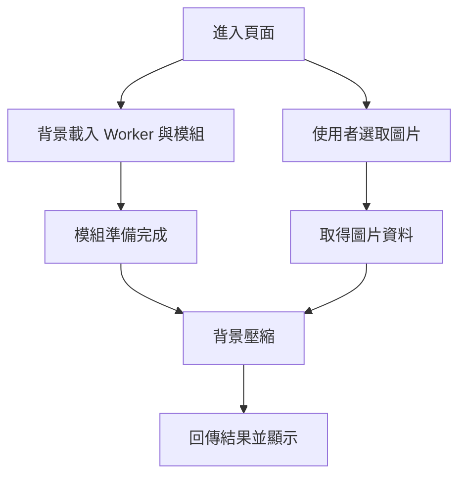

這篇整理來自高等計算機網路課程的《WebAssembly 與 JavaScript 在瀏覽器密集型運算中之性能評估報告》。報告先回顧一篇論文，再記錄自己的瀏覽器圖片壓縮實驗。

閱讀和實作後，最值得保留的問題是：**程式算得比較快，使用者就一定等得比較短嗎？** WASM 的運算優勢，仍要和模組下載、初始化、資料搬移及網路條件一起看。

本文依提供的三頁報告整理，未重新執行基準測試；論文數據與個人實驗分開呈現。

## 先認識幾個名詞

| 名詞 | 在本文中的意思 |
| --- | --- |
| WebAssembly／WASM | 可在瀏覽器等環境執行的低階二進位格式，本報告的論文使用 Rust 編譯產生 |
| JavaScript／JS | 用於網頁互動及運算的程式語言 |
| JIT | Just-In-Time，執行期間進行編譯與最佳化 |
| GC | Garbage Collection，垃圾回收，管理不再需要的記憶體物件 |
| Cold start | 首次使用所需的下載、編譯／初始化等準備成本 |
| Linear memory | WASM 模組使用的線性記憶體空間 |
| Web Worker | 將工作安排到背景執行，減少主執行緒負擔的瀏覽器機制 |
| SIMD | Single Instruction, Multiple Data，同一指令處理多筆資料的方式 |

WASM、Worker 與 SIMD 是不同面向：模組執行、工作安排及資料運算方式。一次實作同時使用它們時，不能把全部收益只歸因於 WASM。

## 第一部分：論文比較三種影像運算

報告回顧 Andrei Gulin 於 2025 年的學士論文 *Evaluating the performance of WebAssembly compared to JavaScript in CPU-intensive browser applications*。

研究以 JavaScript 與 Rust 編譯的 WASM 實作三種工作，在 Linux 桌機的 Chrome／V8 環境比較：

| 工作 | 主要內容 | 報告轉述的 WASM 加速比 |
| --- | --- | --- |
| Color Inversion | 改變像素顏色值 | 約 1.35 倍 |
| Edge Detection | Sobel 邊緣檢測與高斯模糊 | 約 1.8～2.0 倍 |
| K-Means 顏色量化 | 重複分群與距離計算 | 約 3.5～4 倍 |

這些數字屬於該研究設定下的結果，不是所有 WASM 程式都能得到的倍率。報告未附完整原始測試資料，本文也未重新檢查論文全文，因此保留為「報告轉述」。

### 不只看平均速度，也看穩定程度

報告指出 WASM 在這些測試中的時間波動較小，並用變異係數討論一致性。對反覆執行的濾鏡等工作，穩定的時間也可能影響體驗。

不過，不能只看到波動就確定是 GC 或 JIT 造成；仍需要 profiler 等量測才能辨識各種成本。報告中的解釋可以作為分析方向，不是所有環境的固定原因。

### 冷啟動可能反過來比較慢

報告舉出一次首次運行時間：WASM 為 465.6 ms，JS 為 236.3 ms。模組下載、實例化與資料移入 WASM 記憶體，都可能抵銷單次運算的節省。

因此，「WASM 運算比較快」和「第一次任務完成比較快」需要分開測量。

### 圖片越大，不一定加速越多

報告轉述邊緣檢測的加速優勢約在 0.8 MP 達到峰值，之後逐漸下降；K-Means 則在較大輸入下仍維持明顯優勢。

這提醒我，效能和資料規模、演算法、記憶體存取方式都有關。峰值下降可能與快取或頻寬有關，但需更多量測支持原因，不能只由一條曲線直接定論。

## 第二部分：自己的圖片壓縮實驗

報告記錄每次選取兩張約 6 MB 的 JPEG，觀察三種處理方式：

1. 使用 Web Worker 與 WASM 壓縮，再顯示。
2. 使用 `browser-image-compression` 套件處理。
3. 不壓縮，直接顯示原圖。

文件使用「上傳」一詞，但沒有完整描述伺服器與傳輸端點。因此下列時間以報告中的載入、處理與顯示紀錄解讀，不當成已分離量測的伺服器上傳時間。

### 正常網路下的紀錄

| 實作 | 報告中的時間紀錄 | 記憶體紀錄 |
| --- | --- | --- |
| Worker＋WASM | 一組紀錄共約 27 ms；載入後每張顯示約 4 ms | 約 13 MB |
| browser-image-compression | 一組紀錄共約 194 ms，主要時間在套件載入 | 約 14.3 MB |
| 不壓縮原圖 | 每張顯示超過 20 ms | 約 24.9 MB |

報告摘要另外記錄：正常網路下 WASM 壓縮平均約 19 ms、不壓縮平均約 51 ms。這些平均值與截圖段落的單組紀錄，未完整交代是否採相同計時起訖，因此不合併計算單一倍率。

記憶體數字同樣是當次觀察，不代表各方案的固定占用量；也未說明是否涵蓋 WASM memory、JS heap、解碼後圖片與其他瀏覽器資源。

### 3G 網路下：下載成本變得明顯

報告記錄 WASM 需額外載入約 346 KB 檔案。在 3G 條件下，摘要提到等待約 11 秒，截圖說明則記錄背景相關檔案載入約 9 秒。

兩個數字可能採不同量測範圍，文件沒有足夠資訊確認。它們共同呈現的現象是：**第一次載入需要數秒，即使載入後圖片顯示很快，也不能忽略這段等待。**

同一份報告中，JS 壓縮套件在 3G 下也有約 4.93 秒的載入紀錄。因此，冷啟動成本不是只有 WASM 才會發生，依賴套件的大小與載入方式也很重要。

## Worker 可以減少卡頓，但不會消除等待

報告中的實作會在進頁面時開始背景載入，因此使用者選圖片的時間可能與下載重疊。模組若已準備好，後面的處理感覺就會很快。

但「介面還能操作」不等於「任務已完成」。使用者若立刻開始操作，仍可能等待模組準備；若量測從準備完成後才開始，就不應把這個數字當成首次完整體驗的時間。

## 這些結果有哪些限制？

報告已提到未採 Production Build，且測試環境支援 SIMD。整理時，我會再確認以下項目：

- JS 與 WASM 是否使用相同演算法、輸出尺寸及壓縮品質？
- 比較的是首次下載、快取後執行，還是兩者混在一起？
- 是否分別量測讀檔、解碼、資料搬移、壓縮與顯示？
- 不同瀏覽器、手機與硬體是否得到相近結果？
- 測量次數、平均值與波動範圍是否完整？

壓縮後圖片較小，顯示與記憶體表現可能跟著改變；這部分不能直接視為 WASM 執行引擎單獨造成的差異。也不能因為目前是開發版本，就保證正式建置一定改善每個階段。

## 如何選擇 JS 或 WASM？

以下是根據這份報告整理的開發判斷，而不是固定效能保證：

| 情境 | 可優先評估的方向 |
| --- | --- |
| 簡單、偶爾一次的工作 | 先用 JS，避免額外模組成本 |
| 重複的高運算負載 | 評估 WASM，量測載入與重複執行收益 |
| 主執行緒卡頓 | 評估 Worker，不限於 WASM |
| 網路慢、首次操作重要 | 控制模組大小、提供等待提示或 fallback |
| 壓縮品質與格式有差異 | 先統一輸出條件，再比較時間與記憶體 |

背景預載可以重疊等待，快取可以改善後續使用，但也可能下載使用者最後根本沒有用到的模組。真正適合的做法需要依操作頻率與裝置條件決定。

## 我的整理心得

這份報告讓我把效能分成兩個問題：核心運算用了多少時間，以及使用者從開始操作到得到結果，總共等了多久。

WASM 在某些重運算裡有明顯優勢，但實際產品還包括下載、初始化、資料交換、圖片解碼和畫面更新。把這些階段分開觀察，比只用一句「WASM 比 JS 快」更能幫助選擇技術。

下一步若繼續實驗，我會先固定圖片、品質與計時範圍，分開測冷啟動和暖啟動，再於不同網路及裝置上重複測試。這樣才能把這次觀察，轉成更可靠的產品決策依據。

## 整理依據

本文依《WebAssembly 與 JavaScript 在瀏覽器密集型運算中之性能評估報告》整理。報告引用 Andrei Gulin，*Evaluating the performance of WebAssembly compared to JavaScript in CPU-intensive browser applications*，South-Eastern Finland University of Applied Sciences，2025。本文日期為整理日期，不代表實驗執行日期。
