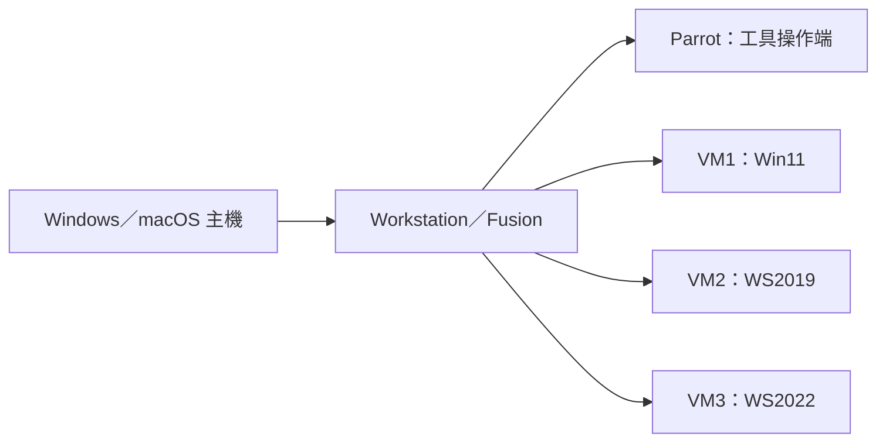

## 前言

從資訊安全目標、授權範圍與攻擊框架，建立 CEH 系列的閱讀基礎。

這篇依 EC-Council 教材 `module01.pdf` 整理，聚焦可確認的主要觀念，並非逐頁翻譯或完整操作手冊。各節頁碼指 **PDF 檔案內頁次**，包含封面及空白頁，不是書中印刷頁碼。實際測試以取得授權的範圍為前提。

## 1. 安全要保護什麼？

教材先介紹機密性（Confidentiality）、完整性（Integrity）與可用性（Availability），再補上真實性（Authenticity）及不可否認性（Non-repudiation）。機密性關心誰能讀取資料，完整性關心資料是否被未授權修改，可用性關心需要時能否使用服務。真實性與不可否認性則處理身分／來源是否可信，以及事後能否否認已發生的行為。這些目標不能只靠同一項控制措施達成。

*來源：本章 PDF 第 5–6 頁；以摘要及觀念解說重新整理。*

## 2. 威脅、弱點與攻擊要分開看

弱點（Vulnerability）是可被利用的缺陷，攻擊則是利用缺陷採取的行動。教材把攻擊動機、目標及 TTPs 放在一起討論：理解對手想達成什麼、使用哪些技術，以及如何實際操作，有助於選擇對應防護。不能只因系統有弱點，就直接斷言資料已遭竊。

*來源：本章 PDF 第 7–15 頁；以摘要及觀念解說重新整理。*

## 3. 道德駭客的界線來自授權

道德駭客運用攻擊者的思考方式協助發現問題，但測試目的、允許範圍、資料處理與保密要求都需要事先確認。教材也提到技術能力之外的溝通與報告能力。發現問題只是開始，讓負責修復的人理解影響與證據，才有助於改善安全。

*來源：本章 PDF 第 26–33 頁；以摘要及觀念解說重新整理。*

## 4. 把框架當作整理問題的工具

本章介紹 CEH 測試流程、Cyber Kill Chain、MITRE ATT&CK 與 Diamond Model。閱讀時可分別思考：測試要走哪些步驟、攻擊如何推進、行為如何分類，以及攻擊者、能力、基礎設施與受害者有何關聯。這些框架切入角度不同，不宜把各自的階段硬湊成同一張流程表。

*來源：本章 PDF 第 45–66 頁；以摘要及觀念解說重新整理。*

## 5. 從技術發現走到持續管理

縱深防禦（Defense in Depth）利用多層控制降低單點失效的影響。風險管理、威脅情報、威脅建模與事件應變則讓安全工作能持續運作。本章另討論 AI／ML 的輔助角色；自動化結果仍需要人判讀，不能直接取代授權、驗證與風險判斷。

*來源：本章 PDF 第 67–97 頁；以摘要及觀念解說重新整理。*

## 重要名詞

| 名詞 | 這篇的理解重點 |
| --- | --- |
| CIA | 機密性、完整性、可用性三個基本目標。 |
| TTPs | 用來描述攻擊策略、技術與實作程序。 |
| Threat Modeling | 依系統與威脅情境梳理風險。 |

## 理解用例（本文自擬）

公司檔案服務需要同時限制可讀取的人、保留異動紀錄，以及準備備份與復原方式。這三件事分別對應不同安全目標，不能因為檔案已加密，就認為可用性也得到保障。

這個例子用於解釋觀念，不是教材案例、實測結果或作者經歷。

<!-- ceh-lab-start -->
## 實作：手冊範圍與補充練習

**資料狀態：目錄未列獨立實驗；可使用環境設定頁建立實驗清單。** `Lab_Manual.pdf` 的 PDF 第 3；環境 7–9 頁可確認下面的目錄／環境資訊。表中的數字是原手冊印刷頁碼，並不表示目前這份 79 頁 PDF 真的包含那些頁面。

目錄的 Module 01 沒有列獨立實驗或起始頁，不能自行添加一組教材原有的任務。

### 建立實驗環境清單（依環境頁整理）

依第 7–9 頁列出實驗機器與角色，記錄自己的 IP、快照名稱及允許測試範圍。教材列出的弱密碼、停用防火牆與弱化政策，是指定實驗條件，不直接複製成日常電腦設定。

**實作產出：** 機器／角色／IP／快照／允許與排除範圍的表格。

環境的哪些部分有來源、哪些部分需要自己配置，見[共用實驗環境與缺頁說明](./CEH實作與資源.md)。

### 實用網址

- [OWASP Web Security Testing Guide](https://owasp.org/projects/web-security-testing-guide)：測試方法與範圍、資訊蒐集、Web 測試分類。

網址的來源與用途於 **2026-10-16** 查核；登入、安裝、所有靶場及完整實驗流程未逐一實測。[查看全系列實作與網址總表](./CEH實作與資源.md)。

<!-- ceh-lab-end -->

<!-- ceh-class-photos-start -->
## 課堂照片補充：先弄清楚實驗機與操作身分

本節依 `CEH_PDF/1to3/` 的課堂照片整理。照片代號只是本次核對索引，不代表拍攝順序，也不是手冊頁碼；完整檔名對照見[照片來源與實用網址](./CEH實作與資源.md)。這批圖片沒有標明每張屬於哪個 module，本文依內容將環境準備放在本章，並與 Module 03 的掃描實驗銜接。

### 1. 主機、虛擬化軟體與客體系統是三個層次

P01 白板畫出 Windows／macOS 主機、VMware Workstation／Fusion，以及其上的多台 VM。Parrot 是安裝工具的 Linux 操作端；其他 VM 用來提供不同服務。

| 白板上的角色 | 可辨認的標記 | 閱讀重點 |
| --- | --- | --- |
| 操作端 | Parrot、Linux、Hacker Tools | 執行測試工具的環境 |
| VM1 | Win11、FTP、Web | 以應用服務作為測試對象 |
| VM2 | WS2019、IIS、SMTP | 另一台提供服務的測試機 |
| VM3 | WS2022、DNS、DC | 網域與名稱服務相關角色 |

這是**白板的角色示意**，不是已驗證的安裝清單。不能只憑圖就認定每台機器已啟用全部功能、採用特定網路模式，或能在自己的主機上直接開機。先把自己的機器名稱、IP、已開啟服務與快照記下來，再依實驗選擇操作端與目標。

以下依白板重畫層次，沒有加入照片看不到的網路接線：



*照片來源：P01。*

### 2. 確認身分，不只看提示字元的顏色

P03、P07 的終端畫面先執行 `whoami`，得到 `attacker`；經過 `sudo su` 後，再執行 `whoami` 得到 `root`。可用來說明：登入帳號與目前執行命令的身分，需要實際確認。

在已備妥且允許使用管理權限的課程 VM，照片所示流程可整理為：

```text
whoami
sudo su
whoami
```

記錄兩次輸出與使用管理權限的原因。不是所有命令都必須切換 root；也不能把白板上的課程密碼當作所有 Parrot 安裝的通用密碼。

畫面中間出現未正常顯示的提示字元控制字串。照片能證明「提示字元顯示異常，但後一次 `whoami` 回傳 root」；無法單憑它確定 shell 設定是哪裡出錯，因此本文不臆測修復指令。

*照片來源：P03、P07；P10 可見相同課堂操作提示。*

### 3. 「Parrot VM」名稱相同，可能指不同專案

P17 的網頁介紹的是執行動態語言位元組碼的 **Parrot VM**。它和課程終端畫面裡用來執行安全工具的 **Parrot Security OS** 不同，不能把該頁當成課程 Linux 系統的安裝文件。

準備課程環境時，應核對 [Parrot Security 官方網站](https://parrotsec.org/) 的產品與文件。這裡只校正專案身分，不由照片推定課程映像的版本或下載檔。

*照片來源：P17，與 P01、P03、P07 對照；官方網址於 2026-10-16 核對。*

### 本章可完成的實作紀錄

建立一張「主機 → 虛擬化平台 → VM 角色」表，並記下執行工具時的帳號與權限。這些照片補充的是準備與確認方法，沒有補齊完整的 VM 匯入、網卡設定或軟體安裝步驟。

<!-- ceh-class-photos-end -->

## 複習問題

1. 弱點存在與攻擊已成功，差別在哪裡？
2. 測試前應確認哪些範圍與資料處理條件？
3. 縱深防禦為什麼仍需要事件應變？

## 來源與判讀限制

本次另參照 `CEH_PDF/1to3/` 的課堂照片；正文的 P 代號可在[照片來源對照](./CEH實作與資源.md)查回檔名。照片沒有完整章節標記，分類以內容為依據，不代表每張照片原本就屬於本章。

來源：`module01.pdf`，共 120 頁，位於本機 `CEH_PDF/`。本篇參照上述頁次的可辨識正文與主題，重要概念另以原圖抽樣核對；沒有宣稱逐頁圖表或每個操作都已完整還原。

第 98–118 頁列有法律與標準，但本篇不整理適用義務、版本要求或期限；這些內容需要另外查核現行官方資料。部分 AI 工具列表與小字圖示未逐項採用。

圖片辨識可能出現錯字，辨識不清的命令、參數、位址、數字與圖表細節均不憑上下文補寫。原理論筆記沒有全面更新工具、產品、法律或標準；新增實作節僅對所附官方文件及明列的校正進行查核。

## 系列導覽

- [回到 CEH 系列目錄](./CEH系列.md)
- 下一篇：[CEH 02：足跡蒐集與偵察](./CEH02.md)
