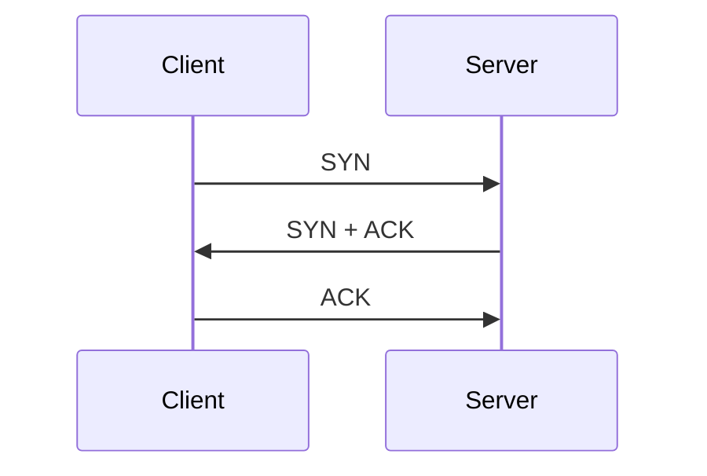

## 前言

依主機探索、連接埠與服務、作業系統辨識三層理解網路掃描結果。

這篇依 EC-Council 教材 `module03.pdf` 整理，聚焦可確認的主要觀念，並非逐頁翻譯或完整操作手冊。各節頁碼指 **PDF 檔案內頁次**，包含封面及空白頁，不是書中印刷頁碼。實際測試以取得授權的範圍為前提。

## 1. 從線索走向可觀察的回應

網路掃描（Network Scanning）在前一章蒐集的線索上，進一步確認主機、服務與系統資訊。教材先說明 TCP／IP 與封包，再引入掃描工具。分析時應記錄測試來源、目標、時間與回應，因為網路位置及過濾規則會影響看到的結果。

*來源：本章 PDF 第 4–21 頁；以摘要及觀念解說重新整理。*

## 2. 沒有回應，不一定代表主機不存在

Host Discovery 用不同類型的探測尋找活動主機。ICMP、TCP 與 UDP 探測可能得到不同結果。如果封包遭過濾，單一方法沒有回應仍不足以判定主機離線。教材列出多種方法，重點是理解每種方法依靠何種回應。

*來源：本章 PDF 第 22–39 頁；以摘要及觀念解說重新整理。*

## 3. 連接埠狀態要連同掃描方法解讀

Port and Service Discovery 用來找出對外提供的服務。開放、關閉與受過濾不是同一件事；不同探測與回應模式也會形成不同判斷。教材討論多種 TCP 與 UDP 掃描，不宜把某一種回應規則套用到所有掃描方式。

*來源：本章 PDF 第 40–78 頁；以摘要及觀念解說重新整理。*

## 4. 服務橫幅與指紋都是辨識線索

Banner Grabbing 與 OS Fingerprinting 協助判斷服務或作業系統。橫幅可以被修改，網路設備也可能改變回應，因此結果應視為待核對的辨識線索。版本資訊有助於後續弱點分析，但服務名稱或版本本身不等於利用一定成功。

*來源：本章 PDF 第 79–99 頁；以摘要及觀念解說重新整理。*

## 5. 從掃描行為看防護配置

教材討論繞過 IDS／防火牆的概念，也介紹掃描偵測與對策。防禦重點包括減少不必要服務、設定流量規則，以及觀察異常探測。本文以防護與結果解讀為主，不還原教材中的規避操作。

*來源：本章 PDF 第 100–143 頁；以摘要及觀念解說重新整理。*

## 重要名詞

| 名詞 | 這篇的理解重點 |
| --- | --- |
| Host Discovery | 確認可能在線的主機。 |
| Banner Grabbing | 讀取服務回傳的識別資訊。 |
| OS Fingerprinting | 根據回應特徵推測作業系統。 |

## 理解用例（本文自擬）

同一台測試主機可能不回應 ICMP，卻仍提供 HTTPS。若只看一次 ping 就標記為離線，資產盤點便可能漏掉它；應結合其他獲准的觀察方式核對。

這個例子用於解釋觀念，不是教材案例、實測結果或作者經歷。

<!-- ceh-lab-start -->
## 實作：網路掃描（Lab Manual 可見步驟）

本節來源是 `Lab_Manual.pdf` **PDF 第 10–57 頁**，對應印刷第 76–123 頁。第一頁已從某實驗的步驟 13 開始，所以前置操作及主機探索沒有完整收錄。以下依可確認內容重新整理；並非宣稱已在教材 VM 上實測。

先看[實驗環境、缺頁與資源總表](./CEH實作與資源.md)。本節的 `10.10.1.11`、`10.10.1.19`、`10.10.1.22` 是**教材實驗機範例**，執行前要對照自己的隔離實驗網路與授權目標，不能直接假設機器已存在。

### 1. 對照連接埠與服務版本

來源：Lab Manual PDF 第 10–19 頁，尤其第 17 頁。

1. 啟動實驗用掃描端與目標主機，確認目標位址及服務設定。若使用 Zenmap，可將命令輸入 Command 欄位；也可在已安裝 Nmap 的終端執行。
2. 先記錄 TCP 掃描的連接埠、狀態與服務名稱，再做服務版本探索。
3. 把版本回應、服務名稱及自己的已知設定對照，記下不一致或無法確認的欄位。

以下兩個命令已核對原圖與官方文件，只是教材位址的範例：

```text
nmap -sS -v 10.10.1.22
nmap -sV 10.10.1.22
```

`-sS` 是 TCP SYN 掃描；所需權限依平台而定。`-sV` 是服務版本探索。兩次觀察的問題不同：前者以連接埠狀態為主，後者再向服務取得辨識資訊。掃描工具可能被服務回應誤導，因此不要把版本字串直接當成利用一定成立的證明。

**實驗紀錄：** 來源端、目標、時間、命令、連接埠／狀態／服務／版本，以及哪些欄位只屬推測。介面與選項可對照 [Zenmap Guide](https://nmap.org/book/zenmap.html) 及 [Nmap Reference Guide](https://nmap.org/book/man.html)。

### 2. 分開驗證 OS 指紋與 SMB 資訊

來源：Lab Manual PDF 第 20–24 頁。

1. 在具備所需權限的實驗掃描端執行 OS 探索。
2. 再對提供 SMB 的同一個目標執行指定 NSE 腳本。
3. 分別記錄 OS 指紋的匹配情況，以及腳本實際回傳的名稱、網域等欄位。

```text
nmap -O 10.10.1.22
nmap --script smb-os-discovery.nse 10.10.1.22
```

**這裡不要照教材敘述預填答案：** 第 23 頁的 `-O` 截圖本身顯示 **No exact OS matches for host**，所以該次結果應記為「未得到精確匹配」。NSE 結果也依服務及可取得資訊而異。兩種方法提供的證據分開保存，不能把其中一種的答案補給另一種。

選項與輸出限制可核對 [Nmap OS Detection](https://nmap.org/book/man-os-detection.html) 及 [smb-os-discovery 腳本說明](https://nmap.org/nsedoc/scripts/smb-os-discovery.html)。

### 3. 用封包與紀錄檢查防護行為

來源：Lab Manual PDF 第 25–33 頁。

這段手冊包含改變掃描封包及來源特徵的示範，也用 Wireshark 觀察接收到的封包。整理時應保留三組資訊：掃描端送出什麼、目標端收到什麼，以及防護設備／工具記錄什麼。**掃描有結果不等於沒有被偵測，沒有回應也不等於防護一定成功。**

第 11–12 頁將 `open|filtered` 和防火牆聯繫得過於直接；依 [Nmap 的狀態定義](https://nmap.org/book/man.html)，這個組合表示工具無法確定是開放還是受過濾，不能單憑它證明已配置防火牆。也不要把 SYN 掃描中的「stealth」名稱當成不可見保證。

本篇先採用觀察與對照的實作範圍；具體封包變形須依原始實驗條件逐項驗證，不把截圖當成任何環境都能重現的結論。封包操作可查 [Wireshark 使用手冊](https://www.wireshark.org/docs/wsug_html_chunked/)。

### 4. 比較不同掃描工具的證據

來源：Lab Manual PDF 第 34–43 頁。

手冊接著使用 Metasploit 的探索／掃描模組，蒐集連接埠與 SMB 版本資訊。練習時可先針對同一台實驗主機，分別保留 Nmap 與模組輸出，再比較服務、作業系統與名稱欄位。不要把這裡的掃描模組寫成已成功取得主機控制權。

手冊的 SMB 模組可對照 [Rapid7 SMB Version Detection](https://www.rapid7.com/db/modules/auxiliary/scanner/smb/smb_version/)。原範例包含整段子網與並行設定；本文不預設你的授權範圍與設備容量相同。

### 5. AI 輔助命令要保留人工核對

來源：Lab Manual PDF 第 44–57 頁。

手冊使用 ShellGPT 產生掃描命令，且在第 45 頁明確依賴另一段 **CEH Lab Setup 的 ShellGPT 整合步驟**。這段整合設定未收錄於目前 PDF 第 7–9 頁，不能說照這份摘頁就能直接完成。

若另行參照 [ShellGPT 原作者專案](https://github.com/TheR1D/shell_gpt) 準備環境，實驗紀錄要同時保存提示、生成命令、人工檢查與實際結果；不要把 AI 文字當成執行成功的證據。第 53 頁涉及從 TTL 推測 OS，也只能列為線索，不能據此填成已驗證的 OS。

### 6. 完成後如何判斷學到了什麼？

- 能分開說明連接埠狀態、服務版本、OS 指紋與 SMB 回傳資訊。
- 遇到 `open|filtered` 或沒有精確 OS 匹配，能照實記錄不確定性。
- 能把工具輸出對回實際命令、時間與目標，而不是照抄教材結果。

以上是本文依可見實驗整理的自我檢查，並非教材原定評分表。[查看本章與其他章的實用網址](./CEH實作與資源.md)。

### 目錄中的本章實驗

| 目錄可確認的實驗主題（中文整理） | 手冊印刷起始頁 |
| --- | ---: |
| 主機探索 | 66 |
| 連接埠與服務探索 | 71 |
| 作業系統探索 | 86 |
| IDS／防火牆相關掃描 | 91 |
| 多種掃描工具 | 100 |
| AI 輔助掃描 | 110 |

### 實用網址

- [Nmap Reference Guide](https://nmap.org/book/man.html)：核對掃描參數、狀態與輸出選項。
- [Zenmap GUI Users Guide](https://nmap.org/book/zenmap.html)：對照圖形介面、掃描設定及結果頁籤。
- [Nmap OS Detection](https://nmap.org/book/man-os-detection.html)：理解 OS 指紋、匹配與限制。
- [Nmap smb-os-discovery](https://nmap.org/nsedoc/scripts/smb-os-discovery.html)：核對 SMB 探索回傳資訊及條件。
- [Wireshark User Guide](https://www.wireshark.org/docs/wsug_html_chunked/)：學習封包分析、篩選與統計介面。
- [Rapid7 SMB Version Detection](https://www.rapid7.com/db/modules/auxiliary/scanner/smb/smb_version/)：核對手冊中 Metasploit SMB 探索模組。
- [ShellGPT 專案](https://github.com/TheR1D/shell_gpt)：核對 --shell、命令確認與安裝條件；不是教材缺頁的替代品。

網址的來源與用途於 **2026-10-16** 查核；登入、安裝、所有靶場及完整實驗流程未逐一實測。[查看全系列實作與網址總表](./CEH實作與資源.md)。

<!-- ceh-lab-end -->

<!-- ceh-class-photos-start -->
## 課堂照片補充：從主機探索到服務與 OS 證據

本節依 `CEH_PDF/1to3/` 的白板、教材畫面及終端照片整理，補充原 Lab Manual 缺少的部分主機探索示範。**照片不是連續錄影，也沒有補齊原手冊全部前置步驟。** 以下的 `10.10.1.11`、`10.10.1.19` 都是照片中的課程實驗位址，執行前須對照自己的已授權實驗機。

照片代號只是核對索引，並非拍攝先後；檔名對照見[來源表](./CEH實作與資源.md)。各項畫面輸出是課堂觀察，不是本次在使用者電腦上重新實測的結果。

### 1. TCP 標頭、資料與旗標要分開看

P06 白板將應用資料、TCP 標頭與 Payload 分開；P20 的教材畫面則列出常見旗標。本文將基本用途整理如下，並依 [TCP 規範 RFC 9293](https://datatracker.ietf.org/doc/html/rfc9293) 釐清：

| 旗標 | 理解重點 |
| --- | --- |
| SYN | 同步序號，參與連線建立 |
| ACK | 確認號欄位有效；不是「這個封包一定只有確認、沒有資料」 |
| FIN | 發送端不再傳送資料，參與正常關閉 |
| RST | 重設／拒絕連線相關狀態 |
| PSH | 推送功能的標記，不能讀成整條網路會立即送完所有緩衝資料的保證 |
| URG | 緊急指標欄位有效，不等於任意封包得到網路優先權 |

P18 的三向交握圖可依序讀為 SYN → SYN+ACK → ACK；圖中的關閉則是雙方各自送出 FIN 並取得確認的例子。序號與確認號是示意，不是所有連線固定採用的數字。

以下按照片重畫交握順序，略去數字：



*照片來源：P06、P18、P20、P21、P22；P19 與 P18 是同一張圖片的重複檔。*

### 2. 主機探索：ARP 與 ICMP 的觀察條件不同

P10 白板列出 ARP／ICMP 探索；P11 終端畫面有以下三次可辨識操作：

```text
nmap -sn -PR 10.10.1.11
nmap -sn -PR 10.10.1.19
nmap -sn -PE 10.10.1.19
```

| 選項 | 意義與限制 |
| --- | --- |
| `-sn` | 不接續進行一般連接埠掃描；此處用於主機探索 |
| `-PR` | ARP 探索，需考慮本地網路位置 |
| `-PE` | 指定 ICMP Echo 探測；不能只憑命令文字認定實際只送了 ICMP |

**官方補充：** Nmap 對本地 Ethernet 目標，可能優先使用 ARP，即使命令指定其他探測型態。若要比較 ARP 與 ICMP，應同時觀察實際封包與網路位置，不能只比較兩次命令的「Host is up」。[Nmap Host Discovery](https://nmap.org/book/man-host-discovery.html)

P11 對 `.11` 的該次探索顯示 **Host seems down**，對 `.19` 顯示可達；但後面其他照片又能掃描 `.11`。這些不是同一次測試，沒有證據指出中間改了什麼。不能自行寫成「關閉防火牆後就修好」或「`.11` 一定離線」。

*照片來源：P07、P10、P11、P21、P22。*

### 3. Full-open 與 Half-open 的差別，不是有沒有紀錄

P12 教材與 P10、P21、P22 白板對照 `-sT` 與 `-sS`：

```text
nmap -sT -v 10.10.1.11
nmap -sS -v 10.10.1.11
```

- `-sT` 使用作業系統的 connect 介面；在開放埠的正常情況下，完成 TCP 連線建立。
- `-sS` 以 SYN 與回應判讀狀態，對開放埠不繼續完成一般應用連線，因此常稱 half-open。

**白板的「No Logs」需要校正：** 沒有完成應用連線，不代表封包、主機或偵測設備不會留下紀錄。是否有應用層紀錄與是否可被網路設備觀察，也是不同問題。這裡把該字樣當成待釐清的課堂簡寫，不當作安全保證。[Nmap SYN Scan](https://nmap.org/book/synscan.html)、[Nmap TCP Connect Scan](https://nmap.org/book/scan-methods-connect-scan.html)

這兩個命令在白板可確認，但本批照片沒有足夠連續封包，不能把手繪箭頭說成已擷取到的實際封包序列。

### 4. `ftp` 名稱、服務探索與 Banner 是三層證據

P02 的白板標記 FTP／Web 與 TCP 21／80，也提到服務名稱對照檔；P16 則把同一目標的兩次命令放在一起：

```text
nmap -p 21 10.10.1.11
nmap -p 21 -sV 10.10.1.11
```

第一個畫面顯示 `21/tcp open ftp`；第二個加上服務探索，VERSION 欄顯示 `Microsoft ftpd`。**這裡只有產品辨識字串，沒有可直接抄寫的精確版本號。**

本機服務對照資料與 Nmap 的埠名稱資料，可以提供慣用服務名稱，不能證明該埠實際運作的產品。Nmap 本身使用 `nmap-services` 等資料；不應把白板上的 `/etc/services` 視為它唯一的辨識依據。[Nmap 服務名稱資料](https://nmap.org/book/nmap-services.html)、[Service and Version Detection](https://nmap.org/book/man-version-detection.html)

P08 再使用 `ftp 10.10.1.11`，可見 `220 Microsoft FTP Service`，畫面停在要求輸入名稱。它支持「連上控制服務並讀到歡迎訊息」，**沒有證明已成功登入、列目錄或傳檔**。P05 的 Banner 示意也應放在這個層次理解。

*照片來源：P02、P05、P08、P15、P16。*

### 5. OS 指紋與 SMB 回報不一致時，保留差異

P13 與 P04 分別顯示以下命令：

```text
nmap -O 10.10.1.11
nmap --script smb-os-discovery 10.10.1.11
```

| 來源 | 照片實際可讀取的內容 | 判讀方式 |
| --- | --- | --- |
| P13 的 `-O` | `Microsoft Windows 10 1703` | 記為 Nmap 指紋辨識結果，不直接當資產真實版本 |
| P04 的 SMB 腳本 | OS 字串含 `Windows 10 Pro 22000`；Computer name 為 `WINDOWS11` | 記為服務回傳欄位；電腦名稱不是 OS 驗證 |
| P01 的角色圖 | VM1 標為 Win11 | 只是角色標記，不能拿來覆蓋工具的不同觀察 |

這些資訊不完全一致。可能原因需另外核對資產與系統資訊；照片不足以判定真實版本，也不能將幾張圖的字串拼成單一「已確認答案」。原 Lab Manual 的另一個例子還出現未精確匹配，應保留各自來源，不混用。

P15 提到 `--script`、`.nse` 與 `/usr/share/nmap/scripts`。這可補充 NSE 腳本的概念，但實際安裝位置依環境確認，不把照片路徑當成所有系統的固定位置。[Nmap NSE](https://nmap.org/book/man-nse.html)

*照片來源：P01、P04、P10、P13、P15；SMB 欄位定義另見 [smb-os-discovery 官方文件](https://nmap.org/nsedoc/scripts/smb-os-discovery.html)。*

### 6. 依照片可整理出的練習順序

以下是本文依已確認內容重組的學習順序，**不是從 UUID 檔名推定的上課時間順序**：

1. 確認 VM 角色、位址及目前身分，參照 Module 01 的環境補充。
2. 在獲准的實驗目標進行主機探索，保存未回應的結果，不預填成功。
3. 針對同一個目標比較連接埠探索、服務探索與 Banner。
4. 分別保存 OS 指紋與 SMB 欄位，再列出一致、不一致與無法確認的部分。

實驗紀錄應有「來源照片／實際命令／觀察／推論限制」四欄。新的照片補到了原手冊未收錄的一些觀念與示範，仍沒有提供完整的網卡設定、環境切換紀錄或連續封包證據。

<!-- ceh-class-photos-end -->

## 複習問題

1. 為什麼主機探索與服務探索需要分開？
2. 服務版本與弱點存在之間還缺哪些證據？
3. 防火牆會怎麼影響掃描結果的解讀？

## 來源與判讀限制

本次另參照 `CEH_PDF/1to3/` 的課堂照片；正文的 P 代號可在[照片來源對照](./CEH實作與資源.md)查回檔名。照片沒有完整章節標記，分類以內容為依據，不代表每張照片原本就屬於本章。

來源：`module03.pdf`，共 144 頁，位於本機 `CEH_PDF/`。本篇參照上述頁次的可辨識正文與主題，重要概念另以原圖抽樣核對；沒有宣稱逐頁圖表或每個操作都已完整還原。

原理論 PDF 的小字掃描旗標與封包範例未逐字轉錄；本次實作節另外依 Lab Manual 原圖與官方文件核對可確認的命令，其他模糊細節仍不補寫。

圖片辨識可能出現錯字，辨識不清的命令、參數、位址、數字與圖表細節均不憑上下文補寫。原理論筆記沒有全面更新工具、產品、法律或標準；新增實作節僅對所附官方文件及明列的校正進行查核。

## 系列導覽

- 上一篇：[CEH 02：足跡蒐集與偵察](./CEH02.md)
- [回到 CEH 系列目錄](./CEH系列.md)
- 下一篇：[CEH 04：列舉與服務資訊曝露](./CEH04.md)
