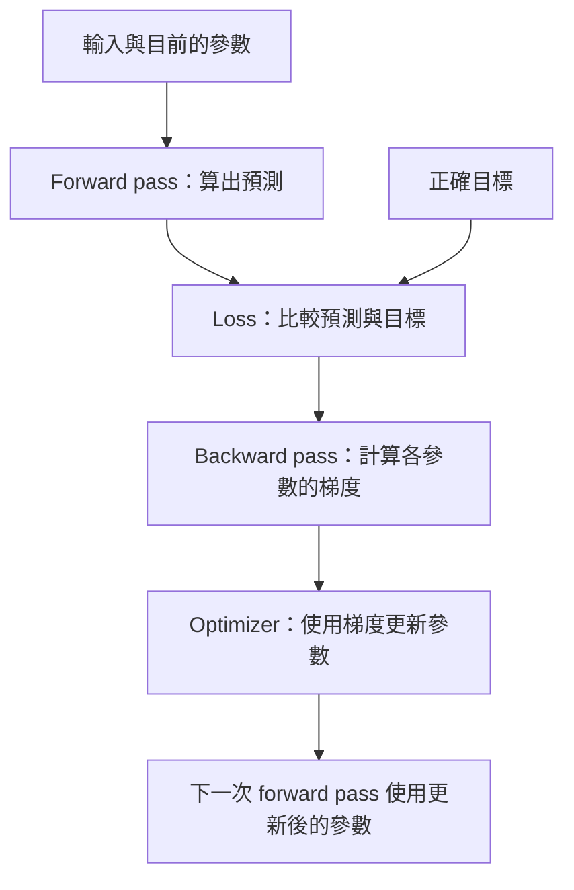
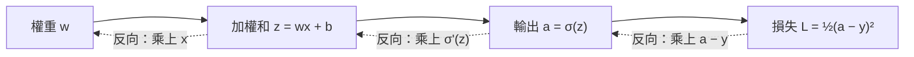
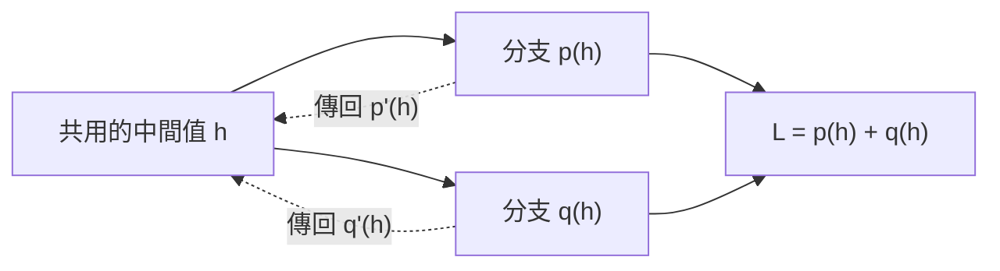
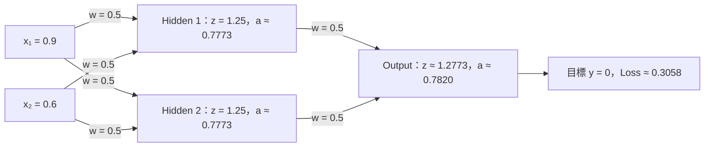

## 前言

前一篇知道網路怎麼算出預測，接下來要問: 權重怎麼改，預測才會變好？這邊先分開兩件事，**反向傳播計算梯度，梯度下降使用梯度更新參數**。

## 1. 一次訓練的流程

若對導數、偏導數或矩陣 shape 還不熟，可以先閱讀補充篇：[微積分與數學先備知識](./深度學習補充微積分與數學先備知識.md)，再回來對照下方的圖解與公式。



Forward pass 從前往後計算輸出。Loss 比較預測與目標；backward pass 則沿計算圖往回算，求出各個參數對 loss 的偏導數。

例如單筆平方誤差 `L = ½(ŷ − y)²`，梯度描述的是「這個參數稍微改變，loss 會怎麼變」，不是直接回傳新的權重。

## 2. 梯度下降沿負梯度更新

```text
w_new = w_old − η ∂L/∂w
```

`η` 是 learning rate。導數為正時，往減小參數的方向走；導數為負時，往增大參數的方向走。

### 用曲線看「往哪裡走」

先用簡單的 `L(w) = ½w²` 建立直覺。橫軸是權重 `w`，縱軸是 loss；藍線是 loss 曲線，灰線是 `w = 2` 處的切線，橘點依序是三次更新的位置。

```function-plot
{
  "title": "梯度下降：沿 loss 曲線往低處移動",
  "xAxis": { "label": "w", "domain": [-2.5, 2.5] },
  "yAxis": { "label": "L(w)", "domain": [-0.3, 3.5] },
  "grid": true,
  "data": [
    { "fn": "0.5 * x^2", "graphType": "polyline", "color": "#2563eb" },
    { "fn": "2 * x - 2", "range": [1.3, 2.5], "graphType": "polyline", "color": "#64748b" },
    { "points": [[2, 2], [1, 0.5], [0.5, 0.125]], "fnType": "points", "graphType": "scatter", "color": "#c2410c" }
  ]
}
```

在 `w = 2` 時，切線斜率是正的 `2`，表示往右增加權重會增加 loss，因此往左更新。若 `η = 0.5`，第一次更新為 `w_new = 2 − 0.5×2 = 1`；下一次斜率變成 `1`，更新到 `0.5`。沿著 **`2 → 1 → 0.5`** 看橘點，loss 也依序由 `2 → 0.5 → 0.125` 下降。

在左半邊，斜率是負的，更新方向就會往右。**梯度不是指向最低點的導航，而是目前位置的局部變化率。** 真實網路有很多參數，這張圖只是單一參數的簡化示意。

### Learning rate 決定步伐大小

同樣從 `w = 2` 出發，對這個特定的平方函數，更新規則是 `w_new = (1 − η)w`：

| Learning rate | 權重更新位置 | 圖像上的意思 |
| --- | --- | --- |
| `η = 0.1` | `2 → 1.8 → 1.62` | 每次只移動一小段，下降較慢 |
| `η = 0.5` | `2 → 1 → 0.5` | 逐步靠近最低點 |
| `η = 1.5` | `2 → −1 → 0.5` | 跨過最低點，在兩側來回，但仍收斂 |
| `η = 2.5` | `2 → −3 → 4.5` | 在兩側越跳越遠，loss 增加 |

這些數字只適用於此示例，不能直接當成其他模型的 learning rate 建議。跨過最低點也不一定代表發散，要看後續是否逐漸靠近。

Learning rate 太大可能跳過較好的位置或發散，太小則更新緩慢。非凸問題還可能遇到鞍點、平坦區域與局部極小值，不能把「求到梯度」當成找到全域最佳解的保證。

## 3. Chain rule 把各段影響串起來

假設某個 neuron 做 `z = wx + b`、`a = σ(z)`，則:



實線由左往右是 forward pass；虛線由右往左是梯度計算。從 loss 開始，依序問「`a` 改一點，loss 改多少？」「`z` 改一點，`a` 改多少？」「`w` 改一點，`z` 改多少？」。把沿路的局部導數相乘，就得到 `w` 對 loss 的影響。

```text
∂L/∂w = (∂L/∂a) × (∂a/∂z) × (∂z/∂w)
       = (∂L/∂a) × σ'(z) × x
```

先知道輸出如何影響 loss，再乘上 activation 和加權和的導數。如果同一個數值通往多個分支，各個分支傳回的梯度需要相加。



例如 `p(h) = 2h`、`q(h) = 3h`，則 `L = 5h`。`h` 增加一點會同時影響兩條路徑，所以總梯度是 `2 + 3 = 5`，不能只取其中一條。

反向傳播會重用已計算的中間結果，不用為每個參數重新走完整條計算路徑。這就是它能處理大量參數的重要原因。

## 4. 用 sigmoid 和平方誤差看單一 neuron

先看 sigmoid 的形狀：藍線是輸出，橘線是導數，兩者共用同一組座標軸。

```function-plot
{
  "title": "Sigmoid 與導數：兩端越平，局部梯度越小",
  "xAxis": { "label": "z", "domain": [-6, 6] },
  "yAxis": { "label": "函數值", "domain": [-0.05, 1.1] },
  "grid": true,
  "data": [
    { "fn": "1 / (1 + exp(-x))", "graphType": "polyline", "color": "#2563eb" },
    { "fn": "exp(-x) / (1 + exp(-x))^2", "graphType": "polyline", "color": "#c2410c" }
  ]
}
```

在 `z = 0` 附近，藍線最陡，導數最大為 `0.25`；兩端輸出接近 0 或 1，曲線變平，導數也接近 0。反向傳播經過 sigmoid 時會乘上這個導數，因此即使後面傳回梯度，傳到前面時也可能縮小。若多層反覆乘上小數，可能出現梯度消失。

```text
σ(z) = 1 / (1 + exp(−z))
σ'(z) = σ(z)(1 − σ(z))
L = ½(a − y)²
δ = ∂L/∂z = (a − y)a(1 − a)
∂L/∂w = δx
∂L/∂b = δ
```

這篇令 `δ = ∂L/∂z`。簡報前半段使用負梯度的符號約定，所以會寫成 `(y − a)a(1 − a)`，再用加法更新權重。兩種寫法可以等價，但**δ 的正負號與更新公式要成套使用**，不能混在一起。

## 5. 多層網路的矩陣形式

以下以單筆資料、column vector 為約定:

```text
zˡ = Wˡaˡ⁻¹ + bˡ
aˡ = fˡ(zˡ)

δᴸ = (∂L/∂aᴸ) ⊙ f'ᴸ(zᴸ)
δˡ = (Wˡ⁺¹)ᵀδˡ⁺¹ ⊙ f'ˡ(zˡ)
∂L/∂Wˡ = δˡ(aˡ⁻¹)ᵀ
∂L/∂bˡ = δˡ
```

`⊙` 是逐元素相乘，和矩陣乘法不同。先取得後一層的 δ，才能算前一層，所以計算方向是由後往前。

Batch 計算時還要依 loss 的 sum／mean 定義，將各筆梯度加總或平均。換成 row vector 記法時，轉置位置也會不同，讀公式前先確認 shape。

## 6. 2-2-1 網路的數值例子

沿用簡報: 輸入 `(0.9, 0.6)`、兩個 hidden neurons、一個 output neuron，各層都用 sigmoid，所有權重與 bias 初值 0.5，目標為 0。



圖中每條實線對應一個權重；三個 neuron 各自還有 `b = 0.5`，為了讓圖容易閱讀，沒有另外畫出 bias 節點。由左往右讀，就能把下方計算式對回每個節點。

```text
hidden z = 0.9×0.5 + 0.6×0.5 + 0.5 = 1.25
hidden a ≈ 0.7773
output z = 0.7773×0.5 + 0.7773×0.5 + 0.5 ≈ 1.2773
output a ≈ 0.7820
output δ ≈ 0.7820×0.7820×(1−0.7820) ≈ 0.1333
```

若 learning rate 為 1，hidden 到 output 的其中一個權重更新約為 `0.5 − 0.1333×0.7773 ≈ 0.3964`。Output bias 更新約為 `0.3667`。

反向則先算 output 的 `δ`，再傳回兩個 hidden neurons：


例如連接 `x₁` 與 Hidden 1 的權重，其梯度約為 `0.0115×0.9 ≈ 0.0104`。這些箭頭表示**梯度計算的依賴方向**；算完全部梯度後，才由 optimizer 更新權重。

計算 hidden δ 時使用同一次 forward pass 的舊權重，再一致地更新全部參數。不要先更新 output 權重，再把新權重拿回去算這次的 hidden 梯度。

> 小補充: 全部權重設成一樣是為了手算方便。實際 hidden neurons 通常需要不同初始化，避免對稱的 neurons 一直學相同的東西。

## 7. 自動微分與課程練習

框架可以沿著可微分的運算計算梯度，但仍需要正確的 loss、shape 與計算圖。把資料轉成框架外的數值操作，可能讓梯度路徑中斷。

簡報提供 `Lab_2_Gradient_Descent.ipynb` 的練習方向。可以先用小網路手算，再對照框架，確認更新符號和 loss 的縮放一致。

- Backpropagation 和 gradient descent 各做哪件事？
- 分支計算的梯度為什麼要相加？
- Loss 改成平均值後，梯度的尺度會如何改變？

## 資料來源

課程簡報: `Chapter 2 反向傳播演算法.pptx`，第 1–35 頁。公式採一致的正梯度記法；數值例子使用簡報設定重新整理，未轉錄圖像中的完整矩陣布局。流程圖、計算圖、平方函數的梯度下降示例與 sigmoid 曲線為補充圖解。

## 系列導覽

[系列目錄](./深度學習系列.md) · [上一篇](./深度學習01感知器與神經網路入門.md) · [下一篇](./深度學習03模型訓練與正則化.md)
