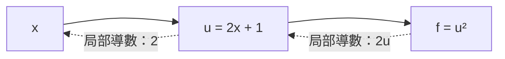

## 前言

讀到反向傳播的公式，不需要一開始就把整套微積分學完。先掌握「函數如何變化」「參數如何影響 loss」「多段影響如何串起來」，就能理解基本的訓練計算。

本篇是系列的補充教材，可以在第 01、02 篇之間閱讀，也可以遇到公式時回來查。先用圖與數字建立直覺，再對照符號；以下例子是為了說明數學概念另外設計，並非課程簡報的逐頁整理。

## 1. 函數、變數與參數：先看誰在改變

### 先把函數想成一台計算機

假設一家店每枝鉛筆賣 10 元，另外收一次包裝費 5 元。買幾枝是輸入，要付多少錢是輸出：

```text
費用 = 10 × 鉛筆枝數 + 5
```

| 買幾枝 | 計算 | 費用 |
| --- | --- | --- |
| 1 | `10×1 + 5` | 15 元 |
| 2 | `10×2 + 5` | 25 元 |
| 3 | `10×3 + 5` | 35 元 |

把「枝數」縮寫成 `x`，就得到 `f(x) = 10x + 5`。`f(x)` 讀作「f 在輸入 x 時的結果」，不是 `f` 乘上 `x`。這個購物例子的枝數是整數；後面畫連續曲線時，則會使用可以取小數的變數。

函數把輸入對應到輸出。例如 `f(x) = 2x + 1`，輸入 `x = 3`，輸出就是 `7`。

神經網路裡常看到 `z = wx + b`：

| 符號 | 角色 | 例子 |
| --- | --- | --- |
| `x` | 資料輸入 | 房屋面積、圖片像素 |
| `w` | 權重參數 | 控制輸入對結果的影響 |
| `b` | 偏置參數 | 調整輸出偏移 |
| `z` | 運算結果 | activation 前的加權和 |

預測時，通常固定 `w`、`b`，換不同的 `x`。訓練時，則用資料計算 loss，研究改變 `w`、`b` 會如何影響 loss。因此，畫函數圖之前，要先確認橫軸是輸入 `x`，還是參數 `w`。

在鉛筆例子中，`w` 就像單價，`b` 就像固定包裝費。增加單價會讓買得多的人受到更大的影響；增加包裝費，則每個人的總費用都增加同樣的量。模型訓練可以想成：根據已知的枝數與總費用，逐步調整猜測的單價與固定費用。

### 閱讀公式的符號小字典

| 符號 | 用白話怎麼讀 |
| --- | --- |
| `x²` | `x×x`，例如 `3² = 9` |
| `Δx` | x 的變化量：新值減掉舊值 |
| `≈` | 大約相等，不是完全相等 |
| `Σ` | 把指定的一串數字加起來 |
| `f'(x)` | 函數在 x 附近的變化率 |
| `∂L/∂w` | 其他量固定時，改變 w 對 loss 的局部影響 |
| `η` | 更新步伐的倍率，稱為 learning rate |
| `ŷ` | 模型猜出的答案；`y` 是正確答案 |

第一次看到新符號，可以先把它換成右欄的句子。還不熟悉導數符號也沒關係，下面會逐步解釋。

## 2. 斜率與極限：從一段變化到一點的變化

### 先從走路的速度理解斜率

你在 2 秒內向前走了 6 公尺，平均速度就是 `6÷2 = 3` 公尺／秒。如果把時間畫在橫軸、位置畫在縱軸，這兩個點之間的斜率也是 3。

所以斜率不只是「看起來有多斜」，還表示**橫軸增加一個單位時，縱軸平均增加多少**。讀圖時要看軸上的數字與單位；把圖拉高或壓扁會改變視覺角度，但不會改變原本計算出的斜率。

### 高度除以水平，就是斜率嗎？

可以這樣理解，但要說得更精確：**高度的變化量，除以水平的變化量，就是兩點之間的斜率。** 重點是兩個位置的「差」，不是直接拿某一個點的高度除以水平座標。

```text
斜率 = 高度變化量 ÷ 水平變化量
     = (終點高度 − 起點高度) ÷ (終點水平位置 − 起點水平位置)
```

例如從 `A = (1, 2)` 移到 `B = (3, 8)`：

| 變化 | 計算 | 結果 |
| --- | --- | --- |
| 水平變化量 | `3 − 1` | 向右 2 單位 |
| 高度變化量 | `8 − 2` | 向上 6 單位 |
| 斜率 | `6 ÷ 2` | `3` |

意思是：**平均往右移動 1 單位，高度增加 3 單位。** 不能直接算 `8÷3`，因為這次的起點是 `(1, 2)`，不是原點。

```function-plot
{
  "title": "斜率：向上 6 單位，除以向右 2 單位",
  "xAxis": { "label": "水平位置 x", "domain": [0, 4] },
  "yAxis": { "label": "高度 y", "domain": [0, 10] },
  "grid": true,
  "data": [
    { "points": [[1, 2], [3, 8]], "fnType": "points", "graphType": "polyline", "color": "#2563eb" },
    { "points": [[1, 2], [3, 2], [3, 8]], "fnType": "points", "graphType": "polyline", "color": "#64748b" },
    { "points": [[1, 2], [3, 8]], "fnType": "points", "graphType": "scatter", "color": "#c2410c" }
  ]
}
```

圖中的藍線連接 A、B 兩點；灰線把移動拆成「先向右 2，再向上 6」，方便看出斜率的分母與分子。

| 線的方向 | 高度變化量 | 斜率 |
| --- | --- | --- |
| 往右上升 | 正數 | 正數 |
| 往右下降 | 負數 | 負數 |
| 水平線 | 0 | 0 |
| 垂直線 | 水平變化量為 0 | 沒有定義，因為不能除以 0 |

以上升或下降來判斷正負時，都是以**往右看**為準。對曲線，兩點間算出的是平均斜率；讓兩點越來越靠近，若斜率趨向同一個有限值，就得到那個位置的導數，也就是切線斜率。

#### 函數的斜率怎麼看？

把函數畫在座標平面時，橫軸是輸入 `x`，縱軸是輸出 `y = f(x)`。點 `(2, 5)` 的意思是「輸入 2，輸出 5」；**5 是這個點的高度，不是斜率。** 看斜率，要觀察輸入改變時，高度怎麼跟著改變。

**先看直線：`f(x) = ax + b`。** 其中 `a` 就是斜率，`b` 是直線在 `x = 0` 時的高度。因為輸入增加 1，輸出一定增加 `a`：

```text
f(x + 1) − f(x)
= [a(x + 1) + b] − (ax + b)
= a
```

| 函數 | 輸入增加 1 時 | 斜率 | 往右看圖形 |
| --- | --- | --- | --- |
| `f(x) = 2x + 1` | 輸出增加 2 | `2` | 上升 |
| `g(x) = −x + 4` | 輸出減少 1 | `−1` | 下降 |
| `k(x) = 2` | 輸出不變 | `0` | 水平 |

```function-plot
{
  "title": "看直線的斜率：上升、下降與水平",
  "xAxis": { "label": "輸入 x", "domain": [-1, 3] },
  "yAxis": { "label": "輸出", "domain": [-2, 8] },
  "grid": true,
  "data": [
    { "fn": "2*x+1", "graphType": "polyline", "color": "#2563eb" },
    { "fn": "-x+4", "graphType": "polyline", "color": "#c2410c" },
    { "fn": "2", "graphType": "polyline", "color": "#64748b" }
  ]
}
```

藍線的斜率是 2，橘線是 −1，灰線是 0。在相同座標尺度下，斜率的絕對值越大，線越陡。例如 −3 比 −1 下降得更陡；判斷陡不陡看的是絕對值，不是只比哪個數比較大。

**再看曲線：斜率可能隨位置改變。** 例如 `f(x) = x²`，先選取不同區段算平均斜率：

| 區段 | 高度變化量 | 水平變化量 | 平均斜率 |
| --- | --- | --- | --- |
| `x = −2 → −1` | `1 − 4 = −3` | `1` | `−3` |
| `x = 0 → 1` | `1 − 0 = 1` | `1` | `1` |
| `x = 1 → 2` | `4 − 1 = 3` | `1` | `3` |

同一條曲線，在不同區段的斜率並不相同，所以不能只說「`x²` 的斜率是某個固定數」。上表描述兩點之間的平均變化；若要看**某一個位置**，就要看該點的切線斜率，也就是後面會介紹的導數。

看函數圖時，可以依序問：

1. **軸上是什麼？** 先確認輸入、輸出與單位。
2. **往右時高度怎麼變？** 在你觀察的區段，上升是正斜率，下降是負斜率，水平是 0。
3. **問的是一段，還是一點？** 一段用兩點的高度差除以水平差；一點看切線斜率。

例如 `f(x) = −x + 4` 在 `x = 1` 的函數值是 3，但斜率是 −1。**高度為正，不代表斜率也為正；線畫得很高，也不代表很陡。**

兩個點之間的平均斜率也可以寫成「輸出變化量除以輸入變化量」：

```text
平均斜率 = Δf / Δx = [f(x + h) − f(x)] / h
```

對 `f(x) = x²`，從 `x = 1` 到 `x = 2`，斜率是 `(4 − 1)/(2 − 1) = 3`。但這描述的是整段變化；如果只想知道 `x = 1` 附近的變化，就把第二個點逐漸移近。

| 間隔 h | 從 x = 1 出發的平均斜率 |
| --- | --- |
| `1` | `3` |
| `0.1` | `2.1` |
| `0.01` | `2.01` |

因為 `[(1 + h)² − 1]/h = 2 + h`，當 `h` 趨近 0，斜率就趨近 2。這就是極限的直覺：**觀察越來越接近某個位置時，數值趨向什麼。** 計算時不直接把 `h = 0` 代入分母。

```function-plot
{
  "title": "割線與切線：從兩點的斜率到局部斜率",
  "xAxis": { "label": "x", "domain": [0, 2.4] },
  "yAxis": { "label": "f(x)", "domain": [-1.2, 6] },
  "grid": true,
  "data": [
    { "fn": "x^2", "graphType": "polyline", "color": "#2563eb" },
    { "fn": "3*x-2", "graphType": "polyline", "color": "#c2410c" },
    { "fn": "2*x-1", "graphType": "polyline", "color": "#64748b" },
    { "points": [[1, 1], [2, 4]], "fnType": "points", "graphType": "scatter", "color": "#2563eb" }
  ]
}
```

藍線是 `x²`；橘線連接 `(1, 1)` 與 `(2, 4)`，是斜率 3 的割線；灰線是 `(1, 1)` 處斜率 2 的切線。切線只在附近近似曲線，不代表整條曲線都能用它取代。

如果「極限」還很陌生，先記住這個操作：取兩個靠近的點，算斜率，再讓兩點更靠近。若左右靠近時都趨向同一個有限值，就能用那個值描述這個位置的導數。有尖角的曲線可能左右斜率不同，例如 `|x|` 在 0 左邊斜率為 −1、右邊為 1，因此該點沒有導數。

## 3. 導數：局部的變化率

### 先認識一階與二階微分

先分清楚兩個用語：**微分是求變化率的運算，導數是這個運算得到的結果。** 日常討論常說「做一次微分」「做兩次微分」，分別得到一階導數和二階導數。

| 階數 | 在問什麼？ | 記法 |
| --- | --- | --- |
| 原函數 | 現在的數值是多少？ | `f(x)` |
| 一階導數 | 原函數在這個位置變得多快？ | `f'(x)` |
| 二階導數 | 一階導數在這個位置變得多快？ | `f''(x)` |

`f''` 的兩個撇號表示再微分一次，**不是把一階導數平方**。第一次先理解這三個問題，下面會再詳細說明一階導數怎麼從斜率算出來。

#### 用位置、速度、加速度理解

假設一台小車在前 3 秒的位置是 `s(t) = t²` 公尺，`t` 是經過的秒數：

| 時間 t | 位置 s(t) | 與上一秒相比向前移動多少 |
| --- | --- | --- |
| 0 秒 | 0 公尺 | — |
| 1 秒 | 1 公尺 | 1 公尺 |
| 2 秒 | 4 公尺 | 3 公尺 |
| 3 秒 | 9 公尺 | 5 公尺 |

每一秒移動的距離越來越多，表示小車在加速。表格最後一欄是每段 1 秒內的位移，不是該時刻的瞬間速度。

如果我們求出位置的一階導數，就得到瞬間速度；再對速度微分，就得到加速度：

```text
位置：s(t) = t²           單位：公尺
一次微分：s'(t) = 2t     單位：公尺／秒，代表速度
再微分：s''(t) = 2       單位：公尺／秒²，代表加速度
```

在 `t = 2` 秒，小車的位置是 4 公尺，瞬間速度是 4 公尺／秒，加速度是 2 公尺／秒²。這是三個不同的量；在這個例子裡，加速度固定為 2，表示每經過一秒，速度增加 2 公尺／秒。

#### 為什麼 t² 微分兩次會得到 2？

先用兩點的斜率算第一次微分。讓時間從 `t` 增加一小段 `h`：

```text
位置的平均變化率
= [(t+h)² − t²] / h
= [t² + 2th + h² − t²] / h
= 2t + h                 （h 不等於 0）
```

當 `h` 趨近 0，就得到 `s'(t) = 2t`。接著把 `2t` 當成新的函數，同樣計算它的變化率：

```text
速度的平均變化率
= [2(t+h) − 2t] / h
= 2h / h
= 2                      （h 不等於 0）
```

這次不論間隔多小，結果都等於 2，所以二階導數是 `s''(t) = 2`。

#### 用圖比較一階與二階導數

下面回到不帶物理單位的數學函數。藍線是 `f(x) = x²`，橘線是一階導數 `2x`，灰線是二階導數 `2`。

```function-plot
{
  "title": "原函數、一階導數與二階導數",
  "xAxis": { "label": "x", "domain": [-2.5, 2.5] },
  "yAxis": { "label": "各函數值", "domain": [-5.5, 7] },
  "grid": true,
  "data": [
    { "fn": "x^2", "graphType": "polyline", "color": "#2563eb" },
    { "fn": "2*x", "graphType": "polyline", "color": "#c2410c" },
    { "fn": "2", "graphType": "polyline", "color": "#64748b" }
  ]
}
```

藍線的斜率在左側為負、到原點為 0、在右側為正，對應橘線的高度。橘線本身的斜率一直都是 2，所以二階導數是高度固定為 2 的灰線。**導數圖上的高度，表示前一個函數圖在相同 x 位置的斜率。**

二階導數還能描述曲線怎麼彎：

| 二階導數 | 一階導數的變化 | 原函數的形狀 |
| --- | --- | --- |
| 在一段區間內為正 | 斜率逐漸增加 | 像碗口向上，例如 `x²` |
| 在一段區間內為負 | 斜率逐漸減少 | 像拱形向下，例如 `−x²` |
| 在一段區間內皆為 0 | 斜率固定 | 該段是直線，例如 `3x + 2` |

「斜率增加」不一定代表函數正在上升。例如 `x²` 在負數區間仍往右下降，但斜率由 `−4` 變成 `−2`，下降的程度正在減緩。也不要只憑某一點的二階導數等於 0，就認定附近都是直線。

在深度學習裡，一般梯度下降主要使用一階導數來決定更新方向；二階導數描述斜率如何改變，能幫助理解 loss 的彎曲程度。現在可以先掌握一次微分，二階的多變數形式留到進階優化再學。

### 平均速度和「現在這一刻」的速度

一趟路的平均速度，不能告訴你途中每一刻都走多快。導數就像位置對時間的瞬間速度：把觀察的時間區間縮得越來越短，描述現在附近的變化。

換成深度學習的語言，就是：「權重再增加一點點，loss 大約會增加還是減少？變化有多大？」因此導數提供方向與變化率，不是直接給你新的權重。

導數就是上述平均斜率在間隔趨近 0 時的極限：

```text
f'(x) = lim[h→0] [f(x + h) − f(x)] / h
```

`f'(x)` 與 `df/dx` 都是常見寫法。對 `f(x) = x²`，導數為 `2x`：在 `x = 1` 時是 2，在 `x = −1` 時是 −2。

若 `Δx` 很小，可以用 `Δf ≈ f'(x)Δx` 估計。例如從 `x = 1` 增加到 `1.01`，估計輸出增加 `2×0.01 = 0.02`；實際增加 `1.01² − 1 = 0.0201`。這是局部近似，所以使用約等號。

| 導數 | 圖形上的意思 | 對 loss 的啟示 |
| --- | --- | --- |
| 正數 | 往右時函數值局部上升 | 小幅減少此參數可能降低 loss |
| 負數 | 往右時函數值局部下降 | 小幅增加此參數可能降低 loss |
| 0 | 切線水平 | 一階變化為 0，不保證是最低點 |

例如 `f(x) = x³` 在 0 的導數為 0，卻不是極小值。看到梯度為 0，不能直接宣告找到最佳解。

### 常用導數與運算規則

先看懂 `ax + b` 與 `x²` 兩列就可以繼續閱讀。`exp`、`ln` 和 sigmoid 是後面會用到的函數，不需要現在把所有規則背起來。

| 原函數 | 導數 |
| --- | --- |
| 常數 `c` | `0` |
| `ax + b` | `a` |
| `x²` | `2x` |
| `exp(x)` | `exp(x)` |
| `ln(x)`，`x > 0` | `1/x` |
| `σ(x) = 1/(1 + exp(−x))` | `σ(x)(1 − σ(x))` |

加法可以分開微分：`(f + g)' = f' + g'`。常數倍可以保留：`(cf)' = cf'`。乘法則要用 ` (fg)' = f'g + fg'`，不能只把兩個導數相乘。

ReLU 在負數處導數為 0，正數處為 1，在 0 處不可微；實作通常會在該點採用約定的值，例如 0。

### 導數練習 1：直線每一步都增加一樣多

假設 `f(x) = 3x + 2`。藍線是函數，橘點是 `(0, 2)` 和 `(1, 5)`。

```function-plot
{
  "title": "練習 1：直線的斜率固定為 3",
  "xAxis": { "label": "x", "domain": [-1, 3] },
  "yAxis": { "label": "f(x)", "domain": [-2, 12] },
  "grid": true,
  "data": [
    { "fn": "3*x+2", "graphType": "polyline", "color": "#2563eb" },
    { "points": [[0, 2], [1, 5]], "fnType": "points", "graphType": "scatter", "color": "#c2410c" }
  ]
}
```

先試著回答：

1. 從 `x = 0` 到 `x = 1`，輸出增加多少？斜率是多少？
2. 在 `x = 2` 的導數是多少？
3. 若 `x` 增加 `0.1`，輸出會增加多少？

**解題：** 第一題輸出增加 `5 − 2 = 3`，斜率是 `3÷1 = 3`。直線每一段斜率都相同，所以第二題也是 3。第三題輸出增加 `3×0.1 = 0.3`；因為這是直線，這次是精確結果。

注意常數 `+2` 把整條線往上移，但不改變斜率。若把函數改成 `3x + 100`，導數仍然是 3。

### 導數練習 2：同一條曲線，不同位置有不同斜率

這次用 `f(x) = x²`。藍線是函數；橘線是在 `x = 1` 的切線，灰線是在 `x = −1` 的切線。

```function-plot
{
  "title": "練習 2：平方函數左右兩側的切線",
  "xAxis": { "label": "x", "domain": [-2.5, 2.5] },
  "yAxis": { "label": "f(x)", "domain": [-1.5, 6.5] },
  "grid": true,
  "data": [
    { "fn": "x^2", "graphType": "polyline", "color": "#2563eb" },
    { "fn": "2*x-1", "range": [0, 2], "graphType": "polyline", "color": "#c2410c" },
    { "fn": "-2*x-1", "range": [-2, 0], "graphType": "polyline", "color": "#64748b" },
    { "points": [[-1, 1], [0, 0], [1, 1]], "fnType": "points", "graphType": "scatter", "color": "#2563eb" }
  ]
}
```

1. 用 `f'(x) = 2x`，算出 `x = −1、0、1` 的導數。
2. 在 `x = −1`，若想讓函數值降低，應往左還是往右小幅移動？
3. 在 `x = 1` 增加 `0.01`，用導數估計輸出變化，再算實際變化。

**解題：** 三個位置的導數依序是 `−2、0、2`。在 `x = −1`，負斜率表示往右時函數值局部下降，因此往右小幅移動。第三題估計增加 `2×0.01 = 0.02`，實際增加 `1.01² − 1² = 0.0201`。

#### −2、0、2 是怎麼算出來的？

先不要直接背 `f'(x) = 2x`。我們從「原本的位置」和「移動一小段後的位置」算斜率。

**第一步：選兩個點。** 原本橫座標是 `x`，往旁邊移動 `h`，新位置就是 `x + h`。因為函數是平方，所以兩個點的高度分別是 `x²` 和 `(x + h)²`。

**第二步：用高度變化除以水平變化。**

```text
兩點間的斜率 = [(x + h)² − x²] / h
```

**第三步：用國中的乘法公式展開。**

```text
(x + h)² = (x + h)(x + h)
         = x² + xh + hx + h²
         = x² + 2xh + h²
```

把它放回斜率公式：

```text
[(x + h)² − x²] / h
= [x² + 2xh + h² − x²] / h
= (2xh + h²) / h           ← x² 與 −x² 抵銷
= h(2x + h) / h
= 2x + h                  ← h 不等於 0 時，才能約掉 h
```

**第四步：讓兩個點越靠越近。** 當 `h` 趨近 0，`2x + h` 就趨近 `2x`，所以平方函數在位置 `x` 的導數是：

```text
f'(x) = 2x
```

這裡不是把 `h = 0` 代入原本的分母，而是觀察 `h` 越來越接近 0 時，斜率趨向哪個數。

**第五步：代入題目的三個位置。**

| 位置 x | 還隔著 h 時的兩點斜率 | h 趨近 0 時的導數 |
| --- | --- | --- |
| `−1` | `2×(−1) + h = −2 + h` | `−2` |
| `0` | `2×0 + h = h` | `0` |
| `1` | `2×1 + h = 2 + h` | `2` |

例如在 `x = −1`，取 `h = 0.01`，新位置是 `−0.99`，高度由 `1` 變成 `0.9801`。兩點斜率是 `(0.9801 − 1)/0.01 = −1.99`；把間隔縮小到 `0.001`，斜率變成 `−1.999`，越來越接近 `−2`。

在 `x = 0`，取 `h = 0.01`，斜率是 `(0.0001 − 0)/0.01 = 0.01`；取 `h = 0.001`，斜率是 `0.001`，越來越接近 0。從左邊靠近時斜率也是趨近 0，因此這個位置的導數是 0。

在 `x = 1`，取 `h = 0.01`，斜率是 `(1.0201 − 1)/0.01 = 2.01`；取 `h = 0.001`，斜率是 `2.001`，越來越接近 2。

這裡也提醒我們：**函數值和導數是兩個不同的數。** 在 `x = −1`，函數值是正的 1，導數卻是負的 −2；一個描述高度，一個描述變化率。

### 導數練習 3：不用先背規則，從變化量算出來

令 `f(x) = x²`，觀察 `x = 2` 附近。請完成表格：

| 變化量 h | 新的 x | 新的函數值 | 平均斜率 `[f(2+h)−f(2)]/h` |
| --- | --- | --- | --- |
| `0.1` | `2.1` | `4.41` | ？ |
| `0.01` | `2.01` | `4.0401` | ？ |
| `−0.01` | `1.99` | `3.9601` | ？ |

**解題：** 原本函數值是 `2² = 4`，三個斜率分別是 `0.41÷0.1 = 4.1`、`0.0401÷0.01 = 4.01`、`−0.0399÷(−0.01) = 3.99`。

從左右兩側靠近，斜率都趨近 4，和 `f'(2) = 2×2 = 4` 一致。第三列的輸入與輸出變化量都是負的，所以斜率仍是正的。

如果想知道規則 `2x` 怎麼來，可以展開：

```text
[(x+h)² − x²] / h
= [x² + 2xh + h² − x²] / h
= 2x + h                  （h 不等於 0）
當 h 趨近 0，結果趨近 2x。
```

### 導數練習 4：看 loss 曲線，決定更新方向

假設 `L(w) = (w − 2)²`。藍線是 loss，橘點是目前的 `w = 0`，灰線是該位置的切線。

```function-plot
{
  "title": "練習 4：loss 最低點在 w = 2",
  "xAxis": { "label": "權重 w", "domain": [-0.5, 4.5] },
  "yAxis": { "label": "Loss", "domain": [-1, 7] },
  "grid": true,
  "data": [
    { "fn": "(x-2)^2", "graphType": "polyline", "color": "#2563eb" },
    { "fn": "4-4*x", "range": [-0.5, 1], "graphType": "polyline", "color": "#64748b" },
    { "points": [[0, 4]], "fnType": "points", "graphType": "scatter", "color": "#c2410c" }
  ]
}
```

這個函數的導數是 `L'(w) = 2(w − 2)`。圖上可看到，碗底從原點移到了 `w = 2`。

1. 在 `w = 0`，loss 和導數各是多少？
2. 想降低 loss，應增加還是減少 `w`？
3. 若 `η = 0.1`，用 `w_new = w − ηL'(w)` 算一次更新，再計算新的 loss。

**解題：** Loss 是 `(0−2)² = 4`，導數是 `2(0−2) = −4`。因此要小幅增加 `w`。更新後 `w_new = 0 − 0.1×(−4) = 0.4`，新的 loss 是 `(0.4−2)² = 2.56`，比原本的 4 小。

「減掉負數」會變成增加，所以梯度下降不代表參數一定變小。它是按照斜率的正負，決定往哪個方向更新。

### 導數練習 5：斜率是 0，一定是最低點嗎？

比較 `f(x) = x²` 和 `g(x) = x³`。兩者在 `x = 0` 的導數都是 0，灰色水平線 `y = 0` 是兩者在該點的切線。

```function-plot
{
  "title": "練習 5：水平切線不一定代表最低點",
  "xAxis": { "label": "x", "domain": [-1.5, 1.5] },
  "yAxis": { "label": "函數值", "domain": [-3.5, 3.5] },
  "grid": true,
  "data": [
    { "fn": "x^2", "graphType": "polyline", "color": "#2563eb" },
    { "fn": "x^3", "graphType": "polyline", "color": "#c2410c" },
    { "fn": "0", "graphType": "polyline", "color": "#64748b" }
  ]
}
```

1. 分別算出兩個函數在 `x = −0.1、0、0.1` 的值。
2. 哪個函數在 0 有最低點？哪個仍有更低的附近位置？

**解題：** `x²` 的三個值是 `0.01、0、0.01`，因此 0 是最低點。`x³` 的三個值是 `−0.001、0、0.001`，往左仍能找到更低的值，所以 0 不是最低點。

對 `x³` 而言，雖然斜率在 0 為 0，函數仍穿過原點繼續上升。判斷高低不能只看一個導數值，也要看周圍的函數值。

### 加分練習：自己畫出切線

不需要先學新的公式，也可以從「通過某個點、斜率已知」寫出直線。對 `f(x) = x²` 在 `x = 2`，曲線上的點是 `(2, 4)`，斜率是 4：

```text
切線高度 = 原本高度 + 斜率 × 水平移動量
y = 4 + 4(x − 2)
  = 4x − 4
```

試著把 `x = 2` 代入，會得到 `y = 4`，確認它通過正確的點。再代入 `x = 2.01`，切線高度是 `4.04`，曲線高度是 `4.0401`；兩者很接近，但不完全相同。

請照同樣步驟，寫出 `x²` 在 `x = −1` 的切線。參考答案是 `y = 1 − 2(x + 1) = −2x − 1`，也就是練習 2 裡的灰線。

## 4. 偏導數與梯度：有很多參數時怎麼看？

### 兩個旋鈕，先一次調一個

想像你在調飲料的甜度與酸度。若同時增加糖和檸檬汁，就不容易判斷是哪個改動造成味道變化。先固定檸檬汁，只微調糖；再固定糖，只微調檸檬汁，就能分別觀察兩種影響。

偏導數使用同樣的想法：先一次改一個變數。模型中的旋鈕是權重與 bias；判斷好壞的數字是 loss。**Loss 可以先理解成「猜錯的程度」：越小，表示在這個評分規則下越接近目標。**

若函數有多個變數，例如 `L(w, b) = ½(wx + b − y)²`，偏導數表示：**固定其他變數，只改其中一個變數，觀察 loss 的局部變化。** 這裡把單筆資料的 `x`、`y` 視為固定值。

令 `e = wx + b − y`，則：

```text
∂L/∂w = e × x
∂L/∂b = e
梯度 ∇L = [∂L/∂w, ∂L/∂b]ᵀ
```

`∂` 用來表示偏導數，`∇L` 則把各參數的偏導數組成向量。在通常的歐氏距離下，梯度指向局部上升最快的方向，負梯度指向局部下降最快的方向。

例如梯度是 `[2, −1]`，可以先讀成：「第一個參數稍微增加，loss 傾向增加；第二個參數稍微增加，loss 傾向減少。」若 learning rate 是 `0.1`，梯度下降會讓第一個參數減少 `0.2`，第二個增加 `0.1`。梯度把多個旋鈕各自的影響收集在一起，讓更新有依據。

### 用一張碗形曲線看更新

先只留一個參數 `w`，並用 `L(w) = ½w²` 當示例。藍線是 loss，橘點依序是 `w = 2、1、0.5` 的位置。

```function-plot
{
  "title": "權重往低處移動，loss 逐步變小",
  "xAxis": { "label": "權重 w", "domain": [-2.5, 2.5] },
  "yAxis": { "label": "Loss", "domain": [-0.2, 3.5] },
  "grid": true,
  "data": [
    { "fn": "0.5*x^2", "graphType": "polyline", "color": "#2563eb" },
    { "points": [[2, 2], [1, 0.5], [0.5, 0.125]], "fnType": "points", "graphType": "scatter", "color": "#c2410c" }
  ]
}
```

這裡的斜率是 `w`。從 `w = 2` 開始，取 `η = 0.5`，就更新到 `2 − 0.5×2 = 1`；再更新到 `1 − 0.5×1 = 0.5`。把更新式讀成「原本的位置，減掉步伐倍率乘上斜率」，就比較容易理解。

碗底在 0，但模型不是先知道碗底位置再跳過去，而是每次根據目前的斜率決定下一步。真實網路的 loss 形狀更複雜，也有更多參數。

對小幅參數變動，loss 可以近似成：

```text
ΔL ≈ (∂L/∂w)Δw + (∂L/∂b)Δb
```

梯度下降取 `Δw = −η∂L/∂w`、`Δb = −η∂L/∂b`，於是 `ΔL ≈ −η[(∂L/∂w)² + (∂L/∂b)²]`。當 `η > 0` 且梯度非零時，這個局部近似為負；步伐太大時近似可能失準，所以更新不保證每次都降低 loss。

## 5. Chain rule：把多段影響串起來

### 用單位換算理解「為什麼相乘」

假設每盒有 3 包餅乾，每包有 4 片。多買一盒，就多 `3×4 = 12` 片：

```text
盒數 → 包數 → 片數
每盒 3 包 × 每包 4 片 = 每盒 12 片
```

這個例子先幫你理解沿路倍率相乘。Chain rule 也是把每一步的變化率相乘；差別是曲線的變化率可能隨位置改變，所以必須使用目前位置的導數。

如果 `u = 2x + 1`、`f = u²`，`x` 不是直接出現在最後一步平方裡，但仍會透過 `u` 影響 `f`。



因此 `df/dx = (df/du)(du/dx) = 2u×2`。在 `x = 1` 時，`u = 3`，導數就是 `6×2 = 12`。直覺上，`x` 小幅增加，`u` 約增加兩倍的量；`u` 的變動再被平方運算的局部斜率 6 放大。

神經網路只是把這條路徑延長：

```text
w → z = wx + b → a = σ(z) → L = ½(a − y)²
∂L/∂w = (a − y) × a(1 − a) × x
```

**同一路徑的影響相乘；不同分支的影響相加。** 反向傳播依計算圖套用這些規則，重用中間結果，算出每個參數的梯度。

## 6. 向量、矩陣與 shape：把很多加權和一起算

### 向量是數字清單，矩陣是數字表格

在這篇的計算裡，可以先把向量想成有順序的數字清單，把矩陣想成排成列與欄的數字表格。`shape` 就是表格大小，這裡使用「橫列數、直欄數」的順序。

例如一間店賣鉛筆與橡皮擦，三位同學的購買數量可以排成：

| 同學 | 鉛筆數量 | 橡皮擦數量 |
| --- | --- | --- |
| 小安 | 2 | 1 |
| 小晴 | 1 | 3 |
| 小宇 | 4 | 0 |

這張數量表有 3 列、2 欄，shape 是 `(3, 2)`。如果鉛筆 10 元、橡皮擦 5 元，價格清單是 `(2, 1)` 的 column vector。矩陣乘法會對每位同學算一次「數量乘單價，再加起來」：

```text
小安：2×10 + 1×5 = 25
小晴：1×10 + 3×5 = 25
小宇：4×10 + 0×5 = 40
```

得到三個總價，shape 是 `(3, 1)`。神經網路中的 `Wx` 也是這樣：每一列做一次乘法與加總，只是表格裡裝的是權重。

向量可以表示一筆資料的多個特徵，例如 `x = [0.9, 0.6]ᵀ`。點積把對應元素相乘後相加：`wᵀx = w₁x₁ + w₂x₂`。`ᵀ` 表示轉置，把 column vector 換成 row vector，或交換矩陣的列與欄。

對一層有三個 neurons、接收兩個特徵的網路，採用 column vector 記法：

```text
z = Wx + b
W 的 shape：(3, 2)
x 的 shape：(2, 1)
b 的 shape：(3, 1)
z 的 shape：(3, 1)
```

`W` 的每一列是一個 neuron 的權重。矩陣乘法要求內側維度相同：`(3, 2) × (2, 1) → (3, 1)`，一次得到三個加權和。

| 符號 | 意思 | 注意事項 |
| --- | --- | --- |
| `Wx` | 矩陣乘法 | 對內側維度加總 |
| `u ⊙ v` | 逐元素相乘 | 本篇假設兩者 shape 相同 |
| `δxᵀ` | 外積 | `(3, 1) × (1, 2) → (3, 2)` |

若 `δ = ∂L/∂z` 的 shape 是 `(3, 1)`，則 `∂L/∂W = δxᵀ`，shape 正好和 `W` 相同。這能幫你檢查第 02 篇的矩陣公式：每個權重都需要一個對應的梯度。

## 7. 指數、對數與平均值：讀 loss 時會遇到

### 指數是連續乘法，對數是反過來問

先用熟悉的整數例子：`2³ = 2×2×2 = 8`。如果反過來問「2 的幾次方是 8？」，答案就是 3，寫成 `log₂(8) = 3`。

自然對數 `ln` 使用另一個底數 `e`，約為 `2.718`。看到 `ln` 時，先知道它在問「e 的幾次方會得到這個數」，不需要立刻學會手算小數的對數。注意本篇其他地方的 `e = wx + b − y` 是誤差的縮寫；意義要依所在公式判斷。

指數 `exp(x) = eˣ` 常出現在 sigmoid 與 softmax。自然對數 `ln(x)` 是它的反函數：`ln(exp(x)) = x`；它可以把正數的乘法轉成加法，例如 `ln(ab) = ln(a) + ln(b)`。

分類問題常見的單筆 loss 是 `−ln(p)`，這裡 `p` 是模型給**正確類別**的機率：

| 正確類別機率 p | −ln(p) 約值 |
| --- | --- |
| `0.9` | `0.105` |
| `0.5` | `0.693` |
| `0.1` | `2.303` |

正確類別機率越低，懲罰越大；當 `p` 趨近 0，loss 趨向無限大。二元分類也常寫成 `−[y ln(p) + (1 − y)ln(1 − p)]`，其中 `p` 表示類別 1 的機率，`y` 是 0 或 1。

多筆資料還要區分加總與平均：

```text
L_sum = Σᵢ Lᵢ
L_mean = (1/N)Σᵢ Lᵢ
∇L_mean = (1/N)Σᵢ ∇Lᵢ
```

對相同的 N 筆資料，加總的梯度是平均的 N 倍。因此比較訓練公式或手算結果時，要先確認 loss 的縮放方式。

例如三筆資料的 loss 是 `1、2、3`，加總是 6，平均是 `6÷3 = 2`。平均值就像平均分數，方便比較不同筆數的資料；`Σ` 在這裡只是把每一筆加起來的簡寫。

## 8. 積分在這裡扮演什麼角色？

先想像水龍頭每秒流出 2 公升，持續 3 秒，累積水量是 `2×3 = 6` 公升。如果每秒流量不同，就把各小段流出的水量加起來；把時間切得越細，這種累積的想法就銜接到積分。

畫圖時，橫軸是秒數、縱軸是每秒流量，長方形的面積是「秒 × 公升／秒」，單位正好是公升。這解釋了為什麼面積可以代表累積量，而不只是幾何圖形的大小。

微分研究局部變化率，積分研究累積量。若 `v(t)` 是速度，對時間積分能得到位移；若 `p(x)` 是連續隨機變數的機率密度，某個區間的機率是該區間下的面積。

理解基本反向傳播時，優先掌握導數、偏導數、chain rule 與矩陣即可。積分會在連續機率分布、期望值與部分生成模型的理論中出現；不要把 loss 曲線下的面積誤認為梯度下降要最小化的目標，它通常是在最小化函數值本身。

## 9. 把先備知識串成一次完整更新

用單一線性 neuron 手算：`x = 2`、`y = 1`、`w = 1`、`b = 0`，loss 為 `½(ŷ − y)²`，learning rate 為 `0.1`。

### 為什麼把誤差平方？

若正確答案是 1，猜 2 的誤差是 `+1`，猜 0 的誤差是 `−1`，兩者都差了 1。如果直接把正負誤差加起來，可能變成 0，掩蓋猜錯的情況。平方後兩者都是 1，就不會因正負號抵銷。

平方也會讓較大的誤差受到較大的懲罰：差 1 的平方是 1，差 3 的平方是 9。前面的 `½` 主要讓微分時的係數 2 抵銷，計算更簡潔；它不改變這個平方誤差函數的最低點。

接著把訓練拆成「先猜答案 → 評分 → 算影響 → 調參數 → 再猜一次」：

| 步驟 | 計算 | 結果 |
| --- | --- | --- |
| 預測 | `ŷ = wx + b` | `2` |
| Loss | `½(2 − 1)²` | `0.5` |
| 對 w 的梯度 | `(ŷ − y)x` | `2` |
| 對 b 的梯度 | `ŷ − y` | `1` |
| 更新 w | `1 − 0.1×2` | `0.8` |
| 更新 b | `0 − 0.1×1` | `−0.1` |
| 更新後預測 | `0.8×2 − 0.1` | `1.5` |
| 更新後 loss | `½(1.5 − 1)²` | `0.125` |

兩個梯度都用更新前的同一次預測計算。這個例子把加權和、平方函數、chain rule、偏導數與梯度下降串在一起；加上 activation 與更多層，就銜接到第 02 篇。

### 不用導數，也能先用小變動檢查方向

保留最初的 `w = 1、b = 0`，只試著把 `w` 增加到 `1.01`。預測會變成 `2.02`，loss 是 `½×1.02² = 0.5202`。因此這段變化的斜率是：

```text
(0.5202 − 0.5) / (1.01 − 1) = 2.02
```

它接近表格裡的精確導數 2，也告訴我們：這裡增加 `w` 會讓 loss 變大，所以應該試著減少。這種小變動估計叫做有限差分，能用來檢查梯度；反向傳播則利用導數規則計算，不必逐個參數反覆試算。

### 第一次閱讀的順序

先能說出「函數是輸入到輸出的規則」「斜率是變化量的比例」「導數是目前附近的斜率」，再看多個旋鈕的偏導數與沿路相乘的 chain rule。矩陣與對數可以留到第二次讀。

回到第 02 篇時，先問每個公式三件事：正在改哪個數？要觀察哪個結果？中間經過哪些運算？用這三個問題對照圖，再讀符號會容易許多。

### 自我檢查

- `f(x) = x²` 在 `x = −2` 的導數是多少？若想降低函數值，應向哪邊移動？
- `f(x) = (3x + 1)²` 在 `x = 0` 的導數是多少？
- 一層有 4 個 neurons、輸入有 3 個特徵，`W` 與 `∂L/∂W` 的 shape 是什麼？
- 上面的手算例子若只更新 `w`，固定 `b = 0`，更新後的 loss 是多少？

參考答案依序為：`−4`，向右小幅移動；`6`；兩者皆為 `(4, 3)`；`0.18`。

## 系列導覽

[系列目錄](./深度學習系列.md) · [感知器與神經網路入門](./深度學習01感知器與神經網路入門.md) · [反向傳播與梯度下降](./深度學習02反向傳播與梯度下降.md)
